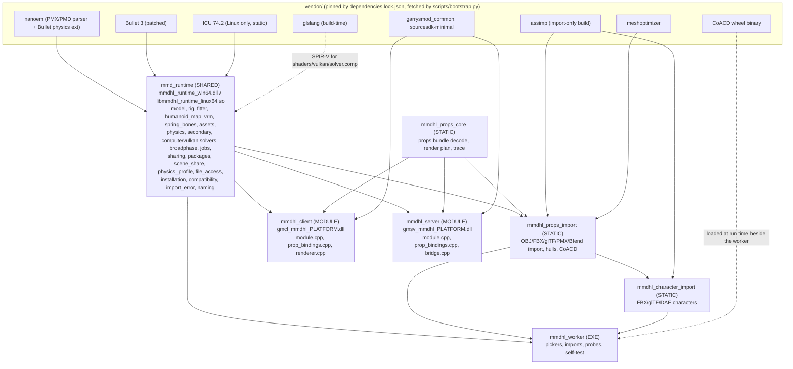
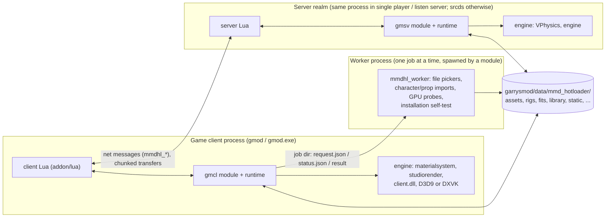
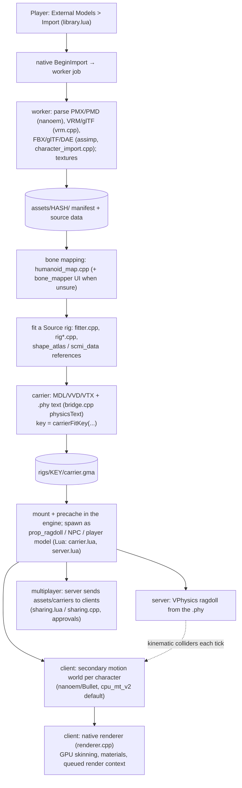

# 01 — Architecture and structure diagrams

The whole system on one page: what ships, which process runs what, how an import becomes a
character in the game, and which identities tie the pieces together. The text after each
diagram names the chapter that owns the details. Verified against `main` @ `9e02a27` (release 2.3.0).

## What ships, and how it updates

| Deliverable | Contents | Channel | Updates |
|---|---|---|---|
| Workshop addon | `addon/` → `addon.gma` (Lua, localization, shaders `mmdhl_*.vcs`, materials, sample packages in `data_static/`) | Steam Workshop item 3810025467 | whenever the maintainer repackages `addon.gma` |
| Native release (per platform) | game modules `gmcl_mmdhl_
.dll` + `gmsv_mmdhl_
.dll`, runtime library (`mmdhl_runtime_win64.dll` / `libmmdhl_runtime_linux64.so`), worker (`mmdhl_worker.exe` / `mmdhl_worker_linux64`), CoACD (`lib_coacd.dll` / `lib_coacd.so` + libgomp), shaders, notices | GitHub release packages (`-win64-vulkan`, `-win64-opengl-remix`, `-linux64-vulkan`, `-linux64-opengl`) installed by hand into the game folder | per release label (`MMDHL_RELEASE`, e.g. `2.3.0`) |
| Renderer (optional, inside the `-vulkan` packages) | DXVK `d3d9.dll` (Windows) / `libtogl_client.so` + `libdxvk_d3d9.so` (Linux) | same packages | with the native release |

The addon and the native release update independently. `addon/lua/mmdhl/native_policy.lua` is the
addon's list of known native releases (sizes, SHA-256, renderer records, approvals, the recommended
release). The addon always tries to load whatever binaries are installed and only *warns* about
unknown or mismatched ones ([03](03_engine_integration.md), [07](07_build_test_release.md)).

## Binary components (CMake targets)

Facts that follow from the graph: assimp, CoACD, the Blender reader and every parser of untrusted
*source* files run only in the worker process; the game modules only decode the project's own
cache formats. The runtime is one shared library so the client module, the server module (listen
server: same process) and the worker share code and state per process. `renderer.cpp` (native
drawing) exists only in the client module, `bridge.cpp` (VPhysics/engine access) only in the
server module.

## Processes and realms

## End-to-end: from a file to a simulated character

Details: import and carriers [02](02_character_import_pipeline.md); mounting, spawning,
rendering, networking, compatibility [03](03_engine_integration.md); secondary motion and the
ragdoll `.phy` [04](04_physics.md); static props take a separate path (bundle `.gmdl`, Lua-built
meshes) [05](05_static_props.md); the Lua side of every flow [06](06_lua_addon.md).

## Identities and versions

| Identity | Defined in | Meaning / rule |
|---|---|---|
| `MMDHL_RELEASE` (e.g. `2.3.0`) | `CMakeLists.txt` | native release label; policy records are keyed by it |
| Build ID `<commit12>-<UTC stamp>` | CMake configure (`MMDHL_BUILD_ID`) | embedded in every binary; module and runtime must agree |
| `ApiVersion=1` | `native/runtime.hpp` | Lua binding API generation (`GetCapabilities().api`) |
| `MMDHL_INSTALL_API=1` | `native/release.hpp.in` | installation-identity protocol; 0 = legacy, update required |
| `RigVersion=3`, `RigGenerator=31`, `RigGeneratorMinLoadable=30` | `native/rig.hpp` | carrier format and fitter generation; older-but-loadable carriers stay valid for saves/dupes |
| carrier fit key | `carrierFitKey` (runtime) | hashes the fit inputs; unedited rigs keep their 2.2 key |
| `PhysicsSchema=1`, `PhysicsWriterVersion=1` | `native/physics_profile.hpp` | physics-editor data and `.phy` text writer |
| prop bundle id = SHA-256 of `.gmdl` | `native/props/core.cpp` | content address; magic `GMLHOT1`, manifest `version` 1 |
| policy record | `addon/lua/mmdhl/native_policy.lua` | sizes/SHA-256 of each shipped file (+ renderer); `approved`, `recommended`, `platforms.linux64` |

## Safety model (why the code is shaped like this)

- **Untrusted inputs** (model files, textures, network payloads, Workshop packages) are parsed in
  the worker or decoded with explicit limits; every numeric input path is "finite or fail".
- **Unknown game builds**: engine interfaces are called by vtable slot; `native/compatibility.cpp`
  checks ownership of slots and pinned RVAs/evidence per game binary, and refuses *individual
  engine calls* it cannot make safely, never the whole module. Findings surface as warnings.
- **Mixed versions** everywhere (addon vs binaries, server vs clients, saves from older
  releases): formats are versioned and additive; capabilities are queried, not assumed.

## Platforms

| Platform id | Game | Notes |
|---|---|---|
| `win64` | Windows x64: the x86-64 branch's `bin/win64/gmod.exe`, and the main branch's `gmod_win64.exe` | runtime also copied to `bin/win64/` (the game loads it from beside the exe) |
| `linux64` | Linux, Garry's Mod x86-64 branch (`bin/linux64/gmod`) | built in the manylinux_2_28 container (glibc 2.28), every file in `garrysmod/lua/bin`, `$ORIGIN` RPATH; the 32-bit default branch is unsupported (reported as an unsupported platform) |
