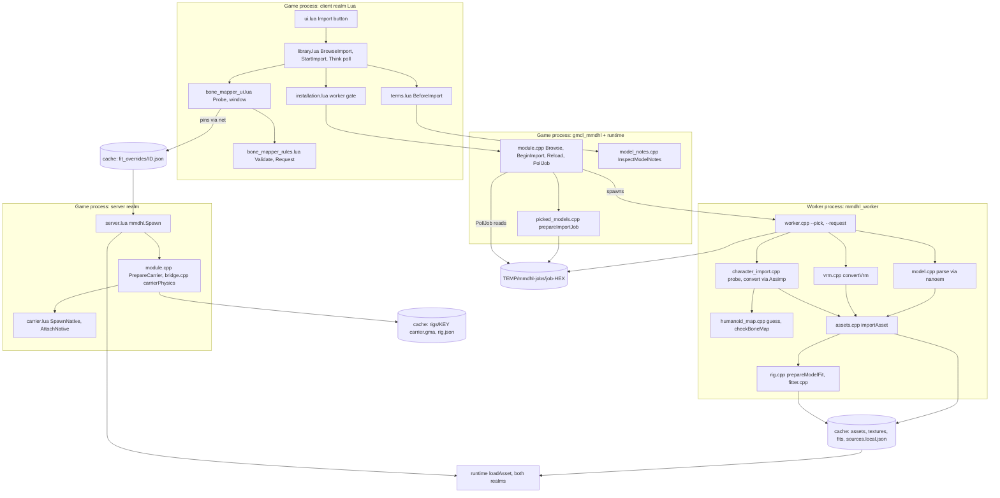
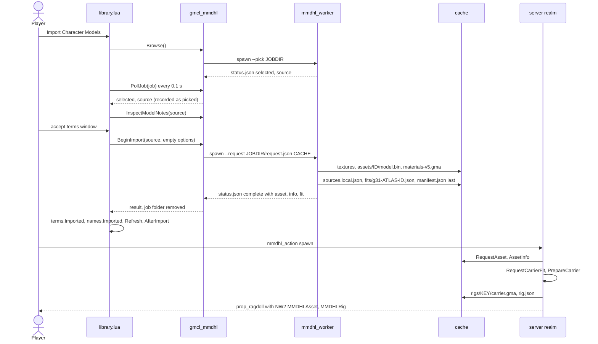

# 02 — Character import pipeline (agent reference)

Scope: PMX/PMD, VRM and FBX/glTF/DAE characters, from file choice to a spawnable `prop_ragdoll` carrier. Static props share the worker but are out of scope. Verified on `main` @ `9e02a27` (2.3.0); code wins over docs (§14). "cache" = `garrysmod/data/mmd_hotloader/`.

## 0. Summary

- Imports run in a **separate worker process** (`mmdhl_worker`), one job at a time, started/polled by the **client** module. Only the worker opens source files and their dependencies (Assimp is linked only into it); the game re-parses only hash-verified cache files (`model.bin`, PNGs), which may also arrive from peers.
- Result: a **content-addressed asset** `assets/<id>/` (`id` = SHA-256 of its manifest), shared PNG textures, a Source material package and a cached default fit (`fits/`). VRM and FBX/glTF/DAE become an in-memory PMX 2.0 first; downstream everything is PMX.
- The **carrier** (empty-mesh ValveBiped MDL/VVD/VTX + 18-body PHY, `rigs/<key>/carrier.gma`) is built later in the **server** realm at spawn (`PrepareCarrier`); the PHY needs engine VPhysics (`native/bridge.cpp`, server module only). FBX/glTF/DAE take two jobs: `character_probe`, bone window, then `character`.

## 1. Binaries and realms

| Component | File (win64 / linux64, in `garrysmod/lua/bin/`) | Role |
|---|---|---|
| Client module | `gmcl_mmdhl_<platform>.dll` (`native/module.cpp`, `renderer.cpp`) | Lua table `mmdhl_native`; start/poll/cancel jobs; `loadAsset`; render |
| Server module | `gmsv_mmdhl_<platform>.dll` (`module.cpp` + `bridge.cpp`) | `loadAsset`, `fitRig`, carrier + PHY |
| Runtime (`mmd_runtime`) | `mmdhl_runtime_win64.dll` / `libmmdhl_runtime_linux64.so` | parse, VRM, `importAsset`/`loadAsset`, fitter, rig writer, humanoid map, errors |
| Worker | `mmdhl_worker.exe` / `mmdhl_worker_linux64` (`worker.cpp`, `file_access_dialog.cpp`, `dialogs_posix.cpp`; + `mmdhl_character_import`, `mmdhl_props_import`) | picker, source parsing, cache writes |

Lua calls `mmdhl.native` = `guardedNative(mmdhl_native)` (`installation.lua`): `Browse`, `BeginImport`, `Reload`, `PropDerive`, `PropReload`, `FileAccess*` are refused until the worker self-test (`--installation-test`) passed.

## 2. Structure diagram

## 3. Sequence: one PMX import, then first spawn

## 4. Entry points and job protocol

### 4.1 Lua
- `ui.lua` button → `library.BrowseImport()`; right-click **Assign bones…** (`BM.OpenFit`), **Import again with the bone window…** (`BM.Probe(source)`); `entity_editor.lua` **Reload** → `library.ReloadCharacter` → `native.Reload(id, library.CharacterImportOptions())`.
- Every character job's options go through `library.CharacterImportOptions(options)`: the job's own table plus `fullTextures=true` when ConVar `mmdhl_import_full_textures` is on and `GetCapabilities().fullTextures` exists (else one `ShowNativeUpdateNeeded`, no release label); `'{}'` when there is nothing, byte for byte as before (tests pin it).
- `library.lua` hook `Think 'MMDHL.LibraryImport'` polls `PollJob` every 0.1 s, gives the status to `BM.OnJobStatus` first, then: `selected` → `terms.BeforeImport` → `proceed` (static → `StartStaticImport`; `BM.Convertible` → `BM.Probe`; else `BeginImport(source,CharacterImportOptions())`); `complete` → `terms.Imported`, `names.Imported` (carry-over via `library.reloadOf`), `Refresh`, `BM.AfterImport`, `ExplainFit`; `failed` → `ShowImportFailure`. `library.job` = the single job.
- `bone_mapper_ui.lua`: `BM.Probe` → `BeginImport(src,CharacterImportOptions({kind='character_probe'}))`; `kind=='bone_map'` → `BM.OpenConvert` (or auto-import with `mmdhl_bonemap_autoskip`); **Import character** → `BeginImport(src, CharacterImportOptions(BM.Request(state)))`; `character.bone_map`/`character.jiggle` failures reopen the window (reason `missing` → re-probe).
- `file_access.lua` is the addon file API (`--fa-pick`/`--fa-consent`), not the model picker.

### 4.2 Native functions (`module.cpp`)
| Function | Realm | Notes |
|---|---|---|
| `GetCapabilities()` | both | `characterImport` (formats), `boneMap`, `rigVersion`, `rigGenerator`, `rigGeneratorMin` (§8), `fullTextures` (16384, the largest edge the option keeps; absent in 2.3.0), `propFullTextures` (the same for static props, §05) |
| `Browse([kind])`, `BeginImport(path, optionsJSON)`, `Reload(id[, settingsJSON])`, `PollJob`, `CancelJob` | client (server throws "Imports must be started locally…") | `Reload` replays `sources.local.json[id]`; the settings' `fullTextures` replaces the recorded one (2.3.0 ignores argument 2) |
| `InspectModelNotes(path)`, `DeleteAssets(json)` | client | terms texts; deletion (`'[]'` at startup finishes pending) |
| `RequestAsset`/`AssetInfo` | both | async `loadAsset`; `AssetInfo` = `Model::info()` |
| `InspectBoneMap`, `GetBoneMapProposal`, `PreviewCarrierFit` | both | need a loaded asset; write nothing |
| `RequestCarrierFit`, `PrepareCarrier` | server | §7 |

### 4.3 Job mechanics (`module.cpp` `launch`/`PollJob`, `native/picked_models.cpp`)
- One running worker at most. `prepareImportJob`: on a server this game does not host, only sources picked in the native picker (store `%LOCALAPPDATA%\ModelHotloader\picked-models.json`, Linux `${XDG_DATA_HOME:-~/.local/share}/ModelHotloader/`); network paths refused; creates `<temp>/mmdhl-jobs/job-<32 hex>` (0700 on Linux) with `status.json` and, for non-picker jobs, `request.json`.
- Process: Windows suspended `CreateProcessW` in a kill-on-close Job object, `CREATE_NO_WINDOW`; Linux `posix::spawn` (own process group); cwd `lua/bin`. Args `--pick <jobdir> [static]` or `--request <jobdir>/request.json <cache>` (cache on argv so a rewritten request cannot redirect writes).
- `PollJob`: once the worker ended, `finishedWorkerStatus` turns a missing/`running` status into `worker.crash`/`memory` (keeping stage/file/detail) and adds `exitCode` + `log` (last 4 KiB of `worker.log`) to failures; a final status while the worker still runs reads `running`/"Committing asset"; picker answers → `notePickedSource`; folder deleted; last 16 results cached; >300 s adds `warning`. `CancelJob` and module close (map change) kill the worker. Client start sweeps legacy `cache/jobs/*` and `job-*` older than 24 h.

### 4.4 Worker modes (`native/worker.cpp` `wmain`)
| Mode | Output |
|---|---|
| `--pick <jobdir> [static]` | `status.json` `{state:"selected",source[,kind:"static"]}` / `{state:"cancelled"}`; Windows `IFileOpenDialog`, Linux zenity→kdialog (`dialogs::pickFiles`, 1.2 s arm delay) |
| `--request <request.json> [cache]` | `status.json`; exit 0/1 (the only import mode the game uses) |
| `--version`, `--installation-test <out> [coacd]`, `--probe-compute`, `--probe-vulkan` | identity, self-test, GPU probes |
| `--fa-pick`, `--fa-consent <dir>`, `--crash-test <dir> access\|abort\|terminate` | addon file access; tests |
| dev (stdout): `--inspect`, `--inspect-physics`, `--convert-vrm`, `--probe-character`, `--convert-character <f> <out> [req.json]`, `--inspect-bone-map`, `--bone-map-proposal <m> [opts.json]`, `--fit <m> [json]`, `--fit-raw` | models load via `loadCharacter` (converted like import) |

Model-reading modes call `guardDependencies()` (dependency denylist = `FilePolicy::system(game)`). Crash handlers append one line with `importStage()` to `<job>/worker.log`.

**`request.json`** = `{"source":"<absolute UTF-8>","options":{…}}` (`cache` honoured only without argv[3]). Routing on `options.kind`:
- `character_probe`: `.obj` → `character.format`, `.blend` → `character.blend`; PMX/PMD/VRM (also `.glb` with `VRM`/`VRMC_vrm`) → `importAsset`; FBX/GLB/glTF/DAE → `probeCharacter`.
- `character` or absent, convertible, not VRM → `importConverted(convertCharacter(...))`; no `boneMap` = automatic map, which must be certain (required parts ≥0.85, no `checkBoneMap` error) else `character.needs_mapping`.
- otherwise → `importAsset` with the options (for kind `character` and PMX/PMD/VRM probes only the import settings: `{}` or `{fullTextures:true}`); `static`, `blend_scene`, `derive` → props.
- `fullTextures:true` (any character kind): keep textures past `MaxTextureEdge` (4096) up to `FullTextureEdge` (16384, `runtime.hpp`).
- `BM.Request` schema: `{kind:"character",requestVersion:1,boneMap:{<ValveBiped key>:"<bone name>"|""},eyes:{L,R},jiggle:{version:1,groups:[{kind,enabled,swing,custom,collide,values{stiffness,dragForce,gravityPower,hitRadius},chains[{root,enabled}]}]}}`, ≤64 KiB.

**`status.json`** (atomic writes):
- running: `{state,stage,stageCode,progress,filename[,detail,current,total]}`, `stageCode` ∈ `pick start read convert_vrm convert_character probe parse textures cache materials fit`.
- probe: `{state:"complete",kind:"bone_map",probe,source,filename}`; `probe` = `{version:1,format,generator,sourceSha256,units,height{meters,normalized},skeleton{bones,points≤3000,signature,maxDepth,armatures},auto{humanoid,slots,eyes},meshes,materials,textures,vertices,triangles,morphs,warnings}`, <2 MB.
- import: `{state:"complete",asset,info:<manifest>,fit,source[,registryBackup]}`; `fit` = `{ok:true}` or `{ok:false,errorCode (fit.landmarks, any thrown ImportError code, else fit.error),error,missing,searched,errorDetails}` (outside identity).
- failed: `{state:"failed",error,errorCode,errorDetails,context,exceptionType,elapsed_ms,worker{release,build},stage?,stageCode?,filename?,detail?,current?,total?,source?,kind}`.

## 5. Parsing

- **PMX/PMD** — `parse()` (`native/model.cpp`) via nanoem (`ext/mbwc.c` on Windows; `native/nanoem_unicode.c` + Microsoft CP932 table on Linux, so names match Windows). Wrong magic → `notCharacterFile` (`format.*`, `character.format`, `io.empty`); load failure → `loadFailed` (`pmx.version`, `pmx.text`, `pmx.truncated` if <1 KiB from end, `pmx.section_corrupt`, `memory`). `repairModel` fixes NaN/absurd values in place (one `Repaired …` warning per kind); bone loops cut with warnings; `pmx.number`/`pmx.reference`/`pmx.materials` checks; zero normals rebuilt; invalid joints skipped with a warning; `m->id = sha256(bytes)`.
- **VRM** — `convertVrm` (`native/vrm.cpp`) → PMX via `writePmx` (`pmx_writer.cpp`: UTF-8, 4-byte indices, BDEF1/2/4, no rigid bodies); MMD axes, 12.5 units/m, humanoid → MMD names from `humanoid_slots.hpp`, expressions → group/material/UV morphs, alpha baked into texture copies; springs, colliders, licence, humanoid map → `vrm` JSON. Errors `vrm.*`, `spring.data`.
- **FBX/glTF/DAE** — `native/character_import.cpp`: `load()` (Assimp, `LocalIO` confined by `DependencyScope`, pivots/animations off, FBX unit/axis metadata), `collect()` (armature moving most distinct vertices; other meshes rebound if ≥90 % names match, else dropped), `analyse()` → `SkeletonView` → `classifyBones`/`guessHumanoid`. `convertCharacter`: `resolveRequest` (names → indices, `checkBoneMap`, jiggle checks), frame from assigned hips/head/arms/thighs, height outside 0.3–3 m → 1.6 m, probe bone order kept, assigned bones get MMD names (chest → `上半身2` without middle spine), others keep source names (`_src`, ` #n`; `sourceNames`), viseme/blink group morphs, ≤128 materials, textures via `TextureResolver` (`Reach::Confined`), `springBones()` JSON. Limits 4096 bones, 4 M triangles, ≥15 usable bones.
- **Textures** — `normalizeTexture` (`assets.cpp`): stb_image (DDS: WIC / Linux `dds.cpp`), `alpha` = any texel <255, edges >4096 downscaled (note `Large texture … was scaled down …`), with the `fullTextures` option only edges >16384 (others noted `Large texture … was kept at full size …`), re-encoded PNG → `textures/<sha256(png)>.png`. PMX/PMD paths: `resolveTexture` with `Reach::Local` (2.2 reach; denied or root-relative refused); toon fallback `<model folder>/../../Data/<name>`. Texture problems are **warnings**.
- **Names** — engine paths: `readableName` (ICU `Any-Latin; Latin-ASCII`, static ICU on Linux via `scripts/build-icu.py`) and `materialPath` (CJK terms → `mmd/<id16>/<slug>_<slot+1>`), `native/naming.cpp`; morph IDs: SCMI `flexNames` + `englishMorph` (`mmd_names.hpp`); foreign bone names: `sanitizeBoneName`/`parseBoneName` (`humanoid_map.cpp`). `names.lua` translations are display-only.
- **Terms** — `inspectModelNotes` (`model_notes.cpp`): embedded texts + ≤8 readmes; Lua saves `terms/<id>.json`; not identity.

## 6. Asset commit and identity (`importAsset`, `native/assets.cpp`)

1. Read source; VRM → `convertVrm` (`vrm.sourceSha256`); converted character → its PMX (`conversion.sourceSha256` = source file hash, `conversion.generator`).
2. `parse`; append converter warnings; `SpringSetup::fromManifest`; `conversionBoneMap`.
3. Manifest = `Model::info()` (name, counts, warnings, morphs, bounds, morphInfo, boneList, materials minus `path`) + `version:2`, `vrm`|`conversion`, `sourceHash`=sha256(PMX), `textures[{base,sphere,toon,alpha}]`, and `fullTextures:true` only when the option kept a texture past 4096 (a model whose textures fit keeps its default identity; `loadAsset` refuses any other value).
4. **Asset id** = sha256(compact `manifest.dump()`) while `manifest.id` = `sourceHash`; then `manifest.id = assetId`. `loadAsset` re-derives it the same way.
5. Writes: `model.bin` → `prepareSourceMaterials` → `sources.local.json[id]={source,options}` (unreadable registry renamed `.damaged-<UTC>` → `registryBackup`) → `prepareModelFit` → `manifest.json` last. Exceptions remove a fresh asset's files.
6. `prepareSourceMaterials`: per material `textures/<hash>.vtf` (v7.2 RGBA8888, full mip chain, 0x2000 flag with alpha) + VMT `materials/<materialPath>.vmt` (VertexLitGeneric, `$basetexture mmd/t/<hash16>`, `$alphatest 1`, `$alphatestreference .5`, `$nocull` = two-sided, SCMI phong/lightwarp/rim with `mmdhl/scmi/*`), streamed into `assets/<id>/materials-v5.gma`. VTFs are scaled to 4096 (caches from before 2.2 hold larger PNGs); in a `fullTextures` asset a PNG past 4096 (IHDR read) keeps its size (≤16384) as `textures/<hash>.full.vtf` at `$basetexture mmd/tf/<hash16>`, so it never meets an older cache's 4096 copy of the same image. Peers build the same bytes from the manifest; a 2.3.0 peer scales, mismatches and downloads the package.

`loadAsset` (both realms): version ∈ {1,2}; identity, `model.bin` and PNG hashes verified; conversion map validated; alpha classified at load (`translucentTexture`, `alphaCoverage`, `cutoutTriangles`, `dynamicCutout`, soft alpha `softTriangles`/`softCoverage` via `cutout.hpp`; none of it in the manifest, `AssetInfo` adds `softTriangles` per material); rebuilds a missing GMA; `prepareModelFit`. Runtime: `native_render.lua` draws the mounted VMTs; the legacy backend reads `textures/*.png`; `materials.lua` only adapts Entity material/bodygroup APIs over `rig.materials` and mounts packages.

## 7. Bone mapping, fitting, carrier

**Catalogue**: `native/humanoid_slots.hpp` `HumanoidSlots` (52 assignable + convert-only `Eye_L/Eye_R`; 15 required, 18 physical), mirrored in `bone_mapper_rules.lua`; parity fixture `tests/fixtures/bonemap/slots.json` (regenerate: `mmdhl_character_import_tests --write-slots tests/fixtures/bonemap/slots.json`).

**Window data**: `humanoid_map.cpp` `guessHumanoid` (confidence, `name`|`topology`), `checkBoneMap` (rule vectors `tests/fixtures/bonemap/rules.json` from `scripts/make-bonemap-fixtures.py`), `skeletonSignature` (sha256 of weighted bone base|side), `inspectBoneMap`. Pins: `mmdhl.Action('bonemap')` → `BM.HandleSave` (permission, 1/s, 16 KiB, re-checked by the server's fitter) → `fit_overrides/<id>.json`; a changed physical pin drops collision corrections (`BM.SamePhysicalPins`).

**`mapBones`** (`rig.cpp`): name match (SCMI names, MMD aliases, ASCII-only loose fold) < `conversionBoneMap` < pins (`options.boneMap`, `12.0` accepted); one PMX bone per carrier bone; `resolveTorso` (`rig_torso.hpp`) picks Spine2/Spine4 from topology (`manifest.torso`); D-bone aliases; eyes; `requireMapping` → `fit.bone_map` / `fit.landmarks` (15 landmarks, names searched). `boneMapProposal` = same without bodies.

**`fitRig`**: `baseFit` rescales `Model::fittedRig` or `pinnedFits` (≤4) unless `height`/`excludedMaterials`. Full fit: scale (`scaleMultiplier`×0.08×40.457 Source units per PMX unit, or `height`/legacy `scale`), mass 1–1000 (70); SCMI reference skeleton with PMX landmark origins, synthesized gaps, tracked limb axes; per-body vertex clouds (secondary chains excluded except twist bones; invisible/excluded materials skipped); `fitBody` (`fitter.cpp`: atlas priors, support regression, templates, `convexTopology` ≤64 vertices); collision overrides; overlap shrink (≤4 passes × 0.94, fitted hulls only); SCMI joint limits; eyes appended; ≤96 stable native flexes; `applyPhysics`, `configureAnimations` (roles ragdoll/citizen/combine/player/arms), `identify`.

**Data headers**: `scmi_data.hpp` (`scripts/sync-scmi-data.py` from the maintainer's SCMI project: 56-bone reference skeleton, QC joint `limits`, 473 `flexNames`); `shape_atlas.hpp` (`scripts/build-shape-atlas.py`, dev-only corpus audit; hash = `shapeAtlasHash()`); `fitter_calibration.hpp` (`scripts/export-fit-calibration.py`) is **included nowhere**.

**Not import stages**: `physics.cpp` (runtime Bullet world for authored PMX bodies; the ragdoll PHY is `bridge.cpp` + `physics_profile.cpp`), `spring_bones.cpp` (runtime solver; import stores JSON only), `jiggle_direction.hpp`, `mesh_topology.hpp` (runtime), `jobs.cpp` (in-process thread pool, not worker jobs).

**Carrier (server)**: `mmdhl.Spawn` (`server.lua`) merges saved defaults (`LoadSavedFit`), always sets `options.boneMap = mmdhl.SavedBoneMap(id)` → `LoadAsset` (≤60 s) → `RequestCarrierFit` polled ≤30 s (`normalizeCarrierOptions`, `carrierFitKey`, async `fitRig`) → `SpawnNative` (`carrier.lua`) → `PrepareCarrier`: reuse `rigs/<key>/carrier.gma` or `packageCarrier(cache, rig, carrierPhysics(rig))` → mount `rig.materialGma` + `rig.gma` (`MountPackage` → `GetMountablePackage` hard-link alias for paths ≥240 chars → `game.MountGMA`) → `prop_ragdoll` (18 physics objects) → `AttachNative` (NW2 `MMDHLAsset`/`MMDHLRig`).
GMA (GMAD v3): `models/mmd/<key16>/<readableName(name,28)>.mdl` (`carrierFiles` + `StudioWriter` in `rig_writer.hpp`: v48, 56–58 bones, 18 hitboxes, bodygroup 0 + ≤31 material toggles, ≤96 flexes, ≤128 VMT paths), `.vvd` v4 / `.dx90.vtx` v7 (mesh only for role `arms`, `rig_geometry.cpp`), animations (`rig_animation.cpp`), `.phy` (`carrierPhysics`: 18 VPhysics convexes from explicit `CPolyhedron` topology, checked against the engine hull, + `physicsText`). Multiplayer clients download `rig.json`/`carrier.gma` by key (`sharing.lua`) and never refit.

## 8. Versions and keys

| Item | Value / formula | Where | Effect |
|---|---|---|---|
| Asset id | sha256(manifest JSON, `id`=`sourceHash`) | `assets.cpp` | everything keyed by id |
| Manifest `version` | writes 2, loads 1–2 | `assets.cpp` | in identity |
| Manifest `fullTextures` | `true` only when the option kept a texture past 4096 | `assets.cpp` | in identity; selects `.full.vtf` / `mmd/tf/` derivatives |
| `CharacterConverterGenerator` | 1 | `character_import.hpp` | in `conversion` → converted ids |
| `RigVersion` / `RigGenerator` / `RigGeneratorMinLoadable` | 3 / 31 / 30 | `rig.hpp`; caps; `actors.lua` `IsLoadableRig`/`IsCurrentRig`/`NewerActor` | format; refit + new keys; oldest loadable carrier (2.2 saves, dupes, NPCs) |
| `shapeAtlasHash()` | sha256(`ShapeAtlas`) | `fitter.cpp` | must equal for **every** carrier in `rigFromManifest` |
| Default fit file | `fits/g<RigGenerator>-<atlas16>-<id>.json` = `{fit,sha256}` (needs matching asset, generator, `torso`) | `prepareModelFit` | |
| Fitted-rig key (memory) | `id` + JSON of the fit-relevant options (scale, mass, collision, role, animation, armsParts, `physicsOverrides`, `boneMap`) | `carrierFitKey` | 2.2's string without the last two |
| Rig key | first 32 hex of sha256(rig manifest minus `key`,`model`,`gma`) | `identify` | `rigs/<key>/`, `models/mmd/<key16>/` |
| Material package | `materials-v5.gma` | `assets.cpp`, `rig.cpp`, `sharing.cpp`, `deleteAssets`, `materials.lua` | rename everywhere |
| `fit_overrides` | `version 3`, `generator 18` (reads 14/15/18) | `physics_editor.lua`, `bone_mapper.lua`, `server.lua` | independent of `RigGenerator` |

## 9. On-disk layout

| Path (cache-relative unless noted) | Content | Writer → reader |
|---|---|---|
| `assets/<id>/manifest.json`, `model.bin`, `materials-v5.gma` | manifest (§6), PMX/PMD bytes, VMT+VTF package | worker / sharing / Workshop → `loadAsset`, `library.Refresh`, mounts |
| `textures/<sha256>.png`, `.vtf`, `.full.vtf`; `*.share2` | shared PNGs, VTF derivatives (`.full.vtf`: kept past 4096 for a `fullTextures` asset), packed transfer copies | `normalizeTexture`, `prepareSourceMaterials`, `packSharedFile` |
| `fits/g31-<atlas16>-<id>.json` | default fit | `prepareModelFit` (worker and game) |
| `rigs/<key32>/carrier.gma`, `rig.json` | carrier, rig manifest | `packageCarrier` (server) / sharing → mounts, persistence |
| `sources.local.json` | `{id:{source,options}}`, never shared | `importAsset` → `Reload`, library |
| `names/{assets,textures,rigs}/<id16>.json`, `names/<kind>/<id16>-<file>.gma` | short-id registry (`{"id"}`), mount hard links | `registerShortName`, `mountablePackage` → `materials.lua`, `game.MountGMA` |
| `library/<id>.json`, `library/folders.json` | `{version:1,name?,favorite?,folder?,deleted?,fit?}` | `library.lua`, Workshop |
| `fit_overrides/<id>.json` | `bodies,scale,collisionOverrideScale,excludedMaterials,mass,physics,editor,boneMap,boneMapVersion,boneMapSavedAt` (server state) | editors, `BM.HandleSave` → `mmdhl.Spawn` |
| `bone_maps/sources/<sha>.json`, `bone_maps/skeletons/<sig>.json` (≤256) | `{version:1,kind,savedAt,filename,format,signature,boneMap(names),eyes,jiggle}` | `BM.SaveMemory` → `BM.LoadMemory` |
| `terms/<id>.json`; `translations/<lang>.json`, `translations/models.json`; `arms/<id>.json` | terms record; name translations, consent; arm parts | `terms.lua`; `names.lua`; `first_person.lua` |
| `approved.json`, `sharing/<pid>-<n>.part` | server approvals `{assets,rigs}`; transfer staging | `sharing.lua`; `BeginSharedFile` |
| `cleanup.json`, `jobs/` | pending deletions; legacy job folders (swept) | `deleteAssets` |
| `<temp>/mmdhl-jobs/job-<hex>/` | `request.json`, `status.json`, `worker.log` | module, worker |

## 10. Error handling

- `native/import_error.hpp`: `ImportError{code,details,context}`, `importFail`, `ImportScope` (breadcrumbs; domain `vrm` → `vrm.json`; places → `details.where`), `describeException` (`exceptionType`), `setImportStage`, `sniffFormat`/`notCharacterFile`, `fileFailure` (`io.*`; cache writes → `io.write`/`io.disk_full`), `describeWorkerExit`, `finishedWorkerStatus`.
- Codes: `pmx.{truncated,section_corrupt,text,version,materials,number,reference}`, `format.{archive,motion,image,renamed,unknown}`, `vrm.{truncated,data,container,external,image,humanoid,json,no_skeleton,no_geometry}`, `spring.data`, `io.{missing,locked,denied,device,read,empty,write,disk_full,filesystem,network}`, `texture.derivative`, `memory`, `worker.crash`, `character.{format,blend,parse,orientation,no_skeleton,too_few_bones,too_many_bones,too_complex,bone_map,jiggle,needs_mapping,request_version}`, `fit.{landmarks,bone_map,error}`, `json`, `unknown`; Lua-only `start.not_picked`.
- Lua `library.lua`: `codeHints`/`familyHints` (`ImportHint`), `codeCauses` (`ImportCause`), `stages` (`ImportStage`), `kinds` (`ImportWhere`), `ShowImportFailure`, `ExplainFit`; `SplitWarnings` classifies warnings by English prefix (`Repaired `, `Large texture `…). Strings in `addon/resource/localization/<lang>/mmdhl.properties`; dynamic keys need `-- i18n-keys:` (`scripts/check-i18n.py`).

## 11. Where to change X

| Change | Edit | Watch |
|---|---|---|
| Add a character format | `convertibleCharacter`/`characterFormats`, caps `formats`, `--pick` filters (both OS), Assimp options in `CMakeLists.txt` | `BM.Convertible` reads caps |
| Probe/request schema | `probeCharacter`, `resolveRequest`; `BM.Request`, `BM.OpenConvert` | Reload replays stored requests |
| Job transport / remote rule | `launch`, `PollJob`, `picked_models.cpp`, worker `--request` | keep cache on argv, jobs outside `data/` |
| Stage codes | `importAsset` `report`; Lua `stages` + i18n | |
| Error code | `importFail` site, `codeCauses`/`codeHints`, i18n, `docs/IMPORT_ERRORS.md` | |
| PMX repairs/validation | `repairModel`, `validateNumbers`, `loadFailed` | warnings change ids |
| VRM conversion | `vrm.cpp` | golden hashes in `tests/vrm_tests.cpp` |
| FBX/glTF/DAE conversion | `character_import.cpp`, `pmx_writer.cpp` | bump `CharacterConverterGenerator`; writer shared with VRM |
| Automatic guess / rules | `humanoid_map.cpp`, `BM.Validate`, rules fixture script | C++ and Lua rules must agree |
| Body-part catalogue | `humanoid_slots.hpp`, `bone_mapper_rules.lua`, `slots.json` | 18 physical bodies fixed |
| Window / pin saving | `bone_mapper_ui.lua`; `bone_mapper.lua` `HandleSave` | server re-checks |
| Fitter bone choice, torso | `mapBones`, `Landmarks`, `requireMapping`, `resolveTorso` | bump `RigGenerator`; re-record `proposal.json` |
| Hull fitting | `fitBody`, `convexTopology`, `shape_atlas.hpp` | atlas change breaks all carriers |
| Joint limits, morph names, scale | `scmi_data.hpp`, `mmd_names.hpp`, `ScmiSourceUnitsPerPmx` | golden carriers, face presets |
| Engine path names | `readableName`, `materialPath` | ICU parity, rig keys |
| Texture normalization, VMT/VTF | `normalizeTexture`, `fitTexture`, `prepareSourceMaterials`, `dds.cpp` | PNG bytes are identity; bump package name |
| MDL/VVD/VTX/PHY | `carrierFiles`, `rig_writer.hpp`, `rig_animation.cpp`, `rig_geometry.cpp`, `carrierPhysics`, `physicsText` | `tests/fixtures/physics/golden*.json` |
| Cache folders, deletion, sharing paths | `deleteAssets` allow-list, `sharedPath` regex, `sharedManifest`, `library.Refresh` | |

## 12. Invariants (saves, multiplayer)

1. Asset ids hash `Model::info()`, **every warning string**, texture PNG hashes (stb decode/resize/encode), `vrm`/`conversion`, `version`. Drift re-identifies unchanged files: duplicates, orphaned `library/`, `fit_overrides/`, `terms/`, peers and Workshop disagreeing.
2. Cache files are immutable and re-verified on load; never patch them in place.
3. Any change in fit output or rig manifest fields (bones, hulls, masses, `torso`…) changes rig keys and MDL paths. Defaults stay byte-identical: unedited carrier key/MDL sha256/`.phy` text per platform (`golden.json` MSVC, `golden-linux64.json` GCC; floats differ, so keys are platform-specific), `carrierFitKey` without `physicsOverrides`/`boneMap`, VRM PMX output. Re-record goldens only with a `RigGenerator` bump.
4. `rigFromManifest` must load generators 30..31 and never rehash published manifests, or saves, dupes and published NPC/player models fail (`persistence.error.carrier_outdated`).
5. `shapeAtlasHash()` is checked for every carrier: editing `shape_atlas.hpp` makes all existing carriers "Incompatible carrier fit".
6. Carrier layout: 18 bodies in `CarrierBodyNames` order, 56 SCMI-ordered bones plus appended eyes, ≤96 stable flex IDs, bodygroup = slot+1; collision corrections live in these bone frames.
7. Spawns read pins only from `fit_overrides/<id>.json`; numbers may arrive as `12.0`.
8. Server and clients run the same native release; clients take server carriers by key.
9. Engine paths stay ASCII and equal on Windows and Linux (ICU, CP932 tables); 16-hex short-id collisions are refused.
10. Only the worker opens source files and their dependencies; network paths, denied places and (FBX/glTF/DAE) files outside the model's folders are never opened; `sources.local.json` is never shared. `parse`/`loadAsset` also run in the game on cache files from peers, so their validation must stay strict.
11. Probe bone *i* = converted PMX bone *i*.

## 13. Tests per stage

| Stage | CTest | Offline (`scripts/check-lua-tests.py`) |
|---|---|---|
| Jobs, worker CLI, crashes | `character_import_worker` (`scripts/test-character-import.py`), `import_errors`, `file_access` (Windows) | `test_import_failures.py`, `test_file_access_worker_gate.py`, `test_bone_mapper.py` |
| PMX/PMD, identity, tamper, DDS | `native_runtime`, `import_errors` | — |
| VRM | `vrm_import_and_springs` | — |
| FBX/glTF/DAE, names, rules | `character_import`, `character_import_worker`, `static_props` (confined textures) | `test_bone_mapper.py` |
| Names, terms | `native_runtime`, `model_terms_of_use` | `test_model_names.py`, `test_model_terms.py` |
| Fitting, torso, pins | `torso`, `native_runtime`, `character_import` | `test_bone_mapper.py`, `test_physics_editor.py` |
| Carrier, keys, generations | `physics_profiles`, `animated_carriers_and_sharing` | `test_carrier_generations.py`, `test_carrier_spawns.py`, `test_input_hardening.py` |
| Cache, deletion, sharing | `native_runtime`, `workshop_packages` | `test_library_deletion.py`, `test_material_asset_mount.py`, `test_sharing_requests.py`, `test_workshop_packages.py` |

## 14. Contradictions and unverified

- `docs/NATIVE_BACKEND.md`: `materials-v4.gma` and `fits/g16-<atlasHash>-<assetHash>.json`; code: `materials-v5.gma`, `fits/g31-<atlas16>-<id>.json`.
- `docs/FILE_ACCESS.md`: `request.json` "sits in data/"; code and `docs/API.md`: `<temp>/mmdhl-jobs/job-<hex>`.
- `docs/IMPORT_ERRORS.md` omits `io.network`.
- `fitter_calibration.hpp` unused; `--fit-raw` passes `{"calibrated":false}`, which `fitRig` ignores (same as `--fit`).
- Unverified: cross-platform equality of converted FBX/glTF asset ids (VRM ids are pinned on both CI platforms).
