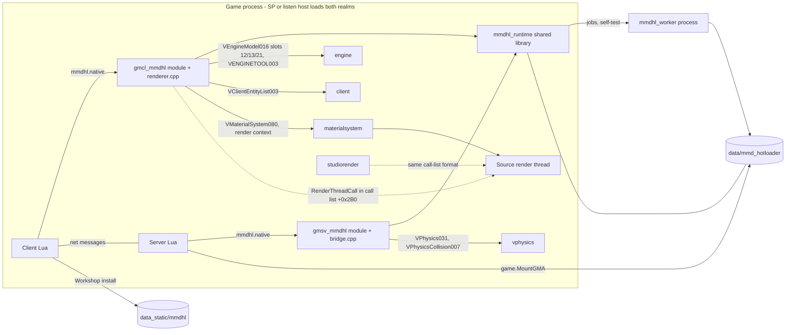
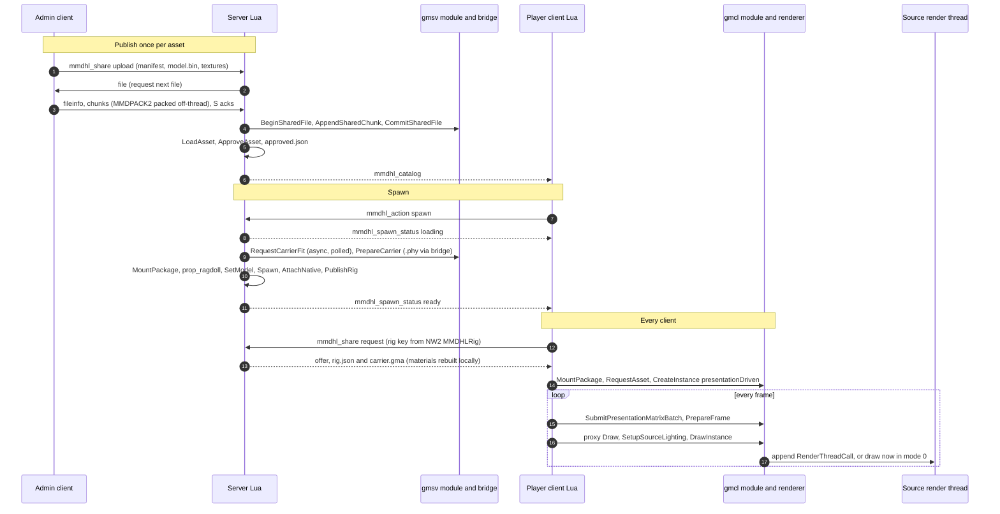

# 03 — Engine integration (runtime)

Covers runtime after import: native Lua API, carriers becoming engine models and visible characters, rendering, VPhysics bridge, safety layer, networking. See also chapters 02 (import), 04 (physics), 05 (props), 08 (renderers). Checked against `main` @ `9e02a27` (native 2.3.0); code wins over docs (differences in §12).

**Terms**
- **asset**: 64-hex SHA-256 id of an import. Cached in `data/mmd_hotloader/assets/<id>/{manifest.json,model.bin,materials-v5.gma}` and `textures/<sha>.png`.
- **carrier/rig**: the generated engine model for one asset + fit options + role, stored in `rigs/<key>/{rig.json,carrier.gma}`.
  - key = first 32 hex of SHA-256(manifest without key/model/gma) (`rig.cpp identify`).
  - The GMA holds `models/mmd/<key[0:16]>/<name>.mdl` (+vvd/vtx/phy): 18 bodies, 56 (+2 eye) bones, no visible mesh.
- **instance**: a realm-local native handle (uint64 as a Lua number) in that realm's `World`.
- **presentation**: a client instance driven by the carrier's client bone palette (`presentationDriven`). It owns the client's secondary physics and skinning.

## 1. Runtime structure

- **Build.** Both modules come from `module.cpp` + `prop_bindings.cpp` (server: `MMDHL_SERVER`). `renderer.cpp` is client-only, `bridge.cpp` server-only, the rest is `mmdhl_runtime_<platform>`. Linux keeps the `.dll` suffix.
- **Realms.** Each module's `Context` owns a `World`, and `FUNCTION` binds `WorldScope` per call, so a listen host runs two worlds.
- **Shared state.** The server scene capture goes through the runtime (`publishScene`/`readScene`; read directly in single player), allocated there since the server module unloads first.

## 2. Native Lua API

**Load.** `autorun/mmdhl.lua` → `CheckInstallation()` → `pcall(require,'mmdhl')`. `GMOD_MODULE_OPEN` finds the game root and cache, registers functions, calls `acquireRuntimeRealm`, sets global `mmdhl_native`. Lua wraps it as `mmdhl.native=guardedNative(...)`: worker-starting calls (`Browse`, `BeginImport`, `Reload`, `PropDerive`, `PropReload`, three `FileAccess*`) need feature `imports`; without `detailedCollision` imports get `collision='hull'`. If loading fails only `debug.lua` loads.

**Close.** Client: drain render queue, unhook shadows, prune buffers, pin the module if a call is outstanding. Server: `clearPhysicsBridge`. Native code never hot-reloads: restart the game.

**Conventions.**
- **Data**: JSON strings (`mmdhl.Decode`); hot paths pass numbers or Matrix userdata.
- **Errors**: `FUNCTION` catches `std::exception` → `nil,msg`. Void mutators return nothing on success, so check the 2nd value (`local _,err=native.X()`). File access: `nil,msg,code`. `PollAssetCheck`: `false`/`true`/`nil,why,'invalid'`. `DrawInstance`: `nil,err` for an earlier render-thread error.
- **Arguments** are checked (finite integers ≤2^53, finite vectors). `requireServer()` functions throw on the client; `launch()` on the server.
- **Threads**: calls run on the game thread; long work = `std::async` futures polled from Lua (Start/Poll, Request/Info); per-frame work = job pool (`jobs.hpp`); draws may run on Source's render thread; imports, dialogs and self-test = worker process.

Realm: B both, C client, S server, B\* both but restricted at run time.

| Group | Functions | Realm | Lua callers |
|---|---|---|---|
| Install | `GetCapabilities` (api 1, rigVersion 3, rigGenerator 31, rigGeneratorMin 30, physicsEditor 1, sharingVersion 2), `GetInstallationInfo`, `ConfigureCompatibility`, `CheckCompatibility`; `{Start,Poll}InstallationProbe` (C, worker self-test) | B/C | installation; capabilities also actors, physics_editor, bone_mapper_ui |
| Imports | `Browse`, `BeginImport`, `Reload`, `PollJob`, `CancelJob` (one worker job); `PropDerive`, `PropReload`, `DeleteAssets`, `InspectModelNotes` (C) | B\*/C | library, props/library, bone_mapper_ui, terms |
| Assets/fit | `RequestAsset`+`AssetInfo` (async load), `{Start,Poll}AssetCheck`, `ForgetAssets`, `GetBoneMapProposal`, `InspectBoneMap`, `PreviewCarrierFit` | B | server, instances, native_render, workshop, bone_mapper, physics_editor |
| Carriers | `RequestCarrierFit` (async; false until done), `PrepareCarrier` (sync: `.phy` via bridge, writes `rigs/<key>`, returns manifest), `ReadAnimationModel` | S | server, carrier, actors, persistence |
| Instances | `CreateInstance`, `DestroyInstance`, `RebindSourceEntity`, `SetMorph`, `SetMorphs`, `GetMorphWeights`, `SetBonePose`, `GetBoneTransform`, `SetMaterialVisibility`, `GetMaterialState`, `GetBounds`, `GetBoundsValues`, `GetState`, `GetDiagnostics`, `ResetPhysics`, `Raycast`, `Clear` | B | instances, carrier, materials, physics_reset, server, mmdhl_ragdoll, compat |
| Legacy sim | `Step`, `SetFrozen`, `SetState`, `{Begin,Update,End}Grab`, `{Begin,Update}Physgun`, `SetMirror`, `RemoveMirror`, `TakeImpulses`, `SubmitSourcePose`, `StepSources` (B\* server); `CapturePhysics`, `ProbePhysics`, `ProbeCarrierCollisions` (S) | B\*/S | server Tick (SP `mmdhl_ragdoll`), compat, weapon_mmdhl |
| Frame/draw | `SubmitPresentationMatrixBatch` (older `SubmitPresentationBatch`, `SubmitPresentationPose`), `MarkTeleport`, `PrepareFrame`, `SetInstanceMaterials`, `DrawInstance`, `Draw`, `SetupSourceLighting`, `{Register,Remove}SourceShadow`, `CheckRenderer` | C | native_render, client, instances |
| Render config/diag | `SetNativeVertexCache`, `SetCompactVertices`, `SetGpuSkinning`, `SetFlashlightOverlapGuard`, `SetPoseSmoothing`, `SetRenderSuspended`, `PruneRenderCache`, `RenderStatus`, `RenderStats`, `RenderFrameStats`, `GetLightingState`, `GetDrawAge`, `GetAlignmentProbe`, `GetModelAnimationDiagnostics`, `StartMainThreadSampling`, `ReadMainThreadSamples` (Windows) | C | native_render (convars), performance, first_person |
| Previews | `{Create,Draw,Clear}Preview`, `{Create,Draw,Destroy}EditorPreview`, `GetEditorPreviewBounds`, `GetMaterialMesh`, `GetMaterialPositions` | C | ui, bodygroups, materials |
| Secondary | `{Get,Set}SecondaryBackend`, `SetSecondaryCollision{Mode,Flags}`, `GetSecondaryCapabilities`, `SetVulkanSolverOrdering` (B); `SetSecondary{Quality,Tuning,WaitBudget,Midphase,Sleep,Broadphase}`, `SetSpringRelativeDamping`, `SetWorkers`, `GetWorkerCapabilities` (C) | B/C | secondary_backend, physics_settings, physics_lod |
| Scene | `CaptureSecondaryScene`, `SceneInterest` (S); `ExportSecondaryScene`, `ReadSceneChunk`, `AcceptSceneGeometry`, `PublishRemoteScene`, `ClearRemoteScene` | S/B | secondary_collision, scene_sharing |
| Sharing | `GetSharedManifest`, `SharedFileMatches`, `{Start,Read,Release}SharedExport`, `GetSharedExportSize`, `StartSharedMaterialBuild`, `{Begin,Commit,Cancel}SharedFile`, `AppendSharedChunk`, `PollSharedCommit`, `GetMountablePackage`, `ReadSharedChunk` (unused) | B | sharing, workshop, autorun |
| Workshop/props | `{Start,Poll,Cancel,Reveal}PackageExport` (C), `{Start,Poll}AddonPackageScan` (B), `Prop{Request,Has,Info,ReadMeshBatch,Hulls,Catalog,CollisionBlob,InstallCollision,Trace,Release,SharedManifest}` (B), `PropDelete` (C) | B/C | workshop(_export), props/\*, mmdhl_prop |
| File access | `FileAccess{Info,Pick,Request,Poll,Read,PollRead,List,PollList,Release,Cancel,Grants,Revoke,SetEnabled}` (SP/listen host only) | C | file_access |

## 3. From carrier to engine model

### 3.1 Server spawn (`mmdhl_native_carrier 1`)

1. **Request.** Client `RequestSpawn` (75 s timeout) → `mmdhl_action spawn`. server.lua checks `CanUseAsset` (approved or SP), one pending spawn per player, eye trace ≤4096, Sandbox spawn hooks; replies `mmdhl_spawn_status` (u32 request, state, message, u16 entindex).
2. **`mmdhl.Spawn`** (needs `FeatureAvailable('physics')`): saved fixes from `fit_overrides/<id>.json` (bone pins always the server's); `LoadAsset` (50 ms poll, 60 s), then `RequestCarrierFit` (≤30 s); a failing saved profile retries once without it; map cleanup aborts.
3. **`SpawnNative`** (carrier.lua):
   1. `PrepareCarrier`.
   2. `MountPackage` the material and carrier GMAs: `GetMountablePackage` adds a `names/` hard-link alias for paths ≥240 chars, then `game.MountGMA`. Clients skip models already mounted.
   3. `prop_ragdoll`: `SetModel` (no precache), `Spawn`, and exactly 18 physics objects.
   4. `AttachNative`, which sets the NW2 values `MMDHLAsset`, `MMDHLRig`, `MMDHLGeneration`, `MMDHLNoDraw`, `MMDHLCollisionFlags` and `MMDHLSecondaryBackend`, and calls `PublishRig`.

   The server keeps **no** instance: Source simulates the bodies.
4. **Actors** (actors.lua): `npc_citizen`/`npc_combine_s`, or the player (original `SetModel` + arms carrier), wear the carrier model; `RegisterActor` → `list`/`player_manager` entries `mmd_<key16>`; corpses copy the NW2 identity + `MMDHLFormerActor`.
5. **Legacy `mmdhl_ragdoll`**: server instance + Bullet, drawn by `client.lua` (forces immediate mode).

### 3.2 Client presentation

The client.lua PreRender hook `MMDHL.Shadows` runs, in order: `UpdateClientInstances` → `PrepareNativePresentation` → `PrepareFrame` → `UpdateNativeVisuals()` → `PruneRenderCache(false)`.

- **`AttachPresentation`** (instances.lua): skips hidden/dormant entities (a local hide releases after 5 s); needs `RenderAvailable()`; reads `rig.json` or calls `RequestSharedRig`; mounts, then `CreateInstance{backend='source',presentationDriven=true,rigManifest}`; re-`SetModel`s entities stuck on `error.mdl`; failure → wireframe placeholder; on death `TransferPresentation` hands the world to the corpse.
- **`PrepareNativePresentation`** (native_render.lua): `SetupBones` + `GetBoneMatrix` for all bones → one `SubmitPresentationMatrixBatch` (one bad matrix rejects the batch); syncs morphs (flex or NW2 `MMDHLMorph<i>`), manual poses, visibility; `mmdhl_update_lod`.
- **`UpdateNativeVisuals`**: one `mmdhl_native_visual` proxy per character (bounds from `GetBoundsValues`) + RTT shadow registration.
- **`draw()`**: `SetInstanceMaterials` once per asset (color = VMT paths, depth = `DepthWrite` clones); `SetupSourceLighting`; entity color and sub-material overrides; first person = clip plane + triangle mask; `DrawCarrier` maps depth flags and draws flashlights.
- **Materials**: VMTs `mmd/<16hex>/<name>_<slot+1>` from `materials-v5.gma`; missing ones retry after 0.25 s (no cached fallback).
- **Related**: bodygroups.lua (group i+1 = material slot i; past 31 via `mmdhl_material_visibility`), faceposer.lua (past 96 flexes), first_person.lua (hides own body), player_copies.lua (adopts other addons' `DrawModel` copies), client_ragdolls.lua (suspends sleeping corpses).

### 3.3 Saves and dupes (`persistence.lua`)

- **Identity:** the carrier model path plus the `MMDHLNative` modifier (v4: asset, rigKey, options, morphs, manual pose, eye, materials). Handles are never saved.
- **`Entity.SetModel` wrapper** (carrier paths): `names/rigs/<16hex>.json` → `rig.json`; `IsLoadableRig` + approval; mount **before** `SetModel`; NPC classes get the NPC variant (`PrepareCarrier`); `BindEntity` next tick.
- **Duplicator wrappers** validate the state first (`CleanNativeState`), refuse unapproved or unloadable models (removing the half-made entity), attach before bodygroups, and drop a physics profile the server cannot build.

## 4. Native rendering (client, `renderer.cpp`)

**Prepare (main thread).** `DrawInstance` → `drawPrepared` builds an immutable `DrawJob`. It holds the shared model and snapshot, the GPU rest data, the masks, the copied tint and the parts left after visibility filtering.

**Submit.** The thread's render context is classified by RTTI:

| Context | Action |
|---|---|
| `CMatRenderContext` | run now, under `renderMutex` |
| `CMatQueuedRenderContext` | queue (below) |
| anything else | throw |

To queue: `GetCallQueue()` must be context+`abi::CallListOffset` (0x2B0); `appendCall` validates `{head,tail,next,16 MiB buffer}` and bump-allocates `{next,CFunctor*}` as studiorender does; the `RenderThreadCall` runs once on the render thread, stores errors in `asyncError`, deletes itself.

**Execute** (`executeItem`, hardware context only): bind; per-part modulation (restored after); layer depth bias and overlap mask; GPU path `SetNumBoneWeights(3)` + `LoadBoneMatrix` per ≤53-bone batch, and/or CPU path with three rotating vertex buffers (only dirty 8192-vertex spans refilled, on the job pool; `mmdhl_vertex_cache 0` = stream mode).

**Lifetime.** `drainRenderQueue` (under `IMaterialSystem::Lock`) unlinks our calls by vtable, drops draws, runs the rest; it runs before `SetWorkers` and at close. `closeRenderQueue` pins the module while calls are outstanding. Inspect with `RenderStats().renderQueue`.

**Queue mode.** Carriers use the game's `mat_queue_mode`. client.lua's `MMDHL.RenderMode` forces mode 0 only while a preview, an editor preview or a legacy `mmdhl_ragdoll` exists, or when `mmdhl_force_immediate_rendering 1` (those set material parameters from Lua).

**GPU skinning** (`GpuSkin`): 3 weights per vertex, ≤53 bones per batch; SDEF/QDEF and heavy 4th weights stay on the CPU. Needs `mmdhl_gpu_skinning`, a Source rig, unfrozen, no soft bodies. Remix, vertex cache off, edge passes, foreign vertex formats, non-skinning shaders (only VertexLitGeneric, UnlitGeneric, DepthWrite, ShadowBuild qualify) and render-thread failures fall back to CPU (`RenderStats().gpuSkinning.blocked`). On Linux the engine (built with `DX_TO_GL_ABSTRACTION`) keeps vertex colours and bone indices in OpenGL byte order, so the client module is compiled with `OPENGL_SWAP_COLORS` (`CMakeLists.txt`; `renderer.cpp` refuses to build without it): otherwise `BoneMatrix` exchanges slots 0 and 2 and every vertex with three bones tears (issue #15).

- **Vertices:** 64-byte layout, or 32-byte compressed (`mmdhl_compact_vertices`; turns itself off when the engine's layout differs).
- **Layers** (`light_overlaps.hpp`): raster uses a per-rank depth bias and a duplicate-triangle mask; Remix offsets copies along normals by less than 0.05 units.
- **Lighting:** `SetupLighting` (slot 21), then `GetLightingConditions` (slot 77+Dtor, guard `lighting`), then `SetLight(0..3)`.
- **Shadows:** hook `VEngineModel016` slots 12/13 only if they are engine code. Unregistered renderables keep the originals. Unhook after the last registration. Key = entindex, or 1048576+instance.
- **RTX Remix** (Windows): detected when `stdshader_dx6.dll` is loaded. Parts draw separately, alpha cuts come from `cutout.hpp`, and previews use `vgui/` materials. Linux has no Remix.

## 5. VPhysics bridge (server, `bridge.cpp`)

`initialize()`: `VPhysics031` + `VPhysicsCollision007`; `requireGameBinary`, `appSystemShift`, `olderPhysicsLayout`; `requireOwnedSlots` on the factory interfaces' slots (query-model/collision-set slots unchecked); guards `physics`, `environment`. Every object is checked against the `objectTable`/`objectPosition` guards (pinned, or learned from the first object).

| Entry | Reads | Writes |
|---|---|---|
| `carrierPhysics` (`PrepareCarrier`) | `ConvexFromConvexPolyhedron`, `ConvertConvexToCollide`, query model (winding, ≤0.01 unit error), `CollideSize/Write` | none; returns the `.phy` bytes |
| `captureSecondaryScene` | `GetObjectList`; per object: flags, collide, radius, mass center, position matrix, velocity, `GetGameData` | none |
| `capturePhysics` (legacy) | the same, plus mass and inertia | `ApplyForceCenter`/`ApplyTorqueCenter` |
| `probeCarrierCollisions` | `FindCollisionSet` → `ShouldCollide` | none |

**Slot numbers** (`engine_abi.hpp`): the MSVC slot, plus `Dtor` (0 on MSVC, 1 on Itanium). MSVC reverses overloads, so `VPhysicsKeyParserCreate(vcollide_t*)` is slot 38 on Windows and 40 on Linux.

**Accepted layouts**: x86-64, and the default-branch build of 2026-09-17 (IAppSystem shift 4: 147/13 entries instead of 151/17; collision 52 entries, so collision slots after 38 and object slots after 43 drop by one). Any other vtable length throws.

## 6. Safety, compatibility and installation

**Rule: never refuse the binary — warnings only.** Hash, identity and game-build mismatches never block loading or features. Features turn off only in these cases:

| Cause | Features off |
|---|---|
| No module, unsupported platform, or `require` failed | all |
| Game library not loaded yet | `rendering` / `physics` |
| Worker self-test failed | `imports` |
| CoACD failed | `detailedCollision` |

Engine calls stay guarded and fail cleanly.

**Native** (`compatibility.cpp`):
- **`configureCompatibility`** (once per process): schema 1; family `source-win64-v1`/`source-linux64-v1`; known libraries only; required guard RVAs (engine `lighting`; vphysics `physics, environment, objectTable, objectPosition, objectForce`).
- **`requireGameBinary`**: evidence (PE: executable + read-only sections, relocations normalized; ELF: non-writable LOAD segments) → `tested`, `abi-evidence` or `unverified` (no guards). Throws only without a policy, for an unloaded library, or on a read error.
- **Guards:** `requireOwnedSlots` (each slot's target must be the expected library's code), `requireAbiRva` (pinned, or learned on first observation), `appSystemShift`, `rttiClass`. Results are cached in `ValidationOnce`; a failure returns `nil,err`.
- **`render_binaries.hpp`** is not a runtime gate.

**Lua** (`installation.lua`):
- **`EvaluateInstallation`** (pure, warnings only): reads module, runtime, worker, CoACD by size, SHA-256 and build ID; compares with `native_policy.lua` releases (Linux: `platforms.linux64`); reports the renderer.
- **`CheckInstallation`**: (1) always tries `require`; on failure `cause` warnings become problems. (2) `ConfigureCompatibility`: Windows offers the whole policy, then minus one library at a time, then none; Linux an empty policy. (3) `RefreshGameCompatibility` retries pending libraries 20 × 0.5 s, then warns `game_not_ready` and turns the feature on. (4) Worker self-test (30 s).
- **Problems vs warnings:** `issue()` turns its feature off; `warn()` disables nothing. `identity` gives one banner line; `cause` is promoted only on load failure.
- **Server:** broadcasts `mmdhl_install_status`. It pools net names before loading, so requests still get an answer.
- **`NativeReleaseAtLeast(label)`**: matched release, else the module's own label; ordered by build-ID time, then label (pre-release before release, `+meta` ignored). Features themselves detect functions/capabilities and call `ShowNativeUpdateNeeded(feature,'2.3.0')`.
- **Generated**: `native_policy.lua` (`native_manifest.py`, every build) and `compatibility_policy.lua` (`compatibility_profiles.py`, whose `GUARDS` must match the C++ list).

## 7. Networking

### 7.1 `mmdhl_share` (`sharing.lua`, `sharing.cpp`)

Each message is: string command, u32 token. Transport 2, manifest version 1.

| Command | Direction | Payload / rules |
|---|---|---|
| `catalog` | C→S | answered ≤1/5 s with `mmdhl_catalog` (id, name) |
| `request(_prop)` | C→S | asset id (64) or rig key (32); refused while busy; manifest memo 60 s; ≤1/s per player, ≤4/s total |
| `offer` / `upload` | S→C / admin C→S | u16 length + compressed JSON ≤60000 B; uploads carry only the manifest, model.bin and textures |
| `file` → `fileinfo` | recv→send→recv | u16 index → u32 wire size, 80 to size+80+8·⌈size/1 MiB⌉ |
| `chunk` / `ack` | send↔recv | u16 index, u32 offset, u16 size ≤48 KiB; window 144 KiB |
| `checking`, `done`, `error`, `cancel` | both | upload `done` only after server load + approval; timeout 60 s (180 s checking) |

- **Materials:** the client rebuilds `materials-v5.gma` (`StartSharedMaterialBuild`) and must match its hash, otherwise downloads it. Withdrawals go out as `mmdhl_catalog_forget`.
- **Native checks**: `sharedPath` whitelist regex; GMA members (rigs only `models/mmd/<16hex>/*.{mdl,vvd,phy,dx90.vtx}`, assets only `materials/{mmd,mmdhl/scmi}/...`, never Lua); free disk ≥ size + 512 MiB; SHA-256, then atomic write.
- **MMDPACK2**: 80-byte header (`"MMDPACK2"`, u64 size, 64-hex digest), then ≤1 MiB blocks (u32 count, u32 stored size, bit 31 = raw). Windows compresses with XPRESS_HUFF; Linux stores raw but decodes compressed blocks (`xpress_huffman.cpp`).

### 7.2 `mmdhl_scene` (`scene_sharing.lua`, `scene_share.cpp`)

The first field is a 2-bit command.

| Command | Direction | Payload | Rate / lifetime |
|---|---|---|---|
| 0 | C→S | active, radius, u5 kinds (World 1, Objects 4, Players 8, Npcs 16) | every 1 s, expires after 3 s |
| 0 | S→C, unreliable | u32 seq, u8 index, u8 count ≤64, ≤48000 B of compressed JSON | 20 Hz |
| 1 | C→S | key, offset | — |
| 1 | S→C | ≤32768 B of shape data | one per 20 ms |

- **Shape format:** a 48-byte header (magic `0x43534d4d`, v1, kind sphere/triangles/convexes), then vertices and hull counts. The key is the shape's SHA-256.
- **Server:** clamps the radius to the farthest character + 512.
- **Client:** drops frames over 32 MiB or 20000 objects. Each frame goes `AcceptSceneGeometry` → `PublishRemoteScene` → `World::externalScene`.

### 7.3 Other messages, Workshop

- **Pooled in installation.lua before load:** `mmdhl_action` (action, id, u16 entity, JSON), `mmdhl_share`, `mmdhl_scene(_active)`, `mmdhl_catalog`, `mmdhl_spawn_status`, `mmdhl_native_morph(s)`, `mmdhl_material_visibility`, `mmdhl_collision_mesh`, `mmdhl_physics(_reset,_status)`, `mmdhl_actor_registration`, `mmdhl_player_selection/clear`, `mmdhl_arms_preview`, `mmdhl_forget_assets`, `mmdhl_notice`, `mmdhl_prop_*`. Not pooled: `mmdhl_catalog_forget`, `mmdhl_workshop_ready`, `mmdhl_bonemap_*`, `mmdhl_secondary_backend`.
- **Workshop packages**: GMA with `data_static/mmdhl/packages/<32hex>.json` + `files/<sha256>.dat` (MMDPACK2, raw caches only). Install: `ValidatePackage` (`mmdhl-package` v1; manifest ≤4 MiB; per-kind 64 MiB / 1 GiB / 256 MiB; 16 GiB total; ≤256× expansion; mirrored in `packages.hpp`) → shared-file transfer → `StartAssetCheck` must pass before recording/approval (`approvedBy='workshop'`).

## 8. Sequence: a player spawns an imported character in multiplayer

## 9. Where to change X

| Change | Native | Lua | Test |
|---|---|---|---|
| New native function | `module.cpp` `FUNCTION`+`REGISTER` | feature-detect; `workerCalls` | CTest |
| New engine call by slot | `engine_abi.hpp`, `requireOwnedSlots`, `checkInterfaces` | — | both vtables |
| Passes / binds | `addDrawItem`, `executeItem` | native_render `draw` | test_material_readiness |
| Queued rendering | `submit`, `appendCall`, `drainRenderQueue` | client.lua `RenderMode` | test-performance.py |
| GPU skinning | `GpuSkin`, `gpu_topology.hpp` | `mmdhl_gpu_skinning` | `gpu_skinning*` |
| Vertex layout | `vertex_upload.hpp` | `mmdhl_compact_vertices` | `presentation_timing` |
| Layer overlaps | `light_overlaps.hpp` | `mmdhl_flashlight_overlap_fix` | `flashlight_overlaps` |
| Remix | `remixFixedFunction`, `cutout.hpp` | `drawRemixPreview` | test_remix_preview |
| Lighting / shadows | `setupSourceLighting`, `installSourceShadows` | `LightingOrigin`, `UpdateNativeVisuals` | test_lighting_origin |
| Spawn / permissions | `RequestCarrierFit`, `PrepareCarrier` | server.lua, carrier.lua | test_carrier_spawns, test_edit_permissions |
| NPC / player | rig_animation.cpp | actors.lua | test_actor_profiles |
| Attach / corpses | `Instance` | instances.lua | test_presentation_handoff |
| Saves / dupes | — | persistence.lua | test_carrier_generations |
| Bodygroups | `setMaterialState` | materials.lua, bodygroups.lua | test_bodygroup_presets |
| Transfers | `sharing.cpp` | sharing.lua | test_sharing_transport |
| Scene sharing | `scene_share.cpp`, `bridge.cpp` | scene_sharing.lua | test_scene_sharing |
| Workshop | `packages.cpp` | workshop.lua | `workshop_packages` |
| Game profiles | compatibility.cpp `guards` | compatibility_policy.lua | test_installation_game_builds |
| Installation | installation.cpp | installation(_ui).lua | test_installation\* |

## 10. Invariants — do not break

1. **Slots**: `engine_abi.hpp` = MSVC slot + `Dtor`; change only after reading both platforms' vtables; keep the length constants in sync.
2. **Guards**: interface slots via `requireOwnedSlots`, physics objects via vtable guards; IAppSystem via `appSystemShift`; collision/object via `collisionSlot`/`physicsObjectSlot`; cached in `ValidationOnce`; unknown layouts throw, never guess.
3. **Never refuse the binary**: unknown builds run `unverified`; Lua identity problems are `warn()`; no accept switches; no runtime `supportedRenderBinary`.
4. **Policy**: schema 1, family per platform, configured once, profiles additive. A new required guard rejects older policies (their libraries run unverified).
5. **Render queue**: validate before each append (fail closed); calls read only their `DrawJob`; drain before pool/buffer changes and at close; restore modulation, matrices, bone weights after each draw.
6. **Shadow hook**: install over engine-owned slots only, restore only ours; key matches `mmdhl.ShadowKey`.
7. **Handles** stay realm-local; replicate asset/rig ids, NW2 values, `MMDHLGeneration`.
8. **Formats**: `mmdhl_share` commands/limits, MMDPACK2 + wire bound (also in Lua), path whitelists, scene shape v1, `mmdhl-package` v1. Linux keeps decoding Windows XPRESS.
9. **Carrier identity**: key hash, model path, rig 3 / generator 31 / min 30; carriers built only on the server (`.phy` needs VPhysics); unedited input → identical bytes.
10. **Version gates**: detect functions/capabilities; keep `NativeReleaseAtLeast` semantics.
11. **Net names** that clients send must be pooled in installation.lua.
12. **Policy files** are generated; builds rewrite `native_policy.lua` (revert or set `MMDHL_POLICY_OUTPUT`).

## 11. Tests

Commands:
- Lua: `python scripts/check-lua-tests.py [filter]` (lupa 2.8).
- Native: `ctest --test-dir build -C Release --output-on-failure`.
- In-game probes: need an owned session (`game-start.ps1`, `gamectl.py`).

| Area | CTest | tests/test_*.py | In game |
|---|---|---|---|
| ABI / install | `native_runtime`, `installation_and_abi_evidence` (Windows), `render_binary_validation_cache` | test_installation\*, test_native_update_\*, test_server_installation_requests | test-installation-game/failures.py, validate-render-abi.py |
| Rendering | `gpu_skinning*`, `flashlight_overlaps`, `presentation_timing` | test_material_readiness, test_render_readiness, test_remix_preview, test_mirror_reflection, test_player_copies | render-proxy-probe, renderer-compare, lighting probes, test-presentation.py |
| Carriers / saves | `animated_carriers_and_sharing`, `torso`, `physics_profiles` | test_carrier_spawns, test_carrier_generations, test_actor_profiles, test_input_hardening | persistence-probe, test-native-migration.py |
| Bridge / scene | `native_runtime` | test_scene_sharing | native-self-contact, scene-measure |
| Sharing / Workshop | `animated_carriers_and_sharing`, `windows_packed_models` (Linux), `workshop_packages` | test_sharing_transport, test_sharing_requests, test_workshop_packages | test-multiplayer.py |

No offline test covers the queued call list.

## 12. Contradictions and unverified points

- `NATIVE_BACKEND.md` says `materials-v4.gma`; code uses v5.
- `NATIVE_BACKEND.md`, `NATIVE_VALIDATION.md`, `COMPATIBILITY_VALIDATION.md`, `DEBUGGING.md`: carriers need/force non-queued mode. Superseded: code queues them (`MULTICORE_RENDERING.md`).
- `MULTICORE_RENDERING.md` describes RVA guards for the render contexts; code uses RTTI. Its "slot 145" for `GetCallQueue` is not in `engine_abi.hpp`.
- Outdated: `RTX_REMIX_VALIDATION.md` ("unknown binaries rejected"); `INSTALLATION_VALIDATION.md` ("Windows only"; renderer "falls back to Source's own", actually a wireframe placeholder).
- `API.md` documents the legacy backend and lists `CreateInstance` as server-only; it is registered in both realms.
- Dead/unused: `carrier.lua` Tick `MMDHL.NativePose` reads NW2 `MMDHLInstance`, never set. No Lua caller: `SubmitSourcePose`, `StepSources`, `SubmitPresentationPose`, `GetMaterialState`, `ReadSharedChunk`. `GetModelAnimationDiagnostics` makes an unguarded virtual call.
- Unverified (from comments/docs, not re-measured): Linux vtable lengths 179/17/60; studiorender's inline append; `materialsystem.dll 0x31070`.
