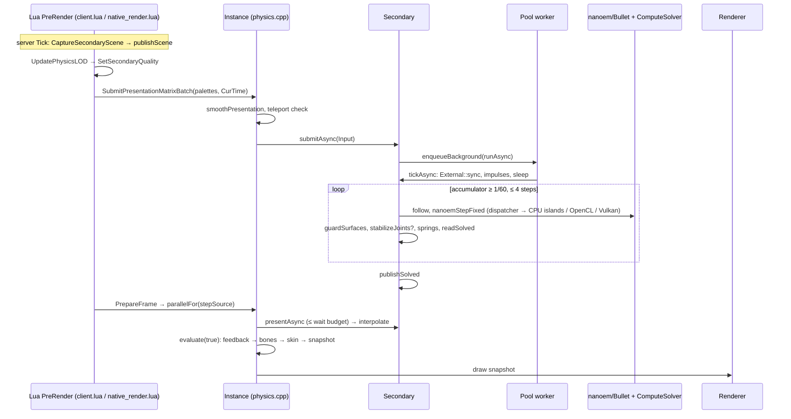
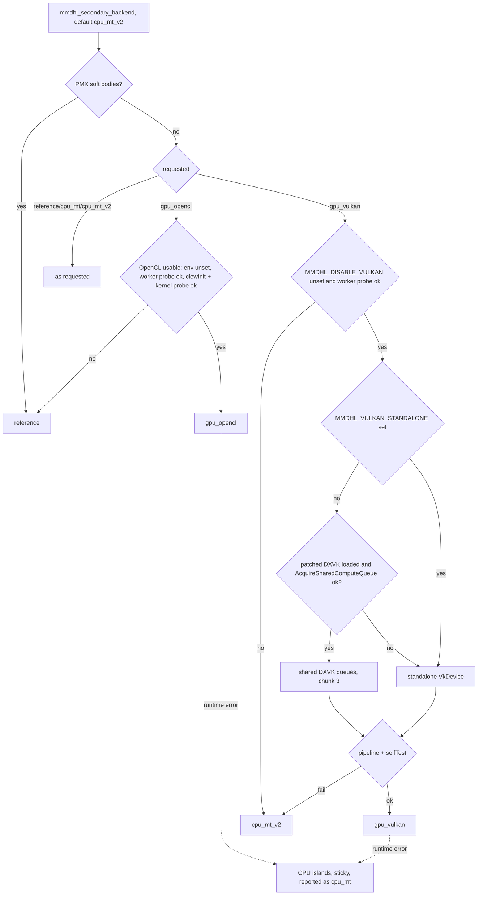

# 04 — Physics: secondary motion, solver backends, ragdoll `.phy` profiles

For AI agents changing physics code. Verified against `main` @ `9e02a27` (2.3.0). Code wins
over `docs/` (contradictions in §18). "(unverified)" = not checked in code or not runnable offline.

## 0. Two unrelated "physics" systems

| | Secondary motion (hair/cloth) | Source ragdoll ("carrier") |
|---|---|---|
| Simulates | PMX rigid bodies/joints/soft bodies, VRM spring bones | 18 `ValveBiped` bodies owned by the game's VPhysics |
| Engine | pinned nanoem `ext/physics_bullet.cc` + Bullet 2, our solvers | VPhysics; we only *generate* the `.phy` |
| Runs | client (and listen server), one world per character | server entity; built once per rig key |
| Code | §1–§9 | §10 (`physics_profile.cpp`, `rig.cpp`, `bridge.cpp`, Lua editor files) |

VPhysics objects are mirrored into secondary worlds as one-way kinematic colliders (§6).
`native/physics.cpp` is `World`/`Instance` plumbing (create, reset, backend switch, presentation
smoothing, `stepSource`) plus the legacy non-carrier backend (`buildPhysics`, 120 Hz
`World::step`); it writes no `.phy`. `native/gpu_topology.hpp` is GPU skinning, not physics.

## 1. Code map

All under `native/` unless noted.
- `secondary.{hpp,cpp}` (`Secondary`, `External`, `Filter`); `secondary_quality.cpp` (modes,
  jiggle, LOD quality).
- `nanoem_backend.cpp`: builds nanoem `physics_bullet.cc` with `#define btDbvtBroadphase
  mmd::SecondaryBroadphase`; `nanoemCreateSecondaryWorld`, `nanoemStepFixed`, midphase switch.
- Multicore: `secondary_mt.hpp` (`SecondaryMtWorld`), `ordered_dispatcher.hpp`,
  `ordered_joint_setup.hpp`, `compute_solver.{hpp,cpp}` (`ComputeSolver`, OpenCL `Coordinator`),
  `compute_rows.hpp` (std430 `GBody` 112 B, `GRow` 144 B, `GIsland` 64 B).
- GPU: `opencl_solver_kernel.hpp`, `vulkan_solver.{hpp,cpp}` + `shaders/vulkan/solver.comp`,
  `dxvk_shared_compute.h`, `compute_probe.cpp` (worker probes).
- `broadphase.{hpp,cpp}`, `dbvt_leaf.hpp`, `contact_projection.hpp`, `jobs.{hpp,cpp}`,
  `scene.{hpp,cpp}`, `bridge.cpp` (`captureSecondaryScene`, `carrierPhysics`), `spring_bones.cpp`
  (VRM springs in the same ticks), `thread_sampler.hpp` (Windows main-thread profiler only).

## 2. World model

- One `Secondary` = one nanoem world (`btSoftRigidDynamicsWorld`) per `Instance` created with
  `backend:"source"` (every carrier; `instances.lua`/`carrier.lua` also pass
  `presentationDriven:true`). Ground off, preferred FPS 60.
- Process-global (client-wide): pool, Bullet scheduler, GPU devices, scene frame, tuning, sleep
  policy, wait budget, broadphase default, DBVT margin, midphase gate, Vulkan coloring.
- **Follower** body = PMX transform type 0 or a Source-controlled bone (`sourceControl[bone]>=0`):
  kinematic. Dynamic bodies drive bones (`drivers`). Joints between two followers/world are not
  added. **Anchors** (`buildAttachments`): Dijkstra over active joints from non-world-anchored
  followers; each dynamic body is presented in its nearest anchor's frame.
- PMX soft bodies only run on `reference` (others fall back).

## 3. The fixed 60 Hz tick (`Secondary::advance`)

Constants in `secondary.cpp`: `TickSeconds=1/60`, `MaxStepsPerInput=4`, `MaxAsyncJobMs=30`,
`PresentHistoryDepth=5`; debt cap 0.25 s. While `accumulator>=h && steps<4`:
1. async: after the first step, stop if the job ran >30 ms (debt kept);
2. blend the queued Source inputs to the tick time; `evaluateSkin`; `follow`/`followSoft`;
3. `nanoemStepFixed` = `stepSimulation(h,0,h)` + sparse-SDF GC (Bullet never substeps). Tick
   callbacks: `beginFollowers` puts followers at the previous pose with start→end velocity,
   `endFollowers` snaps them to the target (removes nanoem's one-tick lead, §12);
4. `External::guardSurfaces`, `stabilizeJoints` (opt-in), `stepSprings`;
5. `readSolved` (non-finite → throw → `Instance::sourceError`, presentation stops).
Debt >0.25 s is dropped in whole ticks (`dropped`, no interpolation across the gap). Iterations =
`min(base,max(2,ceil(base/divisor)))`; tuning applies at step boundaries (version counter).

## 4. Presentation, async ticks, wait budget

- **Sync** (`reference`, `cpu_mt`, `gpu_opencl`; v2 without `presentationDriven`):
  `Instance::stepSource` → `Secondary::step` → `present()` with `interpolation=accumulator*60`;
  anchored bodies: `live*blend(prevAnchor⁻¹*prev, curAnchor⁻¹*cur)`.
- **Async** (v2 && presentationDriven): `submitPresentationPose` builds an `Input` (pose, morphs,
  manual pose, bounds, reset) → `submitAsync` (queue ≤8; a dropped input's time/reset merge into
  the next) → `enqueueBackground(runAsync)`: `InlinePhysicsScope` (one worker per world), pending
  collision flags, `tickAsync`, `publishSolved` (immutable `Solved`); exceptions → `asyncError`,
  rethrown by `presentAsync`. Background jobs run only when no frame group is queued.
- `presentAsync`: waits ≤ **wait budget** for the *running* job (0 = never, default; native
  0–100 ms, convar 0–16), keeps ≤5 states per reset epoch, clock = `inputTime + lag`, display =
  clock − 1 tick − margin (max lag of 32 frames, clamped 0.5–2 ticks, slewed).
- Output: `evaluate(true)` → `Secondary::feedback` → bones → skin/`deformSoft` → snapshot.

## 5. Sleep, teleport, reset, quality

- **Sleep** (v2 only, `applySleepPolicy`): 0.5 PMX/s, 0.35 rad/s, 1.5 s; followers sleep too and
  `follow()` wakes a follower plus its `linked` chain when its target drifts >0.02 PMX. Sleep time
  is Bullet's process-global `gDeactivationTime` (nanoem's setter ignores its world argument;
  world creation sets 30 s; v2 ticks rewrite it). Reference worlds never sleep.
- **Teleport** (`submitPresentationPose`): root jump >128 Source units, timestamp rewind or first
  pose → async `resetTick`, sync `Secondary::reset` (server `submitSourcePose`: >80 PMX). Mirrors
  jumping >128 units are re-placed. `resetReason`: initial, first_pose, clock_rewind, teleport,
  manual, backend_change.
- **Manual reset / backend switch** (`Instance::reset`/`setSecondaryBackend`): wait idle, build a
  new `Secondary` beside the old, swap on success; failure keeps the old world and pose.
- **Accuracy** `mmdhl_secondary_iterations`: −1 follow animation, 0 jiggle (`stepSimplified`, no
  Bullet; spring-only VRM stays full), 1–100 full. A mode switch drains the worker and forces a
  teleport reset. **LOD** `setQuality(1|2|4, paused)`: paused worlds submit nothing; resume re-poses
  bodies relative to anchors and blends 0.12 s.

## 6. Collision modes and scene colliders

- Flags (`scene.hpp`, Lua `mmdhl.Collide`): World 1, Character 2, Objects 4, Players 8, Npcs 16;
  `Scene`=29; default 6 (`mmdhl_collide_with`). Pre-2.2 levels: `collisionFlagsForLevel` 0→2,
  1→3, 2→7; Lua migrates `mmdhl_secondary_collision` once.
- `Secondary::Filter`: mirrors pair only with dynamic PMX bodies; without Character,
  dynamic↔kinematic pairs are dropped; v2 `pruneKinematic` drops follower↔follower pairs; else
  PMX group/mask (Bullet's own rule). Always installed on v2; on others only without Character or
  with a mirrored scene. Async flag changes queue (`pendingCollisionFlags`) until the next tick.
- **Capture** (server `Tick` in `secondary_collision.lua`):
  `native.CaptureSecondaryScene(owners,CurTime(),excluded,players,npcs)` → `bridge.cpp
  captureSecondaryScene` reads every VPhysics object through ABI-checked vtables (geometry once:
  sphere / convex hulls / static triangle mesh; transforms and velocities per tick), keeps those
  reaching a `sceneInterest` region, `publishScene`. Errors turn contacts off (Character only)
  and write `data/mmd_hotloader/diagnostics/secondary-scene-*.json`. Single player captures only
  on client demand (`mmdhl_scene_active`); remote clients get it via `scene_sharing.lua`
  (`ExportSecondaryScene`…`PublishRemoteScene` → `World::externalScene`).
- **Mirror** (`External::sync`, once per step call/tick job): skips own-entity objects (`sceneOwner`) and unwanted
  kinds, keeps those within the character box ±48 units, registers interest (lead ≤512); mass-0
  kinematic bodies tagged `ExternalCollisionTag`, friction 0.5, shapes cached per geometry+scale.
- `guardSurfaces` pushes bodies that crossed a triangle mesh back out (ray from last centre;
  from the anchor if a linear limit is violated >0.5 PMX). `stabilizeJoints` (opt-in) clamps
  violated 6-DOF linear limits: 4 passes model-only, 2 with mirrors (contact-plane clipping,
  `contactSafeTranslation`).

## 7. Backends

| id (UI) | World / solver | Async · sleep · prune | `auto` broadphase | Contract | Fallback |
|---|---|---|---|---|---|
| `reference` (MMD Compatibility) | stock nanoem | no | `dbvt-fast` | Bullet order; only one with soft bodies | — |
| `cpu_mt` (Legacy Multicore) | `SecondaryMtWorld`+`OrderedDispatcher`+`ComputeSolver(Cpu)` | no | `dbvt-fast` | same pair/manifold/row order as reference | soft→reference |
| `cpu_mt_v2` (Multicore CPU, **default**) | as `cpu_mt` | yes | `sap` | sleep off: matches `cpu_mt` within 1e-3 PMX (`secondary_async`) | soft→reference |
| `gpu_opencl` (experimental) | `cpu_mt` + `ComputeSolver(OpenCl)` | no | `dbvt-fast` | ordered PGS, `validated:false` | unavailable→**reference** |
| `gpu_vulkan` (experimental) | v2 + `ComputeSolver(Vulkan)` | yes | `sap` | ordered levels = CPU sweep (documented bit-exact vs `cpu_mt_v2`) | unavailable→**cpu_mt_v2** |

- Selection: client convar `mmdhl_secondary_backend` → `CreateInstance` options (native
  default `reference` when absent) → `Secondary` ctor sets `effectiveBackend`/`backendFallback`.
  Each client simulates with its *own* convar.
- `ComputeSolver`: `solveGroup` only sets up an island; `allSolved` solves all islands (CPU
  pool or one GPU batch) and `finish`es; kinematic followers with inverse mass force an ordered
  flush. A GPU exception is sticky per world (CPU islands, reported as `cpu_mt`).
- OpenCL: `clewInit("OpenCL.dll")`, best GPU (+NVIDIA), 3 s timeout → quarantine; the
  `Coordinator` merges due characters into one launch (≤250 µs wait, count from `PrepareFrame`).
- Vulkan: SPIR-V is built by CMake (`glslang-standalone` → `build/generated/vulkan_solver_spv.h`;
  `scripts/shaders.py` only builds Source VCS shaders). `Device::init`: `attachShared()` (patched
  DXVK `d3d9.dll`/`libdxvk_d3d9.so.0` exports `DXVK_*SharedComputeQueue`) else standalone device;
  pipeline + `selfTest`. 16 slots, ≤8 queues, solves within 500 µs share a dispatch, 3 iterations
  per dispatch on the shared device; lost slots quarantine. Default ordering `ordered`.
- Probes: `*Capabilities()` first run `mmdhl_worker --probe-compute|--probe-vulkan` (15 s
  timeout), cached per process. The worker has no DXVK, so it checks a standalone device.

## 8. Ordering, broadphase, threads

- `OrderedDispatcher` runs near callbacks in parallel, records each pair's manifold add/release
  and replays them serially in pair order → row order independent of scheduling. Mid-phase gate
  (default on, `SetSecondaryMidphase`) skips single-manifold pairs separated by AABB+breaking
  threshold or bounding capsules after `refreshContactPoints`: bit-identical by construction.
- Broadphase: `dbvt` (stock control), `dbvt-fast` (`LeafDbvt`, same pair visitation), `sap`
  (migrates to DBVT on capacity/bounds overflow, see `broadphaseFallback`), `auto` (default).
  `SetSecondaryBroadphase` sets the default for new worlds; the instance option overrides it.
  Direct nanoem C-API worlds (replay) always get stock DBVT (thread-local creation scope).
- Pool (`jobs.cpp`): `mmdhl_workers` or automatic (logical CPUs in the affinity mask, −2 when
  >4). `PrepareFrame` runs one job per pending instance; sync worlds get `workers/n` nested lanes
  (`setSecondaryWorkload`). The owning thread keeps Bullet thread index 0 (`claimOwnerThreadIndex`).

## 9. Bullet / nanoem modifications

`CMakeLists.txt`: `BT_THREADSAFE=1`; `BT_NO_PROFILE=1` unless `-DMMDHL_BULLET_PROFILE=ON`
(phase timing for `mmdhl_profile`); `BULLET2_MULTITHREADING ON`. Both scripts below run in
`build.ps1`/`build-linux.sh`, are idempotent and raise when patch context changed.

`scripts/patch-bullet-threading.py` (Bullet `2c204c4`): (1) diagnostic counters
`gNumSplitImpulseRecoveries`, `gNumClampedCcdMotions`, `gNumAlignedAllocs/Free`,
`gTotalBytesAlignedAllocs` → `thread_local`; (2) soft-body repulsion seed → per-body
`m_repulsionSeed`; (3) `gDisableDeactivation` → `thread_local`; (4) joint rows stay active unless
`fsum<=1e-20` (was `SIMD_EPSILON`): Bullet 2.75/MMD behaviour for ~1e8-mass chains.

`scripts/bootstrap.py` (THIRD_PARTY.md): (1) `solveSoftBodiesConstraints` made `virtual`; (2)
nanoem anchor accessor uses `vertex_index`; (3) nanoem joint `inverseTransformA/B` initialised
(world anchors); (4) rope soft bodies from the material's vertices at authored spacing; (5) soft
pins resolved vertex→node, anchors from pinned nodes to massless bodies dropped. Shims:
`JointInput` mirrors nanoem's joint ABI (`static_assert` 152/140 B).

## 10. Ragdoll `.phy` generation and the physics editor

Carrier bodies follow `CarrierBodyNames` (body i = solid i = PhysObj i; joint i's child is i).
- Build: `P.Resolve` → net `mmdhl_physics` → server `P.Handle` (permission, stale `base` rig
  key, pins, cooldown/budget, `P.Validate`) → `mmdhl.Spawn(...,{replace=true})` →
  `RequestCarrierFit`/`PrepareCarrier` → `normalizeCarrierOptions` → `carrierFitKey` (hashes
  `physicsOverrides`, `boneMap`, shape/mass options; none = the 2.2 key) → `fitRig`/`applyPhysics`
  → `bridge.cpp carrierPhysics` (engine convexes, rejected if VPhysics distorts a hull, +
  `physicsText`) → `data/mmd_hotloader/rigs/<key>/carrier.gma` → `mmdhl.ReplaceRagdoll`.
- Preview: `PreviewCarrierFit` → `fitRig` + `previewCarrier` (masses, rest penetrations,
  `phyText`) through `PreviewQueue` (≤1 refit per model, `pending` until done).
- `physicsText`: `solid`, `ragdollconstraint`, `collisionrules` (the *presence* of
  `selfcollisions` disables self-collision; enabled pairs are `collisionpair`, default all 136
  non-adjacent), optional `animatedfriction` (client death ragdolls only), `editparams`.
- Schema: `PhysicsSchema=1` (`GetCapabilities().physicsEditor`, Lua `P.SCHEMA`), other values
  refused whole. `PhysicsWriterVersion=1`: bump on any `physicsText`/`solidMasses` change. Fields
  (C++ `canonicalPhysics` ≡ Lua `P.CheckPhysics`/`P.Canonical`): `surfaceprop` `[a-z0-9_]{1,32}`,
  `massMode` bias|volume, `automass.density` 10–20000, `collisions` all|none|custom,
  `animatedFriction` (ints 0–1000, times 0–10), per body `limits` `[lo,hi,friction]` (±180 or
  free ±360, friction 0–100, none on pelvis), `massBias` .01–100, `damping` 0–10, `rotdamping`
  0–100, `inertia` .1–100, `drag` 0–100. Quantized, defaults dropped, unknown keys rejected.
- Saved defaults: `data/mmd_hotloader/fit_overrides/<asset>.json` (`version=3, generator=18`;
  14/15/18 current) shared with the collision editor and bone pins; atomic via `<asset>.new.txt`;
  older formats keep only pins. Dupes: modifier `MMDHLNative` `version=3`; loads retry without
  physics (`P.WithoutPhysics`). Mass: Lua 1–500, native 1–1000.
- UI: `physics_editor_ui.lua` (draft + undo, tabs, Checks, debounced `PreviewCarrierFit` polling);
  `collision_editor.lua` (per-body centre/extent → `mmdhl_action 'fit'` → `P.CollisionFit`, saves
  shapes only). Server convars `mmdhl_physics_editor` (0/1/2), `_cooldown`, `_budget`; hooks
  `MMDHLCanEditPhysics`, `MMDHLCanSavePhysicsDefault`, `MMDHLPhysicsApplied`.
- `physics_reset.lua` (`ResetPhysics`, net `mmdhl_physics_reset`) rebuilds only the
  *secondary* world; the editor's `reset` op rebuilds the `.phy` (mass 70).

## 11. Settings and environment

| Client convar (archived) | Default | Native |
|---|---|---|
| `mmdhl_secondary_backend` (userinfo) | `cpu_mt_v2` | per instance; change → `SetSecondaryBackend` on all |
| `mmdhl_collide_with` (userinfo) | 6 | `SetSecondaryCollisionFlags` |
| `mmdhl_secondary_iterations`, `_gravity`, `_damping`, `_stretch`, `_stretch_tolerance` | 10, 1, 1, 0, 1 | `SetSecondaryTuning` |
| `mmdhl_workers` | 0 (auto) | `SetWorkers` |
| `mmdhl_secondary_sleep`, `_sleep_linear`, `_sleep_angular`, `_sleep_seconds`, `mmdhl_secondary_wake_drift` | 1, .5, .35, 1.5, .02 | `SetSecondarySleep` |
| `mmdhl_secondary_wait_ms` | 0 | `SetSecondaryWaitBudget` |
| `mmdhl_lod_enabled/near/full/middle/cutoff/hidden_seconds/speed/angular_speed` | 1/300/1000/2000/4000/2/120/90 | `SetSecondaryQuality` |
| `mmdhl_update_lod`, `mmdhl_smooth_stepped_poses`, `mmdhl_vrm_relative_damping` | 1, 1, 1 | pose rate LOD, `smoothPresentation`, springs |

LOD (`mmdhl.PhysicsLODPolicy`): first person → paused; local player/`MMDHLFullPhysics`/fast
motion → 1; ≤near or visible ≤full → 1; hidden ≥2 s or >cutoff → 4 paused; ≤middle → 2; else 4.

| Environment (presence unless noted) | Effect |
|---|---|
| `MMDHL_DISABLE_VULKAN` / `MMDHL_DISABLE_OPENCL` | probe refuses → `cpu_mt_v2` / `reference` |
| `MMDHL_VULKAN_STANDALONE` | never attach to DXVK queues |
| `MMDHL_VULKAN_DEVICE`, `_WORKGROUP`, `_BATCH_US` (500), `_CHUNK` (3 shared/0), `_OCCUPANCY`, `_THROTTLING` | device index, local size, batching µs, iterations per dispatch, NV occupancy |
| `MMDHL_VULKAN_CLOCK`, `_IR`, `_DEBUG_MODE`; `MMDHL_OPENCL_WORKGROUP` | profiling/dev only |
| `DXVK_SHARED_COMPUTE_QUEUES` (4; 0 off), `DXVK_SHARED_COMPUTE_PRIORITY` (low/medium/high/off) | read by patched DXVK |
| `MMDHL_ASSET_CACHE` | test scripts' asset cache |

## 12. Determinism, references, golden files

- Secondary motion has **no golden trajectory**; its references are CTests (§17): async ≈ sync
  `cpu_mt` (1e-3), midphase on/off bit-identical, `dbvt-fast` pair order == DBVT, 30–240 FPS
  input within 0.002 PMX, `cpu_mt` ≈ reference.
- `tests/nanoem_replay.cpp` (`mmdhl_replay <pmx> [--backend --broadphase --scene contacts
  --tolerance]`, **not in CTest**): independent nanoem world (upstream stepping, stock DBVT)
  compared on bodies, GLM bone feedback, soft vertices. Since the follower-timing change it
  reports ≈0.19 PMX for every backend by design (per docs, not run here; gate undecided).
- GPU parity: OpenCL `FP_CONTRACT OFF`; Vulkan `precise`/`fma` mirrors Bullet's SSE2 or
  SSE4.1+FMA3 row solver; Vulkan ≡ `cpu_mt_v2` is documented on Windows only.
- **Goldens are carrier goldens**: `tests/fixtures/physics/golden.json` (MSVC) and
  `golden-linux64.json` (manylinux_2_28 GCC 14) pin `key`, `mdlSha256`, `phy` for 9 fits of
  `native-cloth21.pmx`. The `.phy` text is the same; keys/hashes differ because fit floating point
  follows each compiler/libc. CTest `physics_profiles` also checks `canonical_cases.json` (57
  cases shared with `test_physics_editor.py`).
- Regenerate from the repo root with each platform's release toolchain:
  `mmdhl_physics_profile_tests --record` (only for a deliberate fit change, all legacy checks
  passing) and `--record-canonical <inputs.json>`. Changing `fitRig`, `carrierFitKey`, MDL
  writing, `physicsText` or `solidMasses` for unedited rigs breaks them and users' carrier keys.

## 13. Performance decisions (PHYSICS_V2_0*, PERFORMANCE_PLAN, FRAME_TIME_RESEARCH, COMPUTE_BACKENDS, VULKAN_*, BROADPHASE/MOTION_*_VALIDATION)

- `cpu_mt_v2` is default: v1 put every world's serial step chain on the frame barrier (10
  characters spiralled into catch-up); async ticks took it off (8 characters standing p50/p95
  29.8/36.8 → 14.3/19.7 ms). v1 backends stay unchanged.
- v2.1: exact mid-phase gate (−32–44 % pairs), SAP for v2 (0.10 vs 0.23 ms/tick), cheaper
  stretch guard: clustered tick 81 → 49 worker ms. Step ≈ solver 49 %, narrowphase 29 %,
  broadphase 14 %; 10 iterations is the fidelity contract.
- Rejected: SAP for replay-exact backends (up to 24.75 units off); stock Bullet MT dispatcher;
  spring coloring; frame-synchronous colour-barrier solve (+31 % p95); `gpu_opencl_v2`, FTZ/DAZ,
  catch-up time dilation, dedicated sim threads; Bullet3OpenCL/Jolt/PhysX; `mmdhl_update_lod 2`.
- OpenCL never paid (≈0.9 MB round trips per character; full-rig divergence). Vulkan is exact but
  slower per step than CPU on all 8 test rigs; it only frees worker CPU at high iterations on the
  DXVK shared device; standalone under D3D9 and low-core CPUs (blocking `vkWaitForFences`) fall
  behind. Large frame wins came from rendering, not physics.
- Open: ~25 ms hair display delay; 600-body tangled rigs compute-bound (~11 ms/tick).

## 14. Diagrams

Sync backends replace submit…publish + `presentAsync` with `Secondary::step` inside `PrepareFrame`.

## 15. Where to change X

| Change | Start in | Also check |
|---|---|---|
| Tick rate / step / debt caps | `secondary.cpp` constants, `advance` | `tuning()` tickRate, `timing_tests`, `async_tests` |
| Interpolation, display delay, wait budget | `present`, `presentAsync` | `buildAttachments`, `setAsyncWaitBudget`, Lua clamp |
| Sleep | `applySleepPolicy`, `follow` | sleep convars, `gDeactivationTime` (§5) |
| Teleport / reset | `Instance::submitPresentationPose`, `resetTick`, `Secondary::reset` | `smoothPresentation`, `timing_tests` |
| Collision category / capture | `scene.hpp`, `External::sync`, `Filter`, `bridge.cpp` | `secondary_collision.lua`, `scene_sharing.lua`, i18n |
| New backend | known sets in `Secondary` ctor and `Instance::setSecondaryBackend`, `nanoemCreateSecondaryWorld` | `secondary_backend.lua` + i18n, `GetSecondaryCapabilities` |
| CPU solver | `compute_solver.cpp`, `ordered_joint_setup.hpp` | `secondary_multicore`, `secondary_async` |
| GPU rows / kernel | `compute_rows.hpp`, `Group::append`, `vulkan_solver.cpp convert`, `solver.comp` | OpenCL structs, `GROUP_ROWS`, `mmdhl_compute_tests gpu_vulkan ordered` |
| DXVK sharing | `attachShared`, `queueCall` | `dxvk_shared_compute.h`, `patches/dxvk/0001-*.patch` |
| Broadphase / midphase | `broadphase.cpp`, `dbvt_leaf.hpp`, `ordered_dispatcher.hpp` | `secondary_broadphase`, `secondary_midphase` |
| Pool / lanes | `jobs.cpp` | `SetWorkers`, `async_tests` |
| Stretch / surface guards | `stabilizeJoints`, `External`, `contact_projection.hpp` | `secondary_stretch*`, `secondary_projection*` |
| `.phy` fields / limits | `physics_profile.cpp` | `physics_profile.lua`, `canonical_cases.json`, versions, goldens |
| Bullet/nanoem behaviour | `patch-bullet-threading.py`, `bootstrap.py` | THIRD_PARTY.md, `secondary_heavy_chain` |

## 16. Invariants — do not break

1. Fixed 1/60 s ticks driven by submitted timestamps (`CurTime()`), never wall time; Bullet never
   substeps; repeated timestamps add no time; 30–240 FPS input gives the same ticks (≤0.002 PMX).
2. `reference`/`cpu_mt`/`gpu_opencl` keep Bullet's pair→manifold→row order (ordered dispatch,
   island/row order, joint indices, DBVT visitation, bit-identical gate). No sleep or kinematic
   pruning there, `auto` must stay `dbvt-fast`, and their filter keeps Bullet's group/mask rule.
3. v2 with sleep off ≈ `cpu_mt`; `gpu_vulkan` ordered ≡ `cpu_mt_v2` (rounding, dot order,
   `GroupRows`=`GROUP_ROWS`=6, std430 `static_assert`s, row rules: B normal = ±A, friction after contact).
4. Async ownership: clock/timing members, bodies and mirrors belong to the tick job; the frame
   reads `published`/`presented` and `frameStats()` only; frame-side mutations (pause/resume,
   mode switch, reset, `SetWorkers`, destruction) call `waitAsyncIdle()` first.
5. Wait budget only chooses which solved state is shown; 0 = never wait.
6. Bounded work: ≤4 ticks per input, 30 ms job yield, 0.25 s debt cap with `droppedTime`, ≤8 inputs.
7. Followers integrate previous→target inside the tick; followers and dynamics publish together.
8. One-way contacts: mirrors kinematic, tagged, never feed VPhysics (`feedbackApplied` 0); a
   character never collides with its own entity.
9. Finite or fail on every input path (presentation, capture, GPU results); errors stop the instance.
10. Soft bodies only on `reference`; unknown ids throw in C++, map to `cpu_mt_v2` in Lua.
11. Unedited carriers keep 2.2 key/MDL/`.phy` bytes; canonical physics is strict schema 1 and
    identical in Lua and C++; bump `PhysicsWriterVersion`, never reinterpret `PhysicsSchema`.
12. Bullet globals touched while stepping must be per-thread/per-world (patch script).
13. The owning thread keeps Bullet thread index 0 across pool rebuilds.
14. DXVK's device: never destroy it or `vkDeviceWaitIdle` it, lock around submit/wait, destroy own
    objects before `Release`; quarantine memory of lost GPU work.

## 17. Tests

| CTest | Binary (fixture) | Covers |
|---|---|---|
| `secondary_multicore` | `mmdhl_compute_tests cpu_mt` | `cpu_mt` vs reference, 8 fixtures × 600 frames (0.01 PMX, 0.02 rad, 5 % energy) |
| `secondary_async` (RUN_SERIAL) | `mmdhl_async_tests` (native-chain) | 24 checks: equivalence, lag, wait budget, teleport, flag timing, backlog, pool resize, teardown, sleep/wake |
| `secondary_midphase` | `mmdhl_midphase_tests` | gate bit-identity, `auto`, SAP v2, margin |
| `secondary_broadphase` | `mmdhl_broadphase_tests` | `dbvt-fast` pair order, SAP migration, per-thread config |
| `presentation_timing`, `_control` | `mmdhl_timing` (cloth21) | FPS independence, resets, rewinds, stalls, stepped poses, nested groups |
| `secondary_motion` | `mmdhl_motion_tests` | attachments, head compensation, buried reset (3 CPU backends) |
| `secondary_projection{,_unaffected,_mass_ratio,_ground}`, `secondary_stretch{,_ground}` | `mmdhl_projection_tests`, `mmdhl_stretch_tests`, `mmdhl_stretch_ground_tests` | stretch/contact projection, defaults, mode changes |
| `secondary_heavy_chain` | `mmdhl_heavy_chain_tests` | ~1e8-mass chains anchored |
| `adaptive_physics_and_materials`, `adaptive_physics_nan_tails` | `mmdhl_quality_tests` | jiggle, tiers, suspend/resume, disabled |
| `physics_profiles` | `mmdhl_physics_profile_tests` (repo root) | goldens, canonical cases, `.phy`, masses, previews |
| `native_runtime`, `vrm_import_and_springs` | `mmdhl_tests`, `mmdhl_vrm_tests` | backend switch/rollback; springs |

Manual: `mmdhl_replay`, `mmdhl_profile`, `mmdhl_compute_tests gpu_opencl|gpu_vulkan ordered`
(**without `ordered` it tests colored**), `mmdhl_vulkan_compare` (Windows, `--dxvk <d3d9.dll>`,
`scripts/vulkan-rigs.py`). In game (Windows): `scripts/test-performance.py` (**defaults to
`--backend reference`**), `test-adaptive-physics.py`, `test-secondary-scenes.py`,
`test-secondary-backends.py` (stale). Offline Lua (CI): `python scripts/check-lua-tests.py
[filter]` (lupa 2.8) runs `tests/test_physics_editor.py` (profile model, Lua/C++ canonical parity,
QC/`.phy` import, server permissions/limits/replace/defaults, client preview).

## 18. Contradictions and unverified

- DEBUGGING.md (0.7.1): "`dbvt-fast` is the release default", SAP rejected → code: `auto` = SAP
  for v2 (default backend), `dbvt-fast` otherwise (rejection holds for replay-exact backends).
- PHYSICS_TUNING.md: "physical cores minus two" → logical CPUs (−2 only when >4); "stretch
  suppressed with world/prop collisions" → stale (contact-aware 2-pass guard runs).
- "Claude CPU v2" (docs, `compute_probe.cpp` fallback text) vs UI "Multicore CPU Processor".
- COMPUTE_BACKENDS.md: `reference` default, server-authorized switch → stale; net
  `mmdhl_secondary_backend` has no sender; NW2 `MMDHLSecondaryBackend` (`carrier.lua` default
  `reference`) has no reader.
- Stale comments: `vulkan_solver.hpp` (standalone-only, one dispatch); `ordered_dispatcher.hpp`
  omits `gpu_vulkan`.
- Zero-difference replay (PHYSICS_V2_0 "Fidelity", PERFORMANCE_PLAN L0) vs ≈0.19 PMX since the
  follower-timing change; `mmdhl_replay` usage lists three backends.
- Runtime GPU failure is reported as `cpu_mt` even when the world stays v2.
- Benchmarks' "mode 2" = flags 7 (with map); the default is 6.
- `gDeactivationTime` facts were checked in a bootstrapped `vendor/` (Bullet sources are not in git);
  unsynchronized same-value writes from concurrent v2 ticks.
- OpenCL on Linux: `clewInit("OpenCL.dll")` goes to `dlopen` there and cannot find that name, so
  `gpu_opencl` is unavailable (read from code, not run). (unverified) Linux Vulkan bit-exactness;
  Linux DXVK shared queues in game; D3D9 device recreation while sharing DXVK queues.
