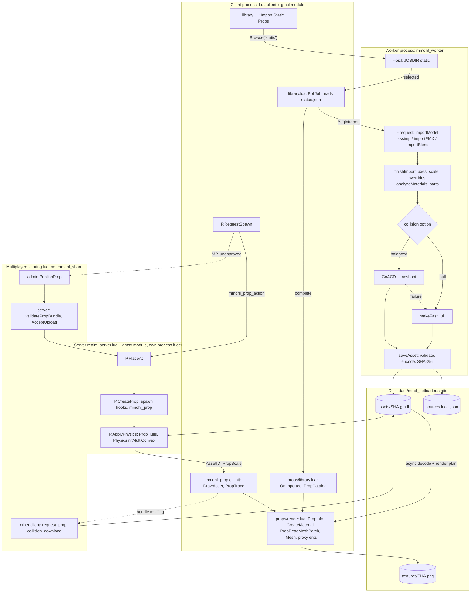

# 05 — Static props: import, bundle cache, Lua meshes, VPhysics

Audience: AI agents changing the static-prop path. Verified against `main` @ `9e02a27` (2.3.0).
Code wins over `docs/STATIC_PROPS*.md`; contradictions at the end. "(unverified)" = not checked.

## 0. Split of work

| Process / realm | Code | Job |
|---|---|---|
| Worker `mmdhl_worker.exe`/`_linux64` (child of client module; one job at a time; job dir `%TEMP%/mmdhl-jobs/job-*`) | `native/worker.cpp` + `mmdhl_props_import` = `props/{import,pmx,blend,zstd_decode,collision,fast_hull,texture_resolver,material_overrides}.cpp` + assimp, meshoptimizer, zlib | picker, parse, textures, collision, write bundle |
| Game modules `gm{cl,sv}_mmdhl_*.dll` (`mmdhl.native`) | `module.cpp`, `prop_bindings.cpp` + `mmdhl_props_core` = `props/{core,trace,image_validation,render_plan,material_processing}.cpp` | off-thread decode/validate, render view, hulls, traces, catalog, delete; never parse sources |
| Lua client | `mmdhl/props/{shared,collision,render,library,tool,editor}.lua`, `entities/mmdhl_prop/cl_init.lua`, `mmdhl/{library,ui,sharing}.lua` | jobs, library UI, IMesh build/draw, traces, tool, attach UI, presets |
| Lua server | `props/{shared,collision,server}.lua`, `entities/mmdhl_prop/init.lua`, `stools/mmdhl_prop.lua` | approval, placement, VPhysics, resize/reimport, attach, dupes |

Static props are **not** drawn by `native/renderer.cpp` (Vulkan/DXVK irrelevant): they are Lua-built
`VertexLitGeneric` IMeshes. `autorun/mmdhl.lua` includes `props/shared.lua`+`collision.lua` in both realms,
then `server.lua` (SV) or `render,library,tool,editor` (CL). Single-player: one process, one cache dir.

## 1. Pipeline

## 2. Native

### 2.1 Files

| File | Role / key symbols |
|---|---|
| `props/core.hpp/.cpp` | types (`Vertex` 48 B `static_assert`, `Hull`, `Texture`, `Asset`, `Options`, `Limits`); `encode/decode/validate`, `saveAsset/loadAsset`, `parseHulls`, `bundleManifest` (header only), `deleteBundles` (texture refcount GC), `parseOptions`, `sha256`, `writeAtomic` (tmp+rename; Win retries). `props::Protocol=2` unused |
| `props/import.cpp` | `importModel` (dispatch by extension), assimp via `UnicodeIO` IOSystem (`DependencyScope::Reach::Local`), `makeTexture` (stb ≤16384², scaled to 4096, PNG level 1, SHA-256), `finishImport` |
| `props/pmx.cpp` | `importPMX`: own PMX 2.0/2.1 reader (not nanoem); geometry+materials only; tangents from UVs |
| `props/blend.cpp` | `listBlendObjects`, `importBlend`: SDNA-driven; headers `BLENDER_v###`/`-v###`/`BLENDER17-01v0500`, little-endian, gzip/zstd; pointers scoped per owning ID; mesh layouts 5.x attributes, 4.x CustomData, MPoly/MLoop, pre-2.63 MFace; ear-clip n-gons; full object transforms + parents; node walk to image textures; visibility. No modifiers/shape keys/poses/linked data |
| `props/zstd_decode.cpp` | `zstdDecompress`: in-house RFC 8878 decoder (no dictionaries, bounded output) |
| `props/fast_hull.cpp` | `makeFastHull` (13 axes → 26 planes, ≤48 verts, flat-input thickness), `buildHull` retries, AABB fallback, `hullFromPoints` |
| `props/collision.cpp` | `makeCollision`: `hull` → fast; `balanced` → CoACD; any exception → fast hull + warning |
| `props/material_processing.cpp` | `analyzeMaterials`: alpha mode from UV-covered texels; sets `material_processing_version:2`, no-op when ≥2 |
| `props/material_overrides.cpp` | `applyMaterialOverrides`: `<model file>.gmodel.json` v1 |
| `props/texture_resolver.cpp` | as written → basename → `tex`/`textures` up to grandparent → alias index; ambiguity = error. **Shared with `character_import.cpp`** (`Reach::Confined`) |
| `props/render_plan.cpp` | `prepareRenderPlan`, `renderVertex`, `propScale` (0.01–100), `validateHullScale`, `traceScaled` |
| `props/trace.cpp`, `image_validation.cpp` | swept-OBB continuous SAT vs hulls; `validatePNG` full decode |
| `props/network_path.hpp` | `networkPath()`, also used across the runtime |
| `prop_bindings.cpp` | Lua `Prop*` (§2.5); per-asset `std::async` cache; `validatePropBundle` for shared-file commits |

### 2.2 Worker

Modes: `--pick <dir> static` (OBJ/FBX/GLB/GLTF/PMX/BLEND filter; IFileOpenDialog or zenity/kdialog) ·
`--request <job>/request.json <cache>` with `options.kind`: `static` → `importProp`, `blend_scene` →
`listBlend` (object list; UI imports chosen `objects`), `derive` → `deriveProp` (preset: hidden slots and/or
centroid `box`; parent untouched) · `--installation-test <out> coacd`. `.vrm` refused. `<job>/status.json`
heartbeat 500 ms; crashes logged to `<job>/worker.log`. `PollJob` warns after 5 min (no kill).

Units: glTF ×39.37, FBX ×0.3937×`UnitScaleFactor` (axes from FBX metadata), OBJ ×1 (extent <8 → ×39.37 +
warning), PMX ×3.2366 (0.08×40.457), BLEND ×39.37. Manifest gains `skeleton{bones,humanoid}`, `pbr`
(glTF/Blender), `unlit`/`emissive_baked`; PMX jobs add `info.classification` (`classifyPmx`) for the
"Import as character" prompt. `finishImport`: Y-up→Z-up for `y_up`, or `auto` except `.blend` (PMX mirrors →
winding/tangent flip), rotation, scale, overrides, `analyzeMaterials`, parts ≤60000 indices, `makeCollision`.
`saveAsset` is the single full validation; then `sources.local.json[id]={source,options}` (a damaged file is
set aside and reported as `registryBackup`).

### 2.3 Collision

CoACD 1.0.14 C ABI (`CoACD_run`, `CoACD_freeMeshArray`, `CoACD_setLogLevel`) from `lib_coacd.dll` (needs
VCOMP140) or `lib_coacd.so` + bundled `libgomp-a34b3233.so.1.0.0` (RPATH set to `$ORIGIN` by
`scripts/bootstrap.py`), beside the worker, kept loaded until exit. Input welded by
`meshopt_generatePositionRemap`; if >18000 indices, `meshopt_simplify` to 18000 **indices** at 2.5% error.
Args `(.05,16,0,30,600,8,20,2,false,true,true,64,false,.01,0,0,false)`: threshold 0.05, ≤16 hulls, ≤64 verts
(other names per upstream `coacd.h`, unverified). Invalid pieces rebuilt by `hullFromPoints` or dropped.
meshoptimizer is used nowhere else.

### 2.4 Bundle and cache

`.gmdl`, little-endian, ID = SHA-256 of whole file = file name: `"GMLHOT1\0"` · u32 manifestLen (≤4 MiB) ·
u32 vertices · u32 indices · u32 textures (≤2×materials) · manifest JSON (incl. `hulls`) · 48-B vertices
(pos, normal, u, v, tangent4) · u32 indices · per texture: 64-char hash, u32 w, u32 h, u32 len, PNG. No
trailing bytes. Manifest: `version` (must be 1), `name`, `format`, `materials[]` (enum keys `alpha_mode`,
`source_shading` validated), contiguous `parts[]`, `mins/maxs`, `warnings`, `options`, `unit_scale`,
`collision_method` (`direct_support_hull_26`|`bounding_box`|`coacd`), optional `skeleton`, `blend_objects`,
`derived_from`, `preset`.

Render plan (at load, never stored): index swap CCW→Source CW, origin = AABB center, opaque chunks ≤6000
tris, blend materials median-split into clusters of min(6000, max(128, ⌈tris/1024⌉)) tris, two-sided →
extra `backface` chunk; adds `render_chunks`, `render_winding:"source_cw"`, `render_origin`, `render_backfaces`.

`data/mmd_hotloader/static/`: `assets/<sha>.gmdl`, `assets/<sha>.gmdl.share2` (transfer pack),
`textures/<sha>.png` (derived; extracted by `prepare()` in **both** realms), `library/<sha>.json` (name, folder,
favorite, spawn.scale, deleted, replacedBy, parent, preset, presetSpec), `library/folders.json`,
`sources.local.json` (never shared). Server `mmd_hotloader/approved.json` `props[id]`. Workshop packages carry
`static/assets/<id>.gmdl` (`native/packages.cpp`; `StartAssetCheck('static',id)` decodes before approval).

### 2.5 Lua bindings (`mmdhl.native`)

Both realms: `PropRequest` · `PropHas` · `PropInfo(id[,wait])` (render manifest + sizes; nil while loading) ·
`PropReadMeshBatch(id,part,offset,count≤2048[,backface])` → `{pos,normal,u,v,userdata=tangent}` ·
`PropHulls(id[,scale][,wait])` · `PropCollisionBlob` · `PropInstallCollision(id,json≤256 KiB)` ·
`PropTrace(id,start,delta,ax,ay,az[,scale])` · `PropRelease` · `PropSharedManifest` (hashes on the Lua
thread) · `PropCatalog` (headers only). Client: `PropDelete`; `module.cpp` `Browse('static')`, `BeginImport`,
`PropReload`, `PropDerive`, `PollJob`, `CancelJob`. Errors return `nil, message`.

## 3. Lua

- **Import/library**: options from convars `mmdhl_prop_import_{axis,collision,scale,yaw}` (`P.ImportOptions`).
  `.blend` runs `blend_scene` first (1 object → direct import, several → `mmdhl.ShowBlendPicker`).
  `Lib.OnImported`: reimport copies name/folder/favorite/spawn, hides old entry (`deleted`,`replacedBy`), SP
  sends `replace_asset` and deletes the old bundle 3 s later if unused. Delete → `remove_asset`, `PropDelete`,
  SP `mmdhl_prop_forget`.
- **Spawn → physics** (`server.lua`): `P.CanUse` (SP or approved) → `P.PlaceAt` (finite values, aim ≤4096,
  cleanup-generation check) → `P.SpawnPose` (local −Y faces the player) → `P.CreateProp` (Sandbox spawn hooks
  with placeholder `models/hunter/blocks/cube025x025x025.mdl`) → `P.ApplyPhysics`: `PropHulls(id,scale)` →
  `PhysicsInitMultiConvex` → mass `clamp(volume_in³×0.000016387×250, 2, 50000)` → `P.SetCollision` → undo.
  `P.Rebuild` (resize/reimport) tries a hidden probe entity first; keeps Weld/NoCollide only.
- **Collision levels** (`collision.lua`): NW2 `MMDHLCollide` none|world(default)|noactors|noplayers|all, NW2
  `MMDHLGravity`. none/world → `COLLISION_GROUP_WORLD`; noactors/noplayers → `ShouldCollide` hook (players pass
  unless attacking at the prop without holding something, NW2 `MMDHLPhysgunHolding`); none → collisions off,
  damping 2/4. Sandbox collision/gravity properties hidden; 20 surface ids in `P.SurfaceMaterials`.
- **Rendering** (`render.lua`): one refcounted `P.RenderCache[id]` per asset shared by all entities (freed
  15 s after last release); 2 ms Lua per Think, ≤512 verts per batch, one `BuildFromTriangles` per chunk.
  `CreateMaterial('mmdhl_prop_r2_<id>_<i><g|m>','VertexLitGeneric')`, textures via
  `Material('../data/mmd_hotloader/static/textures/<hash>.png','smooth mips noclamp')`, PBR→Phong in `phong()`.
  Draw: hidden client ents `mmdhl_prop_piece[_translucent]` (`GetRenderMesh`), per-instance 6-way
  `render.ComputeLighting` cube, `render.RenderFlashlights`, translucent clusters depth-sorted, scale via
  `RenderMultiply`. No RTT shadows.
- **Entity** `mmdhl_prop`: NetworkVar String 0 `AssetID`, Float 0 `PropScale`. Client `TestCollision` →
  `PropTrace` against bundle hulls or hulls pre-installed from `mmdhl_prop_collision`. Copy data
  `MMDHLProp={asset,scale,mass,frozen,collide,gravity,surface}`; pastes lacking `collide` get `all`.
- **Tool/attach/presets**: stool `mmdhl_prop` (left place, right attach editor, reload detach/copy).
  `P.Attach`: no physics, `FollowBone`/`SetParent`, dupe constraint `MMDHLAttach` (`mmdhl_attach_link`).
  Presets: `editor.lua` → `Lib.SavePreset` → `PropDerive`.

| Net message | Dir | Payload |
|---|---|---|
| `mmdhl_prop_action` | C→S | str action (spawn/remove_asset/replace_asset/resize/freeze/remove), str id, u16 ent, str JSON settings |
| `mmdhl_prop_status` | S→C | u32 request, str state, str message, u16 ent |
| `mmdhl_prop_catalog` | S→C | u6 n≤32 × (str id, str name≤256, u32 triangles, u32 bytes) |
| `mmdhl_prop_collision` | S→C | str id, u16 n≤60000, compressed `{hulls,mins,maxs}` (≤262144 inflated) |
| `mmdhl_prop_forget` | C→S (SP) | str JSON ids |
| `mmdhl_prop_attach` / `_open` | C→S / S→C | str action, ent, ent, str id, i16 bone, vec, ang, float / ent, ent |
| `mmdhl_share` | both | manifest `kind:'static'`, one file `static/assets/<id>.gmdl` (sha256 = id), `transport:2` |

## 4. Limits

| What | Value (where) |
|---|---|
| Bundle / expanded bytes | 256 MiB / 1 GiB (`Limits`, `checkGeometryStorage`) |
| Materials / textures | 128 / 256 per bundle |
| Textures | source ≤16384², file ≤1 GiB, stored ≤4096 |
| Triangles | warning only above 1M tris or 3M verts |
| `.blend` raw and inflated | 3 GiB |
| Hulls | 1–16, 4–64 points, closed, convex, volume >0, radius ≤32768 |
| Prop scale / import scale | 0.01–100 (UI 0.05–20), scaled extent ≤32768 / (0,10000] |
| Server convars (archive; max = default) | `mmdhl_prop_max_{package_mb 256, expanded_mb 1024, texture_dimension 4096, materials 128}` via `P.InLimits` |
| Rate limits | 1 pending spawn (client timeout 75 s / 600 s awaiting approval), tool 0.3 s, resize 0.25 s, attach 0.2 s |

## 5. Where to change X

| Change | Edit |
|---|---|
| New source format | `import.cpp importModel` + CMake `mmdhl_props_import`; picker filters in `worker.cpp` (Win and POSIX); `staticTypes` in `mmdhl/library.lua`; i18n |
| Units / axes / facing | `import.cpp`, `pmx.cpp PmxSourceUnits`, `blend.cpp BlenderUnits`, `finishImport`; `shared.lua P.SpawnPose` |
| Fast collider | `fast_hull.cpp`; acceptance in `core.cpp parseHulls` |
| CoACD | `collision.cpp detailedCollision`, `dependencies.lock.json`, `bootstrap.py`, `installation.cpp workerSelfTest` |
| Bundle fields / validation | `core.cpp encode/decode/validate` (see §6) |
| Alpha classification | `material_processing.cpp` + `material_processing_version` gate |
| Texture lookup | `texture_resolver.cpp` (characters too), `native/dependency_scope.cpp` |
| Render chunks / winding | `render_plan.cpp`; Lua fallback `render.lua renderChunks` |
| Material look / upload budget / drawing | `render.lua buildMaterial`, `phong` (bump `mmdhl_prop_r2_`), Think `MMDHL.PropMeshes`, `P.DrawAsset` |
| Mass | `server.lua P.DefaultMass` |
| Collision levels / surfaces | `collision.lua`; `-- i18n-keys:` comment + `addon/resource/localization/*/mmdhl.properties` |
| Server limits / approval | `server.lua` convars, `P.InLimits`, `P.AcceptUpload`; `sharing.lua accept` |
| Tool / attach | `stools/mmdhl_prop.lua`, `props/tool.lua`, `server.lua P.Attach/Detach` |
| Duplicator | `mmdhl_prop/init.lua OnEntityCopyTableFinish` + `server.lua RegisterEntityClass` |
| Presets | `worker.cpp deriveProp`, `editor.lua`, `library.lua SavePreset` |

## 6. Invariants / do not break

- File name = SHA-256 of bundle bytes, checked by `loadAsset`, `prepare`, `validatePropBundle`,
  `StartAssetCheck`. Changing `encode` output re-IDs new imports; old IDs in saves, dupes, `approved.json`,
  `library/` and Workshop packages must keep decoding.
- No version negotiation: magic `GMLHOT1`, manifest `version==1`, raw 48-B vertices. Only add optional
  manifest keys; `validate` rejects unknown values of known keys, so older peers reject new enum values.
- `encode` must never write what `decode` refuses (4 MiB manifest, 2×materials textures) — tested.
- Loading never mutates bundles (render plan and alpha re-analysis are views). Stored winding outward CCW;
  only the render view is Source CW; collision/bounds stay in source coordinates.
- Render chunks ≤18000 verts (IMesh 65535 cap); `PropReadMeshBatch` ≤2048.
- No dependency read from network paths or denylisted places; props keep `Reach::Local`.
- Scale ranges must agree (Lua `P.MinScale/MaxScale`, native `propScale`: 0.01–100).
- `sources.local.json` never leaves the machine; `textures/` is derived.
- Game modules link only `mmdhl_props_core`. Net formats and `MMDHLProp` keys are cross-version contracts.

## 7. Tests

| Test | Covers |
|---|---|
| CTest `static_props` → `mmdhl_props_tests` (`tests/props/*`) | round trip/hash, corruption, limits, hulls, traces, render plan, delete GC, alpha, resolver, synthetic `.blend` + zstd fuzz (docs: 340 checks, unverified) |
| CTest `import_errors` | static OBJ via worker, `derive` presets, picker crash kind `static` |
| CTest `character_import_worker` (`scripts/test-character-import.py`) | damaged `static/sources.local.json`; OBJ/BLEND refused as characters |
| `python scripts/check-lua-tests.py` (lupa): `tests/test_prop_physics_options.py`, `test_input_hardening.py`, `test_map_cleanup.py`, `test_sharing_requests.py`, `test_server_installation_requests.py` | reach rules, surfaces, delete; NaN/NULL hardening; cleanup; approvals/manifests; module-missing answers |
| `scripts/test-props-multiplayer.py` (owned dedicated server + 2 clients, Windows `.ps1` session) | import, share-on-spawn, approval, server physics, remote draw and trace, non-admin spawn |

Untested offline: `render.lua`, `editor.lua`, `tool.lua`, stool, CoACD runs. `tests/game/prop-impact.lua`
is **not** a static-prop test (vanilla `prop_physics` vs a character, from `scripts/test-game.py`).

## 8. Lineage

- `old-Gmod-Simple-Static-Model-Importer`: Python/tkinter app (FBX via external Blender) writing
  `data/pmx_static_importer/models/<id>/*.json`; conceptual ancestor only.
- `old-GModel_Hot_loader` 1.0.6 (`02341db`), standalone addon (`gmodel_hotloader` module,
  `sent_gmodel_hotloader`, own transfer, cache `data/gmodel_hotloader`): bundle v1, `render_plan`,
  `material_processing`, `trace`, `image_validation` ported verbatim (namespace `gm`→`props`); core, fast hull,
  collision, import, pmx, resolver, overrides adapted; Lua render design (proxies, ComputeLighting, 2 ms
  budget) carried over.
- Since: PMX scale 1→3.2366; big textures scaled (were rejected); OBJ auto-metres; Blender; CoACD failure →
  fast hull (old threw); DependencyScope; Linux; mass by volume (old 50 kg); `noclamp`; PBR→Phong; collision
  levels, attach, presets; character sharing transport; no 4 GiB worker cap or 5-min kill. No migration of
  `data/gmodel_hotloader`; old bundles should decode (unverified).

## 9. Contradictions / uncertainties

- STATIC_PROPS.md "at most 18,000 triangles" for CoACD input: code targets 18,000 **indices** (~6,000 tris),
  and `meshopt_simplify` may stop above target.
- Blender: docs "2.60 through 5.x"; `blend.cpp` header says "2.63 to 5.x" (stale; pre-2.63 path exists).
- Docs are Windows-only (picker, `lib_coacd.dll`); Linux uses zenity/kdialog and `lib_coacd.so`+libgomp.
- "Prop size 0.05–20×" is the UI range; server/native accept 0.01–100.
- "Collision arrives first": sent from a `P.Load` callback while the offer goes out immediately.
- `props::Protocol` and `P.Pins` unused. CoACD argument names beyond the three above unverified.
