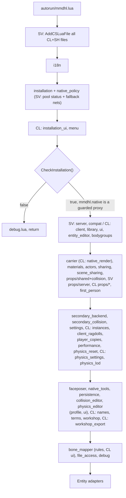
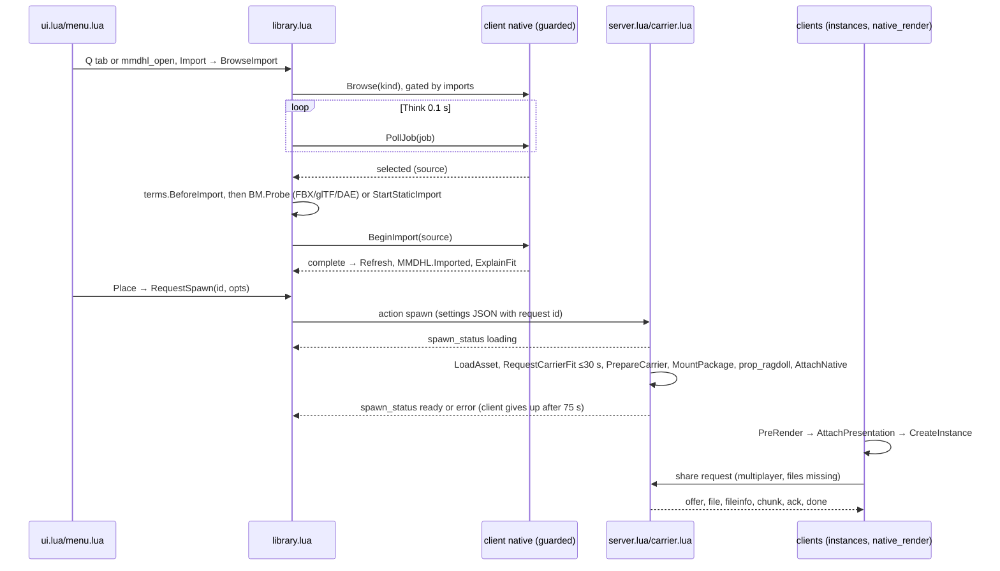
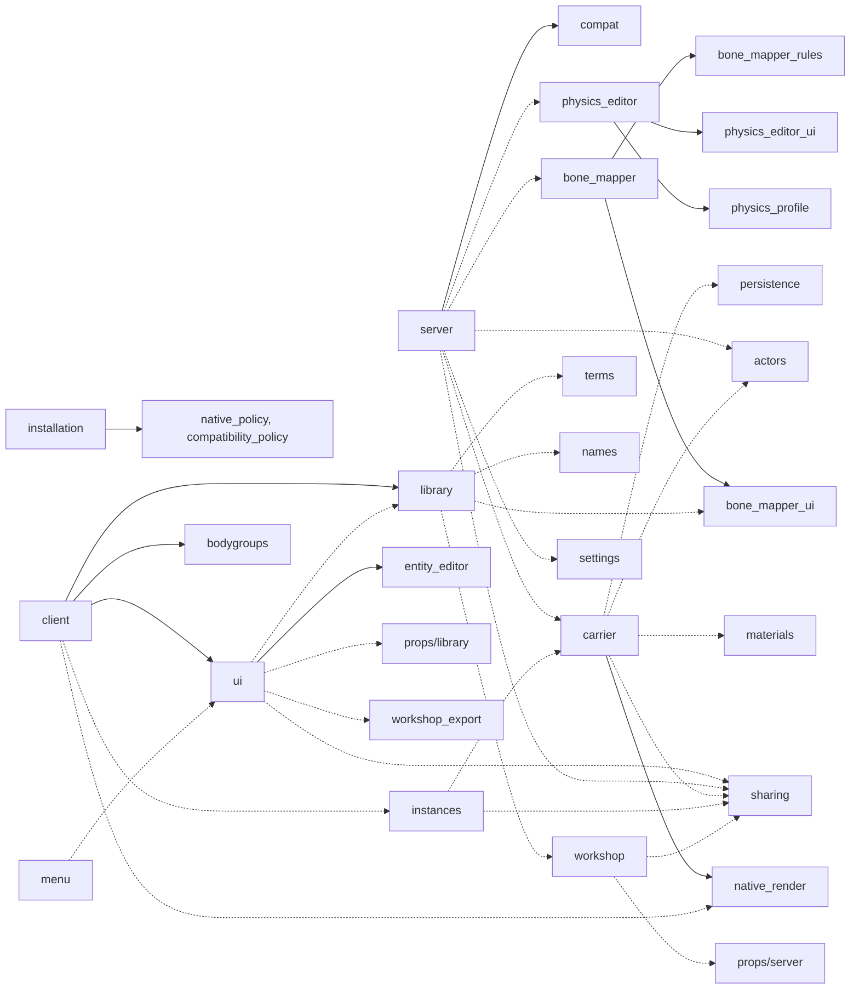

# 06 — Lua addon: load order, realms, modules, networking, i18n, tests

Audience: AI agents changing `addon/`. Verified against `main` @ `9e02a27` (the Lua for native
2.3.0). Code wins over `docs/`; contradictions are listed in §14. "(unverified)" means not
checked.

Notation: SH = shared, SV = server, CL = client. Files are in `addon/lua/mmdhl/`. DATA means
`garrysmod/data/mmd_hotloader/`. Net and ConVar names in §6–§7 omit the `mmdhl_` prefix.
Props: chapter 05. Physics: chapter 04.

## 1. Load order and the installation gate

`autorun/mmdhl.lua` is the only autorun file.

1. **Send files (SV).** `AddCSLuaFile` sends every CL/SH file, all except `server`, `compat` and
   `props/server`. This runs *before* the gate, so clients always receive every file.
2. **Early includes.** `i18n` → `installation` (includes `native_policy`; SV also pools the
   status and fallback net names) → CL `installation_ui`, `menu`.
3. **Gate.** `if not mmdhl.CheckInstallation() then include('mmdhl/debug.lua') return end`.
4. **Load the rest.** Define `MountPackage` and `Decode`, then include the rest (see the diagram).
5. **Entity adapters.** Wrap 20 `Entity` methods (flex, bones, attachments, `SetEyeTarget`).
   On `mmdhl_ragdoll` they dispatch to the SENT methods in `tool_api.lua`, because engine
   methods would otherwise win. Guard: `mmdhl.entityAdaptersInstalled`.

`entities/`, `weapons/` and the stool load regardless of the gate. They check `mmdhl.native` or
`FeatureAvailable` themselves.

**The gate fails only if** there is no module file for the realm, the platform is not
`win64`/`linux64` x86-64, or `require('mmdhl')` errors or leaves no `mmdhl_native` table.
Warnings never fail it.

**After a failed gate:**
- `mmdhl.native`, `MountPackage` and the later files are absent; `debug.lua` still loads.
- `loadError` is set, `MMDHL.InstallationChanged` runs, and SV broadcasts `install_status`.
- SV fallbacks answer `action`/`prop_action` 'spawn' and `physics` (protocol 1, op ≠ close) with
  the server's problem, and resend the status (≤ 1 per 5 s per player).
- On CL the tab shows `loadError`; `mmdhl_open`, `_open_props` and `_installation` open the
  installation window.

Realms are tagged per file in §5. The server-only files are server, compat and props/server.
file_access, collision_editor and physics_editor_ui are shared but return early on SV.
`native_policy.lua` and `compatibility_policy.lua` are generated data
(`return util.JSONToTable([==[…]==])`); never hand-edit them.

## 2. The `mmdhl` table

| Member | File | Notes |
|---|---|---|
| `native` | installation | Guarded proxy (copy taken at load); nil if the gate failed. Worker calls need `FeatureAvailable('imports')`: `Browse`, `BeginImport`, `Reload`, `PropDerive`, `PropReload`, `FileAccessPick`/`Request`, `FileAccessSetEnabled(true)`. Without `detailedCollision`, `BeginImport`/`PropDerive`/`PropReload` options get `collision='hull'`. Never call `mmdhl_native` directly. |
| `L`, `Localize`, `I18n`, `ChatPrint` | i18n | §9 |
| `Decode(v,err)` | installation/autorun | JSON string → table |
| `CheckInstallation`, `GetInstallationStatus`, `FeatureAvailable(f)`, `NativeReleaseAtLeast`, `EvaluateInstallation` (pure), `ServerIssue`, `loadError`, `serverInstallation` (CL) | installation | Features: core; CL imports, detailedCollision, rendering; SV physics. |
| `MountPackage(path)` | autorun | `data/mmd_hotloader/…` only, via `GetMountablePackage` → `game.MountGMA`; memoized. |
| `Spawn`, `LoadAsset`, `SavedBoneMap`, `LoadSavedFit`, `EntityForInstance` | server | `Spawn` is the API for server code. `LoadAsset` polls `AssetInfo` every 0.05 s for up to 60 s. |
| `Action`, `RenderAvailable`, `RequestSpawn`, `library`, `Open(mode)`, `UI` | client/library/ui | modes: library, static, scene, physics |
| `IsMMD`, `GetAsset`, `GetRig`, `Get/SetMorphWeight(s)`, `Entities()`, `AttachNative`/`SpawnNative` (SV) | carrier | — |
| `CanUseAsset` (single player or approved), `CanEdit` (`MMDHLCanEdit` hook, then `CanProperty`), `approved` | sharing | SV only |
| `props`, `physics`, `boneMapper`, `workshop`, `names`, `terms`, `FileAccess`; `Collide` {world 1, character 2, objects 4, players 8, npcs 16}, `CollideDefault`=6 | modules | — |

## 3. Entities, weapons, hooks

- **Characters** are `prop_ragdoll` carriers. The model `models/mmd/<key16>/*.mdl` comes from the
  mounted `rigs/<key>/carrier.gma`; the ragdoll has 18 physics objects. NW2 fields:
  `MMDHLAsset`, `MMDHLRig`, `MMDHLGeneration`, `MMDHLNoDraw`, `MMDHLNativeBodyCount`,
  `MMDHLCollisionFlags`, `MMDHLSecondaryBackend`, `MMDHLMorph<i>`, `MMDHLManual<i>`.
  NPCs and player models are actors.
- **Entities.** `mmdhl_ragdoll` is the legacy backend (`native_carrier 0`; NetworkVars Asset,
  Instance, Frozen). `mmdhl_prop` has AssetID and PropScale (chapter 05). `mmdhl_attach_link`
  is a point entity behind the duplicator constraint `MMDHLAttach`.
- **`weapon_mmdhl`** grabs, freezes, resets. It finds targets only via `EntityForInstance`
  (`mmdhl_ragdoll`), so it is effectively legacy-only; it needs `CanEdit`; `mmdhl_grabber`
  (single player).
- **Stool `mmdhl_prop`**: left click places (0.3 s), right click opens the attach editor, reload
  detaches or copies.
- **Menus.** Context: `mmdhl_reset_physics`, `mmdhl_physics_editor`, `mmdhl_prop_collision`,
  `mmdhl_prop_gravity`. Spawn menu: the "External Models" tab (menu.lua), Utilities pages MMDHL
  and MMDHLProps (ui.lua), NPC and player-model entries (`RegisterActor`).

**Hooks other addons can use.**
- CL `MMDHL.RequestUserFile(opts,cb)`: returns true; absent when the gate failed.
- CL `MMDHLCanAccessUserFile(addon,req)`: false refuses; it can never grant.
- CL `MMDHL.FileAccessReady(api)`, `MMDHL.FileAccessChanged()`.
- SV `MMDHLCanEdit(p,ent,prop)`, `MMDHLCanEditPhysics(p,ent,op)`, `MMDHLCanEditBoneMap(p,id)`,
  `MMDHLCanSetPlayerModel(p,asset,rig)`: false refuses.
- SV `MMDHLCanSavePhysicsDefault(p,asset)`: any non-nil return overrides (true allows).
- CL `MMDHLFullPhysics(ent)`: true means no LOD.
- CL `MMDVMDNPCPoseCut(ent,seconds)` (run by animation addons such as the MMD VMD NPC player):
  `mmdhl.MarkTeleport`, the secondary world is carried across the jump instead of simulated.
- SV `MMDHLActorCreated(ent,rig,opts)`, `MMDHLPhysicsApplied(p,old,new)`.

**Internal events.** `MMDHL.InstallationChanged`, `.LanguageChanged`, `.LibraryChanged`,
`.ImportChanged`, `.Imported`, `.SpawnStatus`, `.Notice`, `.ShareProgress`, `.PropApproved`,
`.NamesTranslated`, `.WorkshopChanged`, and others.

**Engine hooks.**
- `PreRender` 'MMDHL.Shadows': `UpdateClientInstances` → `PrepareNativePresentation` →
  `native.PrepareFrame` → `UpdateNativeVisuals` → `PruneRenderCache`.
- `Tick`: morph sync, scene capture and scene sharing.
- `Think`: polls (imports, file access, transfers, debug).
- `PostCleanupMap`: `cleanupGeneration`++.

## 4. Flows and module dependencies

Solid arrows are `include`, dashed arrows are calls. The `mmdhl.L` and `mmdhl.native` edges are
left out.

## 5. Per-file reference

Each entry gives the purpose, the API, and the natives it calls (nat, found by grep). Net
messages, ConVars and DATA files have an owner column in §6–§8.

**Installation and policy**
- `installation` (SH; works without native). `EvaluateInstallation` (pure) hashes the module,
  runtime, worker, worker-runtime copy and CoACD (≤ 128 MiB each), reads their build ID
  (`<commit>-YYYYMMDDTHHMMSSZ`), compares against the policy and emits only warnings.
  `CheckInstallation` then:
  1. prints the warnings and calls `require`;
  2. `ConfigureCompatibility` (win64: policy, retried without one library at a time; linux:
     `source-linux64-v1`);
  3. `CheckCompatibility` (retried up to 20 × 0.5 s);
  4. CL only: the worker self-test (polled every 0.2 s, 30 s deadline; imports stay off
     meanwhile).

  `mmdhl_check_installation` (admin-only on SV) re-reads files but never reloads a DLL.
- `native_policy` (generated by the native build and `publish-native-release.py`):
  `{approved[] (2.1.0-native.5…2.3.0), releases{label:{build, installApi, files{client, server,
  runtime, worker, coacd}, url, altUrl, platforms.linux64?}}, recommended:"2.3.0"}`.
  `compatibility_policy` is generated by `compatibility_profiles.py`.
- `installation_ui` (CL, loaded before the gate). Banner, windows, `ShowNativeUpdateNeeded`. It
  opens only GitHub or `altUrl` links.

**Realm cores**
- `server` (SV). `Spawn`, `LoadAsset`, the `action` handler, the legacy single-player Tick, the
  `mmdhl_ragdoll` dupe. nat: RequestAsset, AssetInfo, RequestCarrierFit, CreateInstance,
  CapturePhysics, Step, Clear, ForgetAssets.
- `client` (CL). Owns `mat_queue_mode`; `RenderAvailable` (CheckRenderer); the legacy renderer;
  the PreRender pipeline.

**UI**
- `ui` (CL). The `MMDHLLibrary` panel (`SetMode`, `SelectAsset`, `Place`, `Edit*`,
  `DeleteSelected`, `ExportSelected`), `Open`, `mmdhl.UI` helpers, Utilities pages.
- `library` (CL). `library.Refresh/Update/Delete/StartImport/BrowseImport/ReloadCharacter`,
  the failure UI (`ShowImportFailure`, `ImportCause/Stage/Hint`, `ExplainFit`) and
  `RequestSpawn`. nat: Browse, BeginImport, PollJob, CancelJob, Reload, PropReload,
  DeleteAssets.
- `menu` (CL, loaded before the gate). The creation tab.
- `bone_mapper_ui` (CL). `OpenBoneMapper`, `BM.Probe` (FBX/glTF/DAE), `BM.OpenFit` (pins).
- `entity_editor` (CL). `OpenEntityEditor`.
- `physics_editor_ui` (CL). The `.phy` editor (PreviewCarrierFit).

**Characters**
- `carrier` (SH). The §2 helpers; `Entities()` is an incremental list, rescanned every 5 s.
  SV: `AttachNative`, `SpawnNative` (requires 18 bodies). nat: PrepareCarrier, SetMorph(s).
- `actors` (SH). `IsLoadableRig` (generator between `rigGeneratorMin` and `rigGenerator`),
  `RegisterActor`, `SpawnNPC`, `Set/RemovePlayerModel`, corpses. nat: GetCapabilities,
  PrepareCarrier, ReadAnimationModel.
- `instances` (CL). `AttachPresentation`: mounts the GMAs, calls `RequestSharedRig` when files
  are missing, then `CreateInstance`. Wireframe fallback.
- `native_render` (CL). Proxies, Source materials, shadows, Remix preview, pose LOD. nat:
  DrawInstance, SubmitPresentation*Batch, RenderStats, `Set*`.
- `materials` (SH). Material and bodygroup `Entity` overrides for MMD entities only (originals
  in `mmdhl.materialMethods`).
- `bodygroups` (CL): presets. `faceposer` (SH): Face Poser chain. `first_person` (CL): body
  hiding and the arms editor. `client_ragdolls` (CL): client corpses.
- `player_copies` (CL). Wraps `Entity.DrawModel`; the original is kept in
  `mmdhl.EngineDrawModel`.
- `names` (CL). Google `translate_a/t` POST: ≤ 40 names, 4000 B, 15 s; asks for consent.
- `terms` (CL). Terms-of-use windows (nat InspectModelNotes).
- `bone_mapper` + `bone_mapper_rules` (SH). Pure rules, mirrored in `native/humanoid_slots.hpp`
  and `tests/fixtures/bonemap/slots.json`. SV `BM.CanEdit`, `HandleSave`, `HandleQuery`.
- `native_tools` (SH). SV eye wrappers. `compat` (SV): legacy physgun.

**Physics** (chapter 04)
- `physics_settings` (CL): `PhysicsSettingDefaults`, SetSecondaryTuning.
- `physics_lod` (CL): pure `PhysicsLODPolicy`.
- `physics_reset` (SH): `ResetPhysics`; CL `MarkTeleport` (hook `MMDVMDNPCPoseCut`).
- `physics_profile` (SH, pure): `mmdhl.physics`.
- `physics_editor` (SH): server ops, rate limits; replaces `LoadSavedFit`.
- `collision_editor` (CL).
- `secondary_backend` (SH): `cpu_mt_v2` (default), `gpu_vulkan`, `reference`, `cpu_mt`,
  `gpu_opencl`.
- `secondary_collision` and `scene_sharing` (SH).

**Sharing, Workshop, persistence**
- `sharing` (SH). SV: `approved.json`, `ApproveAsset` (admins; automatic in single player),
  `ApproveWorkshopAsset`, `PublishRig`. CL: `RequestSharedRig/Prop`, `PublishAsset/Prop`.
- `workshop` (SH). `ValidatePackage`, `Scan` (InitPostEntity + 1 s, and GameContentChanged on
  CL); installs through the shared-file natives.
- `workshop_export` (CL). The export dialog.
- `persistence` (SH). The `MMDHLNative` modifier (state v4); wraps
  `duplicator.CopyEntTable/CreateEntityFromTable/DoGeneric`.

**Props** (chapter 05)
- SH `shared`: `P.Load`.
- SH `collision`: modes.
- SV `server`: `PlaceAt`, `Attach`, dupe.
- CL `render`, `library`, `tool`, `editor`.

**Utilities**
- `settings` (SH). `GetGlobalSettings` (SV reads userinfo); `WithSpawnDefaults` fills only nil
  keys.
- `performance` (CL). Opt-in HUD.
- `file_access` (CL). `mmdhl.FileAccess` v1 (`Pick`, `RequestPath`, `Read`, `List`, …); each
  callback runs exactly once, from Think.

## 6. Network catalog

C→S data is hostile: validate it. "pre" means the name is pooled by installation.lua before
native loads. Not pre-pooled: catalog_forget, bonemap_*, secondary_backend, workshop_ready, chat.

| Name (owner) | Dir | Payload | Limits / checks |
|---|---|---|---|
| install_status (installation) | ↔ | C: empty. S: status JSON (schema 1) | C asks 1/s up to 5×; S answers ≤ 1 per 5 s per player, broadcasts on change |
| chat (i18n); notice (server…) pre | S→C | token | — |
| action (server) pre | C→S | action, id, ent u16, value JSON | `spawn`: one pending; role ∈ ragdoll/citizen/combine/player; aim ≤ 4096; gamemode hooks; whitelisted options (mass 1–500, scaleMultiplier .1–4). `bonemap`: ≤ 16 KiB, 1/s. `bonemap_pins`: ≤ 8/s. Edit actions: CanEdit |
| spawn_status (server) pre | S→C | req u32, state, token, ent u16 | — |
| forget_assets (server) pre | C→S | ids JSON | single player or listen host |
| native_morph(s) (carrier) pre | C→S | ent, idx u16, float / ent, n u16, floats | CanEdit 'faceposer'; finite; ±2 |
| collision_mesh (carrier) pre | ↔ | C: ent. S: ent, rig, n u16, zip JSON | C 1 per 2 s; S CanEdit, 18 bodies, ≤ 60000 B, no rate limit |
| material_visibility (materials) pre | C→S | ent, slot u16, bool | CanEdit |
| actor_registration, player_selection, player_clear (actors) pre | S→C | rig + arms key / rig / model name | — |
| arms_preview (actors, first_person) pre | ↔ | C: req u16, asset, gender, parts JSON. S: req, rig or '', token | S 1/s, CanUseAsset |
| catalog (pre) / catalog_forget (sharing) | S→C | id, name / static, count u8 ≤ 128, ids | catalog_forget never in single player |
| share (sharing) pre | ↔ | command, token u32, … (below) | below |
| scene (scene_sharing) pre | ↔ | cmd u2. 0 C: active [radius, kinds u5]. 0 S (unreliable): seq, idx, count, n, data. 1 C: shape, offset. 1 S: id, offset, ok, data or error | multiplayer only; subscription 3 s; 20 frames/s, ≤ 64 × 48000 B; shapes ≤ 32 KiB per 20 ms |
| scene_active (secondary_collision) pre | C→S | bool | single player only |
| physics_reset pre | S→all | ent | — |
| secondary_backend | C→S | ent, backend | single player; **no Lua sender** |
| physics (physics_editor) pre | C→S | proto u8 = 1, req u32, op, ent, n u16, zip JSON | ≤ 60000 B (≤ 256 KiB unzipped); ops open/close/test/apply/previous/reset/restore_saved/save_default/clear_default/model; mode, cooldown and budget ConVars |
| physics_status pre | S→C | req, state, token, ent, n, zip | ≤ 60000 B |
| bonemap_result / bonemap_pins (bone_mapper) | S→C | id, ok, token / id, pins JSON, collision bool | — |
| workshop_ready (workshop) | C→S | — | listen host, 2 s |
| prop_action (props/server) pre | C→S | action, id, ent, settings JSON | spawn (one pending), remove_asset, replace_asset (single player), resize (0.25 s), freeze, remove; owner check |
| prop_status / prop_catalog / prop_collision pre | S→C | like spawn_status / ≤ 32 × (id, name, triangles, bytes) / id, ≤ 60000 B zip | C timeout 75 s (600 s while awaiting approval) |
| prop_forget / prop_attach / prop_attach_open pre | C→S / C→S / S→C | ids / action, target, existing, id, bone i16, vec, ang, scale / target, existing | prop_forget: single player. prop_attach: 0.2 s, finite, offset ≤ 4096, CanTool, owner |

**`share` protocol.**
- **Commands.** `catalog` (1 per 5 s), `request`, `request_prop`, `upload`/`offer` (manifest
  ≤ 60000 B zipped, ≤ 16 MiB unzipped, `transport=2`, `version=1`), `file`, `fileinfo`,
  `chunk` (≤ 48 KiB), `ack`, `checking`, `done`, `cancel`/`error`.
- **Flow control.** Window 144 KiB; one transfer per peer; timeout 60 s (180 s while checking).
- **Server limits.** Manifests 1/s per player and 4/s overall. Uploads are admin-only and limited
  to raw `assets/<id>/{manifest.json, model.bin}`, `textures/*.png`, or one `.gmdl`.

Clients send a spawn only if `util.NetworkStringToID('mmdhl_spawn_status')` ≠ 0. They send
`lf_playermodel_update` (Enhanced PlayerModel Selector) only when the server pools it.

## 7. ConVars

Flags: A archived, U userinfo. Help texts are English.

**CL, archived**

| Area (owner) | ConVars (default) |
|---|---|
| Language (i18n) | `language` '' (follows `gmod_language`); `i18n_debug` 0 (not archived) |
| Rendering (client, native_render) | `force_immediate_rendering` 0; `flashlight_overlap_fix`, `vertex_cache`, `compact_vertices`, `smooth_stepped_poses`, `gpu_skinning`, `soft_alpha` all 1; `update_lod` 1 |
| Physics (physics_settings) | `secondary_iterations` 10 (−1 off, 0 jiggle); `secondary_gravity` 1, `secondary_damping` 1; `secondary_stretch` 0, `secondary_stretch_tolerance` 1; `vrm_relative_damping` 1; `workers` 0 |
| LOD (physics_lod) | `lod_{enabled,near,full,middle,cutoff,hidden_seconds,speed,angular_speed}` = 1, 300, 1000, 2000, 4000, 2, 120, 90 |
| Sleep (secondary_backend) | `secondary_{sleep,sleep_linear,sleep_angular,sleep_seconds,wake_drift,wait_ms}` = 1, .5, .35, 1.5, .02, 0 |
| Shortcuts (physics_reset) | `reset_all_key` 0, `toggle_physics_key` 0; `last_physics_accuracy` 10 |
| Names, terms | `translate_names` 1, `translate_new_imports` 1, `translate_notice_seen` 0; `terms_warning_import` 1, `terms_warning_export` 1 |
| Tools, debug (installation_ui, performance, bone_mapper_ui, physics_editor) | `native_update_reminder` 1; `debug_overlay` 0, `debug_print` 0; `bonemap_autoskip` 0; `physics_editor_{advanced,mirror,camera,actual,coached}` |
| Props (props/library, props/render) | `prop_import_{axis,collision,scale,yaw}` = auto, hull, 1, 0; `prop_spawn_frozen` 0; `prop_specular` 1 |
| Migration markers (first_person, settings) | `first_person_body` 2 (forced), `secondary_collision`, `collision_settings_version`, `first_person_default_version` |

**CL, archived + userinfo**
- settings: `spawn_frozen` 0, `collide_with` 6, `secondary_backend` cpu_mt_v2, `npc_health` 0.
- props/library: `prop_collide` world, `prop_gravity` 1, `prop_physprop` default. The stool's
  `ClientConVar` defines these too, plus `prop_{asset,scale,yaw,frozen,r,g,b}`.

**SV, archived**
- carrier: `native_carrier` 1 (0 = legacy backend); `backend_version` 0 (migration marker).
- props/server: `prop_max_{materials,package_mb,texture_dimension,expanded_mb}` = 128, 256,
  4096, 1024. These can only be lowered (max = default).

**SH, archived + replicated** (physics_editor)
- `physics_editor`: 1 on a dedicated server, else 2 (0 nobody, 1 admins, 2 editors).
- `physics_editor_cooldown` 3 s; `physics_editor_budget` 20 per 10 min (superadmins exempt).

**Unused:** `debug_token` (debug.lua).

**Console commands** (all prefixed `mmdhl_`): `open`, `open_props` (static mode), `installation`,
`installation_folder`, `native_update`, `check_installation`, `export`, `file_access`,
`physics_editor_open`, `reset_physics [all]`, `reset_all_physics`, `toggle_physics`,
`share_cancel`, `cleanup_client_ragdolls`, `prop_stats`, `debug_toggle`, `debug_report`,
`debug_capture`, `grabber`.

## 8. DATA files and data_static

Any Lua can write DATA, so DATA never holds security decisions. `file.Write` accepts only some
extensions (`.txt`, `.json`, …). Picked models and file-access
grants live in `%LOCALAPPDATA%\ModelHotloader\`. Readers do
`util.JSONToTable(file.Read(p,'DATA') or '') or {}`, then validate.

| Path | Owner | Schema |
|---|---|---|
| `assets/<64>/{manifest.json,model.bin,materials-v5.gma}`, `textures/`, `rigs/<32>/{rig.json,carrier.gma}`, `names/`, `static/assets/`, `sources.local.json`, `cleanup.json`, `exports/*.gma` | native (Lua reads only) | `names/`: short id → full id; `cleanup.json`: pending deletions |
| `approved.json` (+ `approved.invalid.json`) | SV sharing, props/server | `{version:1, assets{id:{name, approvedBy, approvedAt, package?}}, rigs{key:{asset, role, arms?}}, props{}}` |
| `fit_overrides/<64>.json` | SV physics_editor (DefaultKeys, `.new.txt` → rename), bone_mapper (PinKeys); workshop writes it if missing | `{version:3, generator:14/15/18, bodies, scale, mass, physics, editor, boneMap…}`; each writer keeps the other's keys |
| `library/<64>.json`, `library/folders.json`, `static/library/` | CL library, props/library, workshop | `{version:1, name, folder, favorite, deleted, fit, spawn, bodygroups}` |
| `arms/`, `face_presets/`, `translations/`, `terms/`, `bone_maps/` | CL first_person, faceposer, names, terms, bone_mapper_rules | version 1 |
| `workshop/state.json` | SH workshop | `{version:1, assets{"kind:id":{installed, adopted, hidden, package, times}}}` |
| `installation_dismissed.txt`, `misplaced_dismissed.txt`, `native_update.json` | CL installation_ui | convenience only |
| `exports/*.{jpg,txt}`, `diagnostics/`, `failures/` | export, performance, scene, carrier, native_render | — |
| `debug-session.json`, `debug/<token>/` | scripts, debug.lua | §10 |

`addon/data_static/mmdhl/` holds two packages that ship with the addon, both
`install:"workshop"`, generator 2.2.0, ~56 MB:
- "Gun" (`0180c77f…`): one static prop.
- "Linlong" (`84c3039b…`): one character, 20 files.

Their files are `files/<sha256>.dat` (MMDPACK2). They are scanned like any mounted package.

## 9. i18n

**Files.** `addon/resource/localization/<lang>/mmdhl.properties` in 7 languages: `en` (source),
`fr`, `ja`, `ko`, `ru`, `zh-cn`, `zh-tw` (the lowercase codes of `gmod_language`). 1983
phrases, all translated. `check-i18n.py` currently reports 0 errors and 1 warning.

**Format** (parsed by `I.Parse`)
- One `key=value` per line, UTF-8; `#`/`!` start comments; escapes `\n`, `\t`, `\uXXXX`, `\\`.
  Values are trimmed. An empty value falls back to English. A line that is not `key=value` is an
  error. Keys match `^mmdhl(\.[a-z0-9_]+){2,}$`.
- English: sections `# ===== Title (file.lua) =====`, and a context comment above each phrase
  (where it appears, what each `{placeholder}` is).
- Translations: a header with a glossary, then English order, each phrase preceded by
  `# en: <the exact English>`. A stale `# en:` line is reported as outdated.

**Lookup.** `local L=mmdhl.L`, then `L'area.name'` or `L('area.name',{n=1})`. On SV, `L` returns
a token (U+E000..E003, can nest). Clients must `mmdhl.Localize` all text from the server.

**Rules**
- Never compare display text or join translated fragments.
- Use `I18n.Lazy` for load-time tables, rebuild UI on `MMDHL.LanguageChanged`, take fonts from
  `I18n.FontData`.
- Game-shown names (tool, undo `mmdhl.undo.*`, `MenuLabel='#mmdhl.*'`, weapon and entity names)
  go through `addGamePhrases`.
- A new language needs an `I.Languages` entry. ConVar help and native sentences stay English.

**Dynamic keys.** The checker finds `L'lit'`, `L("lit"`, `mmdhl.L(…)` and `..L'x'` (not `x.L` or
`x:L`), and skips literals that end in `.`. List the keys such code builds in a comment:
`-- i18n-keys: a.b a.c`.

**Add a phrase**
1. In `en`, in its section: a blank line, `# <context; {placeholders}>`, then
   `mmdhl.area.name=Text`.
2. In each of the 6 translations, at the same position: a blank line, `# en: Text`, then
   `mmdhl.area.name=<translation>`. Keep the same placeholders and the same number of `\n`. Use
   the glossary and the game's terms. Do not translate product names or commands.
3. Call it with a literal vars table, or list the key under `-- i18n-keys:`.
4. Run `python scripts/check-i18n.py`. It must report no errors (CI fails on errors) and no new
   warnings.

When you change English text, update all 6 translations and their `# en:` lines. When you
remove a phrase, remove it from all 7 files.

**Never run `--sync` unless asked.** It rewrites whole files: it keeps only the header, the
sections and the `# en:` lines, empties untranslated phrases and writes CRLF. `--csv` and
`--template` only write output.

**Other references**
- `docs/TRANSLATING.md` is the human guide.
- `Translation Templates Write.txt` is the Steam Workshop description in BBCode, with sections
  `//English`, `//Chinese_Simp`, `//Chinese_Trad`, `//Japanese`, `//Korean`, `//French`,
  `//Russian`. Nothing reads it; update all 7 sections by hand.
- `mmdhl_i18n_debug 1` shows pseudo-text and `2` shows keys, so hard-coded text stands out.

## 10. Debug bridge and in-game tests

**When it runs.** `debug.lua` (SH) only listens when all of these hold:
- the global `MMDHL_DEBUG_TOKEN` exists (set by `lua/autorun/000_mmdhl_test_session.lua`, which
  `scripts/game-start.ps1` writes and which loads before mmdhl.lua);
- DATA `debug-session.json` contains the same token;
- the game is single player, or `ownedMultiplayer` is set (`multiplayer-session.ps1`).

It runs even when the installation gate fails.

**Protocol** (files in `debug/<token>/`)
- On load it writes `<realm>-ready.json`.
- Each Think it reads `<realm>-request.json` `{token, sequence, code}`. For a newer sequence it
  runs `xpcall(CompileString(code))` and writes `<realm>-response.json` `{ok, value|error}`.
- The sequence survives reloads (`mmdhl.debugSequences`).
- `mmdhl_debug_capture <name> [ui]` writes a PNG.

**Host side**
- `scripts/gamectl.py server|client '<lua>'` (or `--file tests/game/x.lua`): writes the request
  atomically, polls every 0.1 s and saves the response in `validation/`. Exit codes: 0 ok,
  1 Lua error, 2 timeout.
- `reload-lua.py` copies the Lua into `addons/mmd_hotloader`, re-includes autorun in both realms
  and re-registers `mmdhl_ragdoll`. Native changes still need a restart.
- `scripts/test-*.py` drive the game through `gamectl.execute`. `tests/game/*.lua` probes assert
  `MMDHL_DEBUG_TOKEN`.

These launchers are PowerShell and Windows-only; there is no Linux launcher. Always finish with
`game-stop.ps1`.

## 11. Offline Lua tests (lupa)

**Run.** `pip install lupa==2.8`, then `python scripts/check-lua-tests.py [filter]`. It runs every
`tests/test_*.py` except `test_native_installer.py`. CI runs `check-i18n.py` first. All 48 scripts
passed on Linux with lupa 2.8 at `9e02a27`.

**Harness**
1. Create `LuaRuntime(unpack_returned_tuples=True)`.
2. Set `SERVER`/`CLIENT` and stub the GMod globals the code needs.
3. `lua_i18n.attach(lua)` loads the real i18n.lua and English catalogue; server code then returns
   tokens.
4. Load whole files, or extract a piece with `lua_source.definition(lua, src, header)` (the
   fewest lines from `header` that compile) or with `src.index()` slices.

**What the tests enforce**
- **Syntax.** All `addon/lua/**/*.lua` must load in lupa 2.8's default Lua 5.5 (checked here)
  after `continue` is replaced with `break`. So: no `!=`, `&&`, `||`, `!x`, `/* */` or `//`
  comments, and no assigning to a `for` loop variable (const in 5.5).
- **No acceptance path.** No API, file, command, button or phrase for accepting unverified native
  files may exist in `addon/` (the `GONE` list in test_installation.py, e.g.
  `install.unverified`, `unverified_native.json`).
- **No `DScrollPanel` `:Rebuild`** overrides (test_bone_mapper.py).
- **Anchors.** Tests find code by exact strings: `local policy=include`, the `value={size=…}`
  line in installation.lua, `if not mmdhl.CheckInstallation()`, `function mmdhl.Spawn(`,
  `net.Receive('mmdhl_action'`, `function PANEL:ShowFitStatus(`. Change these only together with
  their tests.

**New test.** Add `tests/test_<area>.py` with a docstring. Print `PASS:` lines and exit non-zero
on failure.

## 12. Where to change X

| Change | Edit | Also / tests |
|---|---|---|
| UI text | `L'key'` + 7 `.properties` | test_i18n.py |
| New C→S message | owner's SV block: pool, validate, rate-limit, reply with tokens | installation.lua pre-pool if needed; test_input_hardening.py |
| Layout of action, prop_action, spawn/prop_status, physics(_status) | owner **and** installation.lua fallback | test_server_installation_requests.py |
| Spawn option | `RequestSpawn` → server.lua 'spawn' whitelist → `Spawn` → `SpawnNative` | test_carrier_spawns.py |
| Global default | settings.lua (userinfo ConVar), Utilities page, `PhysicsSettingDefaults` | test_collision_checkboxes.py |
| New native call | `isfunction(mmdhl.native.X)`; worker calls also in `workerCalls`; old natives → `ShowNativeUpdateNeeded` | test_native_update_*.py |
| Library window | ui.lua `PANEL:*` | PANEL-slicing tests |
| Import failure text | library.lua `ImportCause/Stage/Hint` + keys | test_import_failures.py |
| Menus, game-shown names | menu.lua, ui.lua `PopulateToolMenu`, `properties.Add`, i18n `addGamePhrases` | — |
| Approval / sharing | sharing.lua (`CanUseAsset`, `accept`) | test_sharing_*.py |
| Permissions | `CanEdit` + hooks, `P.Can`, `BM.CanEdit` | test_edit_permissions.py |
| Dupe / save format | persistence.lua | `scripts/test-native-migration.py` |
| Workshop packages | workshop.lua `ValidatePackage` + native export | test_workshop_packages.py |
| File access | file_access.lua + native + docs | test_file_access*.py |
| Installation checks, UI | installation(_ui).lua; policy files are generated | test_installation*.py |
| Bone rules | bone_mapper_rules + humanoid_slots.hpp + slots.json | test_bone_mapper.py |
| New Lua file | autorun `AddCSLuaFile` (SV block) + `include` in the right realm; before the gate only if it must work without native | syntax tests pick it up |

## 13. Invariants — do not break

1. **Never refuse native files.** Policy and identity mismatches are warnings that disable
   nothing; only §1's three cases block loading. No accept-unverified path (enforced by tests).
2. **Workshop Lua and native releases ship independently.** The Lua must run on every approved
   release (2.1.0-native.5…2.3.0) and on unknown builds: feature-detect with `isfunction(…)` or
   `GetCapabilities` (`rigVersion`, `rigGenerator`, `rigGeneratorMin`, `physicsEditor`,
   `version`). `NativeReleaseAtLeast` orders releases (pre-release first, `+meta` ignored, then
   build timestamps); nothing calls it yet. The policy files are generated and append-only.
   `addon.gma` is built from the committed `addon/` by `publish-native-release.py`; do not
   repackage it unless asked.
3. **Network.** Clients run the server's Lua (docs/API.md), so the Lua matches but the natives
   may not. Keep message layouts in sync with the installation.lua fallbacks. Keep the version
   tags (`transport=2`, manifest `version=1`, physics `Protocol=1`, status `schema=1`). Keep
   messages ≤ 60000 B, rate-limited and validated.
4. **Pool before load.** The status and fallback names stay pooled before native loads.
5. **Data.** Readers keep accepting approved v1, library v1, workshop state v1, fit_overrides
   v3 (gen 14/15/18), MMDHLNative v4 and package v1. Old carriers load while `IsLoadableRig`
   accepts them. Writers keep keys they do not own; readers tolerate garbage.
6. **Use the guard.** Call natives only through `mmdhl.native`; gate features with
   `FeatureAvailable`.
7. **Entity patches** chain to the original for non-MMD entities and must be idempotent across
   reloads (the `mmdhl.*` guards).
8. **Tokens.** Server strings are tokens. Logic compares IDs, never display text.
9. **Debug bridge.** It stays dormant without the bootstrap, the token and single player or
   `ownedMultiplayer`. Never ship the bootstrap or the session file.
10. **File security is native.** Lua only forwards file-access requests and never holds paths.
11. **One simulation loop.** No second physics Tick loop (API.md). A map cleanup ends pending
    spawns via `cleanupGeneration`.
12. **Syntax and anchors.** Standard Lua plus `continue`; keep test anchors or update the tests.

## 14. Contradictions and unverified items

- **docs/API.md** (historical): it calls `mmdhl.native` an alias, but it is now a guarded
  proxy. It says `Spawn` makes a custom entity; it now makes `prop_ragdoll` carriers unless
  `native_carrier` is 0.
- **docs/DEBUGGING.md**: it says 2560×1440, but `game-start.ps1` defaults to 3840×2160. It says
  single player only, but `ownedMultiplayer` is also accepted. It never mentions the ConVar
  `mmdhl_debug_token`, which debug.lua creates but never reads.
- **docs/GLOBAL_SETTINGS_VALIDATION.md** (0.8.0): it gives the defaults as `reference` and "mode
  2"; the code uses `cpu_mt_v2` and `collide_with` 6.
- **docs/INSTALLATION_VALIDATION.md**: it says Windows-only, but the code also handles
  `linux64`. It gives a 10 s probe deadline; native uses about 11 s and Lua 30 s.
- **docs/FILE_ACCESS.md**: the hook only returns true if the native module loaded.
- The `secondary_backend` net message has no sender. `NativeReleaseAtLeast` has no caller.
- The bundled packages use `install:"workshop"`, not the "user" demo mode.
- Unverified: the stool ConVar flags, Lua 5.5 in CI's lupa, and CRLF from `--sync` under
  `text=auto`.
