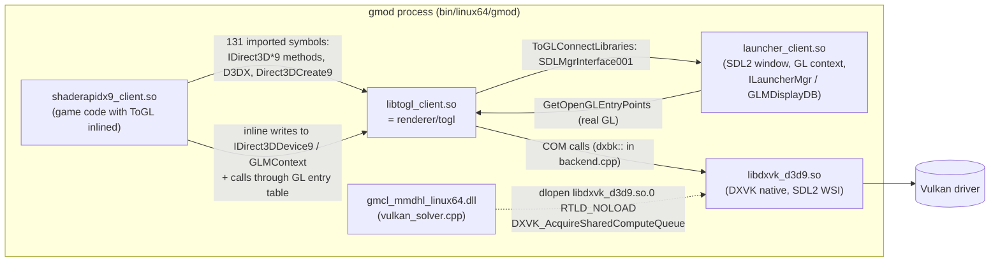

# 08 — Renderer packages: DXVK on Windows, the ToGL shim on Linux

The native modules never require a particular renderer. The *packages* optionally replace the
game's Direct3D 9 implementation so that the game renders through Vulkan (DXVK). This has two
effects the project relies on: lower GPU load, and a Vulkan device that the `gpu_vulkan` physics
solver can share (see [04_physics.md](04_physics.md)). Everything here is optional at run time:
the addon reports the renderer, it never gates a feature on it.

## Package matrix

| Package (CI artifact `Model-Hotloader-<release>-<commit>-…`) | Renderer files | Game renders through |
|---|---|---|
| `win64-vulkan` (default on Windows) | `bin/win64/d3d9.dll` = DXVK 3.1.1 + `patches/dxvk/*` | Direct3D 9 → DXVK → Vulkan |
| `win64-opengl-remix` | none | the game's own Direct3D 9 (or RTX Remix / ReShade `d3d9.dll`) |
| `linux64-vulkan` (default on Linux) | `bin/linux64/libtogl_client.so` = `renderer/togl` shim, `bin/linux64/libdxvk_d3d9.so` = DXVK native + `patches/dxvk/*` + `patches/dxvk-linux/*` | Direct3D 9 → shim → DXVK native → Vulkan |
| `linux64-opengl` | none | the game's own ToGL (Direct3D 9 → OpenGL) |

Renderer notices ship in `bin/win64/DXVK-LICENSES` or `bin/linux64/DXVK-LICENSES` (DXVK zlib,
dxbc-spirv MIT, libdisplay-info MIT; Linux adds `licenses/linux/togl.txt`, Valve ToGL MIT).
Native files ship in `garrysmod/lua/bin` (Windows also `bin/win64/mmdhl_runtime_win64.dll`).
Packaging: `scripts/package-dropin.py` (see [07_build_test_release.md](07_build_test_release.md)).

## Windows: DXVK `d3d9.dll`

- Build: `scripts/build-dxvk.ps1` (after `scripts/build.ps1`, whose glslang compiles DXVK's
  shaders). Pins `vendor/dxvk` to tag `v3.1.1` / commit `b1a1c99`; if any patch in `patches/dxvk/`
  is not applied (`git apply --check --reverse`) it resets the tree and re-applies all of them.
  Meson options: d3d8/d3d10/d3d11/dxgi off. Output `build-dxvk/src/d3d9/d3d9.dll`.
- Patches:
  - `patches/dxvk/0001-shared-compute-queues.patch`: DXVK reserves queues of a *dedicated compute
    family* that it never uses itself and exports `DXVK_AcquireSharedComputeQueue`,
    `DXVK_LockSharedComputeQueue`, `DXVK_UnlockSharedComputeQueue`, `DXVK_ReleaseSharedComputeQueue`
    (`src/d3d9/d3d9_shared_compute.{h,cpp}`; ABI mirrored in `native/dxvk_shared_compute.h`).
    `DxvkDevice::waitForIdle` takes the shared lock. Env: `DXVK_SHARED_COMPUTE_QUEUES` (count,
    default 4, 0 disables), `DXVK_SHARED_COMPUTE_PRIORITY` (low default / medium / high / off).
    No queues are reserved on GPUs without a compute-only family (common on Intel iGPUs).
  - `patches/dxvk/0002-gmod-app-profile.patch`: built-in app profile `\\gmod(_win64)?\.exe$` →
    `dxvk.enableDescriptorHeap = False` (descriptor heaps crash the game on NVIDIA ≥ 595.84 /
    610.88; see `docs/DXVK_PACKAGE.md`, `docs/DXVK_VANILLA.md`).
- Recording: `python scripts/native_manifest.py --renderer build-dxvk/src/d3d9/d3d9.dll` adds a
  `renderer` record `{name:'d3d9.dll', size, sha256, kind:'dxvk', dxvk:<tag>, patches:[…]}` to
  `native-release.json` / the policy record. A run without `--renderer` keeps the recorded one.
- Addon detection (`addon/lua/mmdhl/installation.lua`, `EvaluateInstallation`, client only):
  reads `bin/win64/d3d9.dll` (`BASE_PATH`) → `renderer.kind` `dxvk` (current or another release's
  record), `d3d9` (no file), `other` (unknown file, e.g. RTX Remix), or `other` + `error`.
  `installation_ui.lua` `rendererLine` prints "Renderer: …". Never an issue, never a gate.

## Linux: `renderer/togl` (a ToGL-ABI shim on DXVK native)

Garry's Mod on Linux draws through **ToGL**: `shaderapidx9_client.so` calls Direct3D 9 and
`bin/linux64/libtogl_client.so` (Valve's ToGL, MIT, github.com/ValveSoftware/ToGL as of 2014 +
GMod's 64-bit changes) carries the calls out on OpenGL. The `-linux64-vulkan` package overwrites
that file with `renderer/togl`'s build, which keeps ToGL's *binary interface* and forwards to DXVK's
native `libdxvk_d3d9.so` (loaded from beside itself with `dlopen`).

### Files

| File | Role |
|---|---|
| `renderer/togl/togl_abi.hpp` | ToGL's classes, structs and enums with GMod's exact layouts (mangled names must match): `IUnknown` with ToGL's two refcounts, `IDirect3DDevice9` (824 bytes), `GLMContextLayout` (18720 bytes), `GLMTexSamplingParams`, `D3DCAPS9` (156), `D3DADAPTER_IDENTIFIER9` (0x440), `D3DRECT` (64-bit `LONG`), `RECT` (32-bit). Offsets are `static_assert`ed. |
| `renderer/togl/togl.cpp` | Everything else: format/enum translation, resource wrappers, `Device` (caches + `flush()` before draws), fake GL entry points that turn the game's inline GL state calls into D3D9 render states, `IDirect3D9` (caps, adapter identity, `CheckDeviceFormat`, modes), `CreateDevice`/`Reset`/`Present`, entry points `Direct3DCreate9`, `ToGLConnectLibraries`, `GetOpenGLEntryPoints`, `toglGetClientRect`, `D3DPERF_SetOptions`. |
| `renderer/togl/gl_tables.cpp`, `gl_layout.inc` | The two `COpenGLEntryPoints` tables (0x718 bytes, GMod layout, header has `const char* library` at 0x10): the real one for the launcher (`launcherTable`, filled through the launcher's lookup callback `(library, name, okay&, required, fallback)`) and the game's (`gameTable`): fake functions from `fakeGL()` or per-slot traps that log once. |
| `renderer/togl/backend.{hpp,cpp}` | `dxbk::` thin wrappers over DXVK's COM interfaces; the only file that includes DXVK headers (`include/native/directx`). |
| `renderer/togl/d3dx.cpp` | D3DX helpers ported from ToGL with identical (sometimes odd) behaviour. |
| `renderer/togl/exports.map` + `check_exports.py` | Version script: exports exactly the symbols the game imports; CTest `togl_exports` compares `nm -D` with it. |
| `renderer/togl/CMakeLists.txt` | Standalone project, `MMDHL_DXVK_SOURCE` = patched DXVK tree; static libstdc++/libgcc, `-z defs`, debug info split to `.debug`. |
| `patches/dxvk-linux/0001-sdl2-surface-and-gmod-profile.patch` | DXVK's SDL2 WSI creates an Xlib/Wayland surface for a window SDL created *without* `SDL_WINDOW_VULKAN` (the launcher's GL window); profile `/bin/linux64/gmod$` → descriptor heaps off. `SDL_syswm.h` is included only in `wsi_window_sdl2.cpp`, last (X11 macros break `LogLevel::None`). |
| `scripts/build-dxvk-linux.sh` | Builds DXVK native d3d9 (`-Dnative_sdl2=enabled`) into `build-dxvk-linux64/` and the shim into `build-dxvk-linux64/togl/`; called by `scripts/build-linux.sh` in the manylinux_2_28 container. |

### How the shim works (facts an editor must not break)

- **The game inlines ToGL.** `shaderapidx9` writes `IDirect3DDevice9` members (stream sources,
  index buffer, shaders, textures, vertex declaration, `gl.*` state mirrors) and `GLMContext`
  members (sampler params + dirty list, shader constants with dirty ranges, `m_bDirtyPrograms`)
  directly, and calls OpenGL through the table `ToGLConnectLibraries` returned. `Device::flush()`
  pushes all of that into DXVK before each draw. Every layout change in the game would break this;
  the offsets in `togl_abi.hpp` were measured from GMod's binaries (see `docs/LINUX.md`).
- **Enum and struct translation.** ToGL numbers `D3DFORMAT` sequentially (`A8R8G8B8 = 3`,
  `D24S8 = 2`, `UNKNOWN = 0x31495442`): `d3dFormat()` / `toglFormat()` convert both ways. Texture
  address modes are 0/1/2; `D3DCOLOR` vertex data is RGBA (decl type 4 → `UBYTE4N`), the order the
  engine's `OPENGL_SWAP_COLORS` meshes and our client module (same definition) write;
  `D3DUSAGE_TEXTURE_SRGB` (0x80000000) is stripped; `D3DRECT` uses 64-bit `LONG` → converted to
  32-bit for DXVK (`Rect32`).
- **Depth bias is in OpenGL units.** The game calls `glPolygonOffset(factor, units)` (shadow-map
  pass: 2, 20). `applyDepthBias` sets `D3DRS_DEPTHBIAS = units · 2^-bits` of the bound depth
  format (`depthBitsOf`: D16 → 16, D24* → 24) because DXVK multiplies it back. Passing `units`
  raw pushed every shadow-map depth past the far plane: projected shadows vanished.
- **Adapter identity comes from the launcher, as with ToGL.** `launcherAdapter()` calls
  `ILauncherMgr::GetDisplayDB()` (vtable slot 26) → `GLMDisplayDB::GetFakeAdapterInfo` (slot 4)
  and reads the renderer record (vendor 0x44, device 0x48, video memory 0x3c, max anisotropy 0xe8,
  `m_hasGammaWrites` 0xde, mixed attachment sizes 0xdf, native clip 0xe2, `m_cantAttachSRGB` 0xff).
  `GetAdapterIdentifier` and `fillCaps` (FakeSRGBWrite, MixedSizeTargets, CanDoSRGBReadFromRTs,
  MaxUserClipPlanes with `-nouserclip`) use it. The game picks per-GPU defaults (`dxsupport.cfg`)
  from these IDs; DXVK's own (spoofed) IDs changed `mat_hdr_tonemapscale` and other defaults.
- **DXVK configuration** set by `Direct3DCreate9` before loading DXVK: `DXVK_WSI_DRIVER=SDL2`,
  `DXVK_CONFIG += d3d9.countLosableResources = False; d3d9.hideIntelGpu = False` (user values win).
- **Launcher slots used** (GMod's `ILauncherMgr`): RenderedSize 24, DisplayedSize 25,
  GetDisplayDB 26, ShowPixels 14, GetWindowRef 33, SetGammaRamp 39.
- **Failure UX:** if DXVK cannot load (no Vulkan 1.3, missing `libdxvk_d3d9.so`), an SDL message box
  explains that verifying the game files in Steam restores OpenGL.
- **Known, accepted differences from ToGL:** DXVK always compares D16/D24S8 depth textures
  (debug views of shadow depth maps differ); HDR maps are brighter because ToGL's histogram
  occlusion queries count every pixel (`mat_show_histogram 1` shows > 1000 %) and pin auto
  exposure at the map minimum, while DXVK behaves like Windows. Window title still says "OpenGL".
- **Returning to OpenGL:** Steam "Verify integrity of game files" restores the stock
  `libtogl_client.so` (a game update may do the same); `libdxvk_d3d9.so` stays behind unused.
- **Addon detection:** `installation.lua` reads `bin/linux64/libtogl_client.so` and reports
  `kind='dxvk'` when it matches a recorded Linux renderer (`platforms.linux64.renderer`, which
  also records `library = libdxvk_d3d9.so`), otherwise `opengl`.

### Shared compute queues on Linux

`native/vulkan_solver.cpp` `attachShared()` uses `dlopen("libdxvk_d3d9.so.0", RTLD_NOW|RTLD_NOLOAD)`
(the SONAME; the shim loads DXVK by path) and `dlsym` for the four `DXVK_*` functions; Windows uses
`GetModuleHandleW(L"d3d9.dll")`. Without a dedicated compute family, or with
`MMDHL_VULKAN_STANDALONE=1`, the solver creates its own `VkDevice` (`context: standalone` in
`GetSecondaryCapabilities().gpu_vulkan`).

## Testing a renderer change

1. Build (Linux: `scripts/build-linux.sh linux64` in the container; Windows: `build.ps1` then
   `build-dxvk.ps1`), run CTest (`togl_exports` on Linux).
2. Install the package as a player would (copy its `GarrysMod` folder over the game folder) and
   compare against the stock renderer view by view: shadows from a lamp/flashlight, water, decals,
   ragdolls, an imported character, `mat_info` ("Chipset version"), a video mode change
   (`mat_setvideomode` cannot be run from Lua; append it to `cfg/listenserver.cfg`, which runs at map
   start). Restore the stock files afterwards.
3. Linux logs: the shim prints `[ToGL/DXVK] …` lines (device creation, adapter, reset, failures,
   unexpected GL calls) to stderr and to the game console.

## Where to change X

| Task | File |
|---|---|
| Pin a newer DXVK | `scripts/build-dxvk.ps1` and `scripts/build-dxvk-linux.sh` (`tag`, `commit`), regenerate/rebase `patches/dxvk*/*`, `THIRD_PARTY.md`, `docs/DXVK_PACKAGE.md` |
| Change the shared-queue protocol | `patches/dxvk/0001-shared-compute-queues.patch` **and** `native/dxvk_shared_compute.h` (version field) **and** `native/vulkan_solver.cpp` |
| Add a game-imported ToGL symbol | `renderer/togl/togl_abi.hpp` (declaration with the exact mangling), `togl.cpp` (implementation), `exports.map` |
| Translate another GL state call | `fakeGL()` table and the `gl*_` functions in `togl.cpp` (otherwise the call hits a trap in `gl_tables.cpp` and is ignored) |
| Package contents / INSTALL.txt text | `scripts/package-dropin.py` (`LINUX_VULKAN`, `VULKAN`, `NO_VULKAN`, `LINUX_NO_VULKAN`) |
| Renderer detection in the banner | `addon/lua/mmdhl/installation.lua` (`EvaluateInstallation`), `installation_ui.lua` (`rendererLine`), tests in `tests/test_installation.py` |
