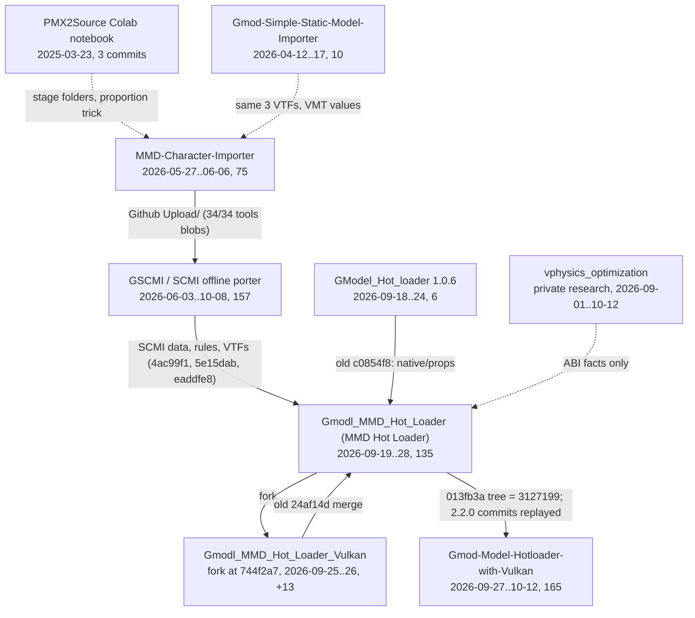

# 09 History and lineage

For AI coding agents working on Model Hotloader (`SheepyLord/Gmod-Model-Hotloader-with-Vulkan`, HEAD `9e02a27`, 2026-10-12). Facts come from full-history clones of the repositories in §1.1 (most are private: only the maintainer's account can read them), plus read-only `gh` queries where marked. "old" = `old-Gmodl_MMD_Hot_Loader`, "cur" = this repo. Dates are author dates (-0700 unless noted).

## 0. Key facts

- Cur is a **squashed re-root** of the old repo: root `3127199` (2026-09-27) has tree `2d5bfc79` = old `013fb3a`. No shared commit objects; 0.1.1 → 2.1.0-native.5 history exists only in old.
- Idea lineage: PMX2Source notebook (2025-03) → static importer (2026-04) → Blender-based MMD-Character-Importer (2026-05/06) → GSCMI/SCMI offline porter (2026-06, deprecated 10-08) → GModel static-prop hot loader (09-18), MMD hot loader (09-19), Vulkan test fork (09-25/26) → cur (09-27).
- From SCMI: rig/joint/flex data (`native/scmi_data.hpp`), torso and hull rules, 40.457 scale, material VTFs. From GModel Hot Loader 1.0.6: `native/props/*` (99.6 % identical at port). From the Vulkan fork: `gpu_vulkan`, DXVK patch 0001, multicore rendering, scene-capture culling (all merged).
- Versions: 0.1.1 (09-19) … 0.8.0 → 2.0.0 (Physics v2.0) → 2.1.0-actors-preview.5–.16 → `2.1.0-native.1`–`.12` (09-24..28) → `2.2.0` (09-28) → `2.3.0` (10-12, first Linux packages). Rig generator 30 (2.1–2.2), 31 in 2.3.0 with 30 still loadable.
- Rules to keep (§4.1): never refuse the binary module; game checks only warn; old carriers/saves keep loading; unedited carriers byte-identical (per-platform golden files); no network paths; immutable release labels; `addon.gma` only from committed files.

## 1. Lineage

### 1.1 Repositories

| Repo (origin `SheepyLord/…`) | Period, commits | Purpose, stack | In cur |
|---|---|---|---|
| `Generalized-Interactive-PMX2Source-Pipeline-Program` | 2025-03-23, 3 | Colab notebook driving (uncommitted) Blender scripts: name translation, mesh split, VTF, proportion trick, auto-QC | Concepts only |
| `Gmod-Simple-Static-Model-Importer` (MIT) | 2026-04-12..17, 10 | tkinter tool → `PMXSM01` mesh; Lua builds `Mesh()` + `VertexLitGeneric` props at runtime | 3 VTFs (byte-identical), VMT values |
| `MMD-Character-Importer` (no license) (private) | 2026-05-27..06-06, 75 | PySide6 GUI over a 15-step headless Blender pipeline (mmd_tools, Cats, Source Tools, CoACD), studiomdl/VTFCmd/gmad | Via GSCMI (its `mmd2source.py` bone map is **not** used) |
| `Gmod-Simple-Character-Model-Importer` = GSCMI/SCMI (MIT) | 2026-06-03..10-08, 157 (5 contributors, 145 by SheepyLord) | Offline MMD/VRM → Source porter (GMod/L4D2/SFM; PySide6 + managed Blender 4.5.10): analyze→plan→apply steps, 18-body ragdoll table, 473 flex names, spine fix; `AGENTS.md`/`agent_guide/` (`2497c43`) | §1.2; README `895aaac` deprecates it for GMod, pointing to cur |
| `-GModel_Hot_loader` (MIT) (private) | 2026-09-18..24, 6 | Native static-prop loader 1.0.6: game DLLs + worker (Assimp, own PMX, meshoptimizer), `.gmdl` cache, CoACD | `native/props/*` (§1.3) |
| `-Gmodl_MMD_Hot_Loader` (private) | 2026-09-19..28, 135 | The hot loader, 0.1.1 → 2.1.0-native.5 | Whole tree (§1.4) |
| `Gmodl_MMD_Hot_Loader_Vulkan` (private) | fork work 2026-09-25..26, 98 (85 shared) | Vulkan solver, DXVK shared queues, multicore rendering, scene capture | All of it (§1.5) |
| `-vphysics_optimization` (private) | 2026-09-01..10-12 | Research on Source's VPhysics module; nothing merged | ABI facts only (§1.6) |

GSCMI's first public tree came from MMD-CI's `Github Upload/` folder (all 34 `tools/` blobs at GSCMI `4c910b9` = MMD-CI `c725271`, verified).

### 1.2 SCMI-derived files in cur

Added in old on 2026-09-20 unless noted; blob-identical at HEAD.

| Cur path | Origin | Evidence |
|---|---|---|
| `native/scmi_data.hpp`, `scripts/sync-scmi-data.py` (old `4ac99f1`) | GSCMI `tools/blender_sort_collision.py` `DEFAULT_PHYSICS_QC_SETTINGS`, `tools/flex_name_dictionary.json` (473), reference SMD `0aa7bb8c…` (56 bones) | Header "Generated by scripts/sync-scmi-data.py"; data equals GSCMI ≥ `7fb0756`; source commit not pinned; reference SMD in no repo |
| `addon/materials/mmdhl/scmi/{normal,lightwarptexture,phong_exp}.vtf` (old `5e15dab`) | `models/sheepylord/shared/*` in the static importer, MMD-CI and GSCMI | Same sha256 in all four repos (`856c88d8…`, `53d3d28e…`, `8da92b30…`) |
| VMT recipe `native/assets.cpp:251` | Static importer / MMD2SMD workflow (not GSCMI `write_vmt`) | `$phongboost 24`, Fresnel `[0 0 1]`, rim 1/2/2 |
| `native/shape_atlas.hpp`, `scripts/{build,evaluate}-shape-atlas.py` (old `eaddfe8`); `native/fitter_calibration.hpp`, `scripts/calibrate-fitter.py` | User's local corpus of SCMI ports (`1_PMX` + `5_propo/Physics.smd` + QC; 159 pairs) | THIRD_PARTY.md credit; "Development-only corpus audit"; corpus in no repo |
| `native/rig_torso.hpp` (cur `9eb3c44`), hull selection in `rig.cpp` | GSCMI `blender_fix_spine_bones.py` `nearest_common_ancestor` (0.26 limit); `half_max_summed_influence_weight` | Named in comments |
| `native/runtime.hpp:54` `ScmiSourceUnitsPerPmx`, `native/props/pmx.cpp:10` | GSCMI/MMD-CI `DEFAULT_SCALE_FACTOR = 40.457` | `.08f*40.457f` = 3.23656 |
| `physics_profile.lua` / `.cpp` defaults; `native/rig_animation.cpp` includes | GSCMI `reference_collision_block.qc`, `sort_qc_compile.py` | Same friction/inertia/damping; extra includes dropped `3e197ff` |
| Not from SCMI | — | `native/humanoid_map.cpp` (`c85763c`, "written for this project"), `native/codepage_tables.hpp` (Python codecs, `09c7ce7`) |

### 1.3 GModel Hot Loader → `native/props/`

- 1.0.6 at `02341db`: worker per job (kill-on-close job object), `.gmdl` cache (magic `GMLHOT1\0`), 26-plane fast hull, optional CoACD (≤ 16 hulls).
- Ported by old `c0854f8` (2026-09-24, 53 min after `02341db`): 14 files → `native/props/`, namespace `gm` → `props`, 1,060/1,064 lines identical (`fast_hull.cpp` verified); ~94 % survive at HEAD.
- Traces: `GMLHOT1\0` in `native/props/core.cpp`, `Prop*` bindings, the lighting block in `addon/lua/mmdhl/props/*.lua`, SHA-identical fixtures, same dependency pins, `mmdhl_prop_max_*` = old `gmhl_max_*` defaults; THIRD_PARTY.md:24.
- Not GModel code: `blend.cpp`, `zstd_decode.*` (old `08d557e`), `network_path.hpp` (cur `680cd17`). Not carried: separate DLLs, its transfer protocol, `gmhl_*` commands.

### 1.4 old-Gmodl_MMD_Hot_Loader → this repo

- 107 commits by `SheepyLord`, 28 by `Claude <noreply@anthropic.com>` (2026-09-25 web sessions); PRs #1–#15 from `claude/*` branches.
- Since `957cfc8`, `docs/IMPLEMENTATION.md` names its references: "!GModel_Hot_loader (MIT worker and UI); !Github_SCMI (anatomical rig reference); !vphysics_optimization (exact-build ABI probe); garrys-mod-rtx-remixed (Source material interface headers)" (local `!` prefix = `-` on GitHub).
- **Re-root, not fork**: cur `3127199` (2026-09-27 02:25, no parent, 473 files) has the tree of old `013fb3a` (PR #15, 02:24). Old `claude/release-2.2.0` (`c8d9c75`, `61bd943`, 2026-09-28 18:32) was re-committed here as `65e945c`/`82dc38c` (18:45/18:46, same author dates and diffstats); every other old branch is merged into old main.
- Policy build ids of native.1/.2/.5 name old commits (`2797e22`, `a1f0f67`, `bd28cdb`).
- Names: "MMD Hot Loader" → "Model Hotloader" in old `18b8302` (2026-09-25); README title "…(GSCMI-SS)" from old `fb76e11`, "…with Vulkan (GSCMI-SS)" from cur `b1a6890`. The `mmdhl` prefix (convars, `mmdhl.*`, `gmcl_mmdhl_*`, `data/mmd_hotloader`, `models/mmd/`) is the old name, kept for compatibility.

### 1.5 Vulkan test fork

- Fork point `744f2a7` (old PR #3, 2026-09-25); 13 fork commits stacked: `vulkan-compute` `4094834..36646dc` (solver `e9a4246`, DXVK shared queues `633a86c`, short dispatches `c1ebf78`, vanilla benchmark `2386c80`) → `queued-rendering` `54dd3d2` → `scene-capture` `1fb6379`.
- Merged whole by old `24af14d` (PR #5 `7c9282b`); PR #6 (`7991d65`) then shipped DXVK in the default package. All 98 fork commits are in old; its 16 added files exist at HEAD; `docs/VULKAN_MERGE.md` = `f0ef24e` byte for byte.
- VULKAN_MERGE.md: `gpu_vulkan` bit-exact vs `cpu_mt_v2`; the merge (multicore rendering + capture culling) cut 8 characters 11.7 → 4.1 ms p50; DXVK then gave no frame gain but ~half GPU load; defaults stayed D3D9 + `cpu_mt_v2`, later DXVK_PACKAGE.md made `-vulkan` the default package (CPU solver still default).

### 1.6 Research repos

- **vphysics_optimization** (private research): shares only ABI facts with this repo: slot 11 / RVA 0xBBF0 `GetActiveEnvironmentByIndex` in `vphysics.dll` `4ebd6149` (`engine_abi.hpp`) and GMod's 4 extra IAppSystem methods. This repo's branch `fix/default-branch-vphysics` is unrelated to it.

## 2. Version timeline

### 2.1 Old repo (0.1.1 → 2.1.0-native.5)

Version from README title, `project(VERSION)` and `GetCapabilities().version`; commits up to `3846c37` are one-word snapshots; Gen = `RigGenerator`.

| Version | Old commit, date | Change |
|---|---|---|
| 0.1.1 | `957cfc8` 09-19 | custom `mmdhl_ragdoll` entity, own Bullet world (120 Hz), `weapon_mmdhl` grabber, nanoem, worker, exact engine-DLL hash check |
| 0.2.0 | `7fc74c8` 09-20 | "Optimization" |
| 0.3.0–0.3.2 | `4ac99f1`, `41a5188`, `5e15dab` 09-20 | generated `prop_ragdoll` carrier (18 bodies, 17 joints) by default, SCMI data; `options.backend='legacy'` kept; SCMI material recipe |
| 0.4.0 / 0.5.0 / 0.6.0 | `eaddfe8`, `fd0b048`, `dfbbb4e` 09-20 | SCMI scale + shape atlas (Gen 14) / joint+hull repair, eye pivots, 5-model cap removed (Gen 16, RigVersion 3) / material names, cache deletion (Gen 18) |
| 0.7.0 / 0.7.1 / 0.8.0 | `0084e9b`, `068c548`, `3846c37` 09-21 | 60 Hz clock + interpolation (Gen 19) / DBVT specialization / `cpu_mt`, global settings, experimental OpenCL |
| 2.0.0 | `7f5b53f` 09-21 | Physics v2.0 `cpu_mt_v2` async worlds; version jumps 0.8.0 → 2.0.0 |
| 2.1.0-actors-preview.5–.16 | `d64c2c7` (.5, Gen 27) … `a5a13fa` (.16) 09-22/23 | NPCs, player models, hands; Gen 28 `2971207`, 29 `5d41bd5`, **30** `f9d6673`; RTX Remix `a25ad10` (.13) |
| — | `ed97832`, `c0904bd`, `c450545` 09-23 | Physics v2.1, 32-byte vertices, hardware (GPU) skinning, update-rate LOD |
| — | `c0854f8`, `08d557e`, `7a2c995`, `c4d5cc5`/`a765e84` 09-24 | static props, `.blend`, VRM, i18n (7 languages) |
| 2.1.0-native.1 | `53f985d` 09-24 | `MMDHL_RELEASE` + `native_policy.lua`; CI package workflow `4027ec9` 09-25 (manual only) |
| — | `18b8302`, `fb76e11`, `d72fafb` 09-25 | rename to Model Hotloader; GSCMI-SS README; ReleaseNote.md |
| 2.1.0-native.2 | label `f83da80`, approved `aeb8948` 09-26 | first record with a DXVK renderer |
| — | `24af14d`, `7991d65` 09-26 | Vulkan fork merged; DXVK in default package |
| 2.1.0-native.3 / .4 | `ac876d1` / `857e52a` 09-26 | Remix fixes, packages `-win64-vulkan` / `-win64-opengl-remix`; never approved |
| 2.1.0-native.5 | `6c87f05`, approved `05b6b6a` 09-27 | Remix triangle cut; `013fb3a` public-repo layout |

### 2.2 This repo

Per label: `MMDHL_RELEASE` bump → manual Actions run "Build drop-in package" → lightweight tag on the built commit → "Approve and recommend native release …" commit (policy + `addon.gma`).

| Label | Tag commit | Approval | Actions run | Change |
|---|---|---|---|---|
| 2.1.0-native.5 | `3127199` | (old) | 36303330301 | — |
| native.5+d4a199ab | — | `2ba04d7` | 36309978677 | same source rebuilt at README-only `d4a199a`; new hashes, both approved |
| native.6 | `20be509` | `48edbce` | 36356764922 | main branch `bin/win64` layout, DXVK profile for `gmod_win64.exe`, unverified game builds run |
| native.7 | `e30ae33` | `1c18e3e` | 36363003077 | measured IAppSystem slot shift (default branch) |
| native.8 | `9ac92d8` | `020159b` | 36367183243 | default-branch vphysics layout (52 collision slots) |
| native.9 | `0c88b8a` | `d991f3a` | 36388637875 | Exit-to-menu crash (queued render calls) |
| native.10 | `4b7e3aa` | `ea12a0f` | 36392653403 | quit crash (scene objects made in runtime DLL) |
| native.11 | `be10d15` | `b2223b8` | 36407571102 | ragdolls get player + Citizen animations |
| native.12 | `0525383` | `e677882` | 36418141866 | only shipped player pack; Citizen packs first |
| 2.2.0 | `82dc38c` | `c9385a0` | 36509935196 | PMX repair pass, 4096 texture cap, collision checkboxes |
| 2.3.0 | `1df48da` | `9e02a27` | 38215722189 | physics editor, FBX/glTF/DAE + bone window, torso fit, never-refuse, file access, Linux |

- Policy at HEAD: approved native.5 (+d4a199ab), .6–.12, 2.2.0, 2.3.0 (recommended, with `platforms.linux64`); unapproved records kept for native.1/.2 and `legacy-actors-preview`; native.3/.4 never recorded.
- GitHub releases on 2026-10-16 (`gh api`): only `2.2.0`, `2.3.0`; native.N pages were removed outside git, their tags remain.
- Rig generator: 30 from preview.8 through 2.2.0 → **31** in `46ed406` (torso fit); `RigGeneratorMinLoadable = 30` from `565ab7a`; `RigVersion` 3 since 0.5.0; `PhysicsSchema` 1 (`396de9d`).

Milestones:
- 09-27/28: native.6–.12 compatibility/crash series; `publish-native-release.py` `992e9ef`, hardened `0525383`.
- 09-28: 2.2.0 replayed from old `claude/release-2.2.0`; demo models make `addon.gma` 1.9 → 74.7 → 59.6 MB (`f3940e0`, `ca6734e`); Workshop item changes to 3810025467 (`c4eeb52`, `8836b4e`).
- 09-29 → 10-05: Lua-only fixes on main, each followed by "Repackage addon.gma with …".
- 10-09: 100 commits: `46ed406` layout; merges `92e57b7` (physics editor, #5), `07789db` (FBX/glTF/DAE, #10), topics `origin`/`remix`/`spine`/`update`/`errors`/`fileio`, `fix/compat|pins|bonemap|fileaccess|importsec`; PR #11 `24fd0ba`; then `f278495` (never refuse), `db4e89c` (game checks warn).
- 10-09/10: Linux port `09c7ce7` (linux64 + 32-bit linux, no DXVK), PR #12 `444b8cc`; `fix/codex-review` `2c0de85`; `3313640` repackage.
- 10-11: `609ce83` `-linux64-vulkan` (ToGL-ABI `renderer/togl` on DXVK 3.1.1 native) + `-linux64-opengl`, 32-bit Linux removed; `1df48da` RUN_SERIAL for `secondary_async`; fast-forwarded to main.
- 10-12: `0db09ee` publish script handles Linux packages; `9e02a27` approves 2.3.0 ("Not tested in game for this commit").
- GitHub issues (gh): #5 physics editor, #9 chest, #10 FBX, #8 Linux, #6 install folder, #4 first-person/mirror, #7 .mdl export (declined), #2/#13 DX11, all closed; open 10-15: #14 antivirus, #15 Linux broken model, #16 bonemerge.

User-visible changes: ReleaseNote.md (2.3.0, 2.2.0, then 2.1 preview and 0.x paragraphs); native.6–.12 appear only in approval commit bodies.

## 3. docs/*.md catalog (57 files)

51 docs are inherited (36 untouched since `3127199` = "root"); 6 were added in cur on 2026-10-09; none deleted. Kind: A API/user, D design/plan, V validation report, R research, P policy. "First add" = old commit (VK = made on the Vulkan fork, same hash). "Matches code" = spot check of 2–6 claims; hist = historical by design.

| Doc | Covers | Kind | First add | Last change | Matches code |
|---|---|---|---|---|---|
| ABI | audited DLL hashes, interface versions/slots, unit contract | A | 957cfc8 | e30ae33 | partly: Windows only; slots now in `engine_abi.hpp` |
| ACTOR_COMPATIBILITY_FIXES | preview.6 poses, death physics (Gen 28) | V | 2971207 | root | hist, superseded by FURINA_BIND |
| ACTORS_IMPLEMENTATION | actors hub: NPC/player carriers, adaptive physics | D | d64c2c7 | 1e22171 | partly (Gen 30, "Q → MMD") |
| ANATOMY_VALIDATION | 0.3.2 bone frames, hull bounds, PHY pairs | V | 5e15dab | root | hist |
| API | native/Lua API: jobs, instances, physics bridge | A | 957cfc8 | 01a7aa0 | yes, despite "legacy 0.2.0" banner |
| BROADPHASE_VALIDATION | 0.7.1 dbvt-fast specialization; SAP rejected | V | 068c548 | root | partly (default now `auto`) |
| CHARACTER_IMPORT | FBX/glTF/DAE import, bone window, pins | A | cur c83b16c | fda5068 | yes (CTest is `vrm_import_and_springs`) |
| COMPATIBILITY_VALIDATION | 0.5.0 joints, hull repair | V | fd0b048 | root | hist |
| COMPUTE_BACKENDS | 0.8.0 reference / cpu_mt / OpenCL backends, fidelity gates | D | 3846c37 | root | partly (defaults changed) |
| DEBUGGING | dev loop, `gamectl` RPC, acceptance gates | P | 957cfc8 | 565ab7a | partly (2560×1440 vs 3840×2160; `dbvt-fast` vs `auto`) |
| DXVK_PACKAGE | Windows packages, renderer record, solver order, low-core tests | D+R | af8b9ce | f278495 | yes (Windows only) |
| DXVK_VANILLA | DXVK vs stock D3D9 in vanilla scenes | R | VK 36646dc | root | partly |
| FILE_ACCESS | `mmdhl.FileAccess`, consent, denylist, limits | A | cur ddc8a76 | f278495 | yes (Windows wording) |
| FRAME_TIME_RESEARCH | 10-model frame cost, GPU-skinning study | R | 989ebc6 | root | yes (numbers not re-run) |
| FURINA_BIND_VALIDATION | preview.7 bind/IK fix, 3-segment torso (Gen 29) | V | 5d41bd5 | root | not checked |
| GLOBAL_SETTINGS_VALIDATION | 0.8.0 global settings, telemetry | V | 3846c37 | root | partly ("Q → MMD") |
| HIDDEN_CONTROLLERS_FACE_LIGHTING_VALIDATION | preview.12 face, controller, shadow fixes | V | eab83a7 | root | not checked |
| IMPLEMENTATION | legacy 0.2.0 ledger, gates, reference repos (§1.4) | D | 957cfc8 | root | hist |
| IMPORT_ERRORS | failure window, error codes, `status.json`, crash log | A | cur f44deff | f278495 | yes |
| INSTALLATION_VALIDATION | load/warn policy, reminders, game updates, release workflow | P+V | 53f985d | 01a7aa0 | partly (says Windows only) |
| JIGGLE_ROOT_ACCURACY | preview.16 jiggle roots, accuracy slider | V | a5a13fa | root | yes |
| LIBRARY_VALIDATION | 0.3.1 library and placement | V | 41a5188 | root | hist |
| LINUX | linux64 packages, build, ToGL→DXVK renderer, ABI, tests | A | cur 09c7ce7 | 609ce83 | yes (no 32-bit text left) |
| MAP_LIGHTING_LIBRARY_VALIDATION | preview.10 model lights, facing | V | d5f79dd | root | yes |
| MENU_DEATH_HANDOFF_VALIDATION | preview.15 scissor fix, corpse render handoff | V | 0fd8d64 | root | not checked |
| MODEL_NAMES | name translation cache, Google endpoint, consent | A | d22d391 | root | yes |
| MODEL_TERMS | terms acknowledgement, readme discovery | A | f83da80 | cd72171 | yes |
| MOTION_PERFORMANCE_VALIDATION | 0.7.0 clock, worker pool | V | 0084e9b | root | yes |
| MULTICORE_RENDERING | native draws on Source's render thread | D+R | VK 54dd3d2 | 0c88b8a | yes |
| NATIVE_BACKEND | carrier architecture/API, 0.3.2 → 2.3.0 | D+A | 4ac99f1 | bfc8502 | partly (F8 default, `materials-v4` vs v5, `fits/g16`) |
| NATIVE_VALIDATION | 0.3.0 carrier acceptance | V | 4ac99f1 | root | hist (`mat_queue_mode 0` era) |
| PERFORMANCE_PLAN | 0.8 proposal, fidelity levels L0–L2 | D | 068c548 | root | superseded |
| PERSISTENCE_LIGHTING_VALIDATION | preview.9 save/dupe restore | V | f9d6673 | root | yes |
| PHYSICS_EDITOR | ragdoll physics editor, convars, hooks | A | cur 22932ad | 01a7aa0 | yes |
| PHYSICS_TUNING | Physics & Performance defaults, stretch history | A | d026d10 | 82dc38c | partly (worker sizing wrong) |
| PHYSICS_V2_0 | v2.0/v2.1 async worlds, sleep, SIMD, mid-phase | D+R | 7f5b53f | root | partly (UI label "Claude CPU v2") |
| PHYSICS_V2_0_PLAN | v2.0 plan | D | 7f5b53f | root | superseded (dead refs, missing convars) |
| PHYSICS_V2_0_RESULTS | v2.0 results | V | 7f5b53f | root | hist |
| PLAYER_LIGHTWEIGHT_PHYSICS_VALIDATION | preview.11 ledge lighting, lightweight motion | V | 3012f90 | root | not checked |
| QOL_ACTOR_PHYSICS_VALIDATION | preview.8 origin, NPC weapons, reset-all | V | f9d6673 | root | partly (F8 stale) |
| QOL_VALIDATION | 0.6.0 ASCII paths, deletion | V | dfbbb4e | root | not checked |
| RTX_PREVIEW_CLIENT_RAGDOLLS | preview.14 RTX preview, client ragdolls | V | df767b0 | root | not checked |
| RTX_REMIX_VALIDATION | preview.13 Remix, plus 2.3.0 UV-morph cutouts | V | a25ad10 | 0f06566 | partly |
| SCALE_ALIGNMENT_VALIDATION | 0.4.0 scale 0.08×40.457 | V | eaddfe8 | root | yes |
| SCENE_CAPTURE | region-culled scene capture; cross-realm fix | D+R | VK 1fb6379 | 4b7e3aa | yes |
| SINGLEPLAYER_RENDER_VALIDATION | preview.5 fingerprints, `ValidationOnce` | V | d64c2c7 | root | partly |
| STATIC_PROPS | prop import, tool, parts, Blender, convars | A | c0854f8 | 1e6dfae | yes (Windows wording) |
| STATIC_PROPS_VALIDATION | 2026-09-24 port validation | V | c0854f8 | root | not checked |
| STRETCH_CONDITIONING | removed parameter conditioning | V | 0ebd9e4 | root | no (feature removed in f9d6673) |
| TORSO_FIT | torso resolver (Gen 31), pins, `GetBoneMapProposal` | D+A | cur 02a13dc | bfc8502 | yes |
| TRANSFER_VALIDATION | preview.4 transfers, XPRESS packets | V | d64c2c7 | root | yes |
| TRANSLATING | 7 languages, `.properties` format, `check-i18n.py` | P | c4d5cc5 | f44deff | yes |
| VALIDATION | legacy 0.1–0.2.0 validation | V | 957cfc8 | root | no (legacy backend; mojibake title) |
| VRM_IMPORT | VRM 0.x/1.0 import, spring bones | A | 7a2c995 | root | yes |
| VULKAN_COMPUTE | `gpu_vulkan` solver, shared DXVK queues | R | VK 30ba852 | root | partly (`dxvk.conf` steps superseded) |
| VULKAN_MERGE | Vulkan fork merge validation and performance | V | f0ef24e | root | partly (recommendation superseded) |
| WORKSHOP_PACKAGES | Workshop export/install, GMA layout, caps | A | f83da80 | 01a7aa0 | yes |

**Stale across docs:** "Q → MMD" (now External Models → Character Models), "Claude CPU v2" (now "Multicore CPU Processor"), old generator numbers (ACTORS, QOL_ACTOR, FURINA, ACTOR_COMPAT, COMPATIBILITY, SCALE_ALIGNMENT), Windows-only wording (ABI, INSTALLATION_VALIDATION, FILE_ACCESS, IMPORT_ERRORS, STATIC_PROPS, DXVK_PACKAGE, VULKAN_COMPUTE, TRANSFER). PHYSICS_V2_0 (bit-identical replay) and PHYSICS_TUNING (no longer strict, after `ed97832`) disagree.

**Stale outside docs/:** ReleaseNote.md "Install and use" (`update-native-policy.ps1`, `package.py --version`) and "Limits" (Windows only, "temporarily requires `mat_queue_mode 0`"); README.md:3 "from OpenGL to Vulkan" (Windows is D3D9 → Vulkan via DXVK); `native/release.hpp.in` still lists `linux`.

**Read first for current behaviour:** NATIVE_BACKEND, API, INSTALLATION_VALIDATION, LINUX, DXVK_PACKAGE and the six 2.3.0 docs; PHYSICS_TUNING for current physics settings.

## 4. Decisions, rules, rejected approaches

### 4.1 Rules in force at HEAD

| Rule | Recorded in |
|---|---|
| **Never refuse the binary module**: unknown/CI/old/mixed files load with a dismissable warning; `Use anyway…` and `mmdhl_accept/revoke_unverified_native` removed. | `f278495` |
| **Game-build checks only warn**; the binary still refuses each unsafe engine call; client falls back to Source rendering. | `db4e89c` |
| **Older releases keep running** with an update reminder; features gate on capabilities / `mmdhl.NativeReleaseAtLeast`; old policy records are never removed. | `90817a0`, `80ce6a6`; INSTALLATION_VALIDATION.md |
| **Old carriers keep loading**: generators 30..31 (`RigGeneratorMinLoadable`..`RigGenerator`); new fits use 31; menus show the newest per character/role/gender. | `565ab7a`, `bfc8502` |
| **Unedited = byte-identical**: golden tests pin rig key, MDL and `.phy` of unedited carriers; VRM writer and fixtures stay byte-identical; repairs keep cache ids. | `62fb71b`, `396de9d`, `c85763c`, `65e945c` |
| **Per-platform golden files** (`golden.json` MSVC, `golden-linux64.json` GCC 14); Linux carrier keys differ, mixed servers transfer by key. | `09c7ce7`, `609ce83` |
| **No network paths** for model dependencies or Lua file APIs; FBX/glTF/DAE confined to their folders; PMX/props keep 2.2 reach + denylist. | `680cd17`, `eab26c0`, `1e6dfae` |
| **Immutable releases** ("Immutable native release label"); publish script never replaces or deletes a release, tag or record; zips reproducible. | CMakeLists.txt:12; `992e9ef`, `0525383` |
| **`addon.gma` only from committed files** (`git archive` + `gmad`); `MMDHL_POLICY_OUTPUT` keeps local hashes out of the policy. | `0525383`, `46ed406` |
| Packages ship native files only (Lua via Workshop); DXVK descriptor heaps off via built-in profile (patch 0002); patches byte-exact. | old `2797e22`, `7991d65`, `b17a38c`; `ab036dc` |
| Native messages stay English (Lua catalogues in 7 languages); no user models, corpus data or engine DLLs distributed. | ReleaseNote; old `c4d5cc5` |
| No support for the community DX11 build or `.mdl` export. | GitHub issues #2, #7 |

### 4.2 Tried, then replaced or abandoned

| Approach | Outcome | Evidence |
|---|---|---|
| Custom `mmdhl_ragdoll` + own Bullet world | Generated `prop_ragdoll` carrier; legacy path kept (`server.lua:80`) | old `957cfc8` → `4ac99f1` |
| Engine-DLL hash allow-list / ABI profiles | `20be509` ran unverified builds → preview hang → `be4eeb2` turned features off → `e30ae33` measured slot shift → `db4e89c` warnings only | 2026-09-27..10-09 |
| "native.5 the only accepted release" | Reversed by update reminders | old `05b6b6a` → `90817a0` |
| Forced `mat_queue_mode 0` | Multicore rendering (queued draw jobs); mode 0 only for previews/legacy | old `54dd3d2` |
| Sweep-and-prune broadphase | Failed v1 fidelity; now `auto` only for `cpu_mt_v2` worlds | ReleaseNote 0.7.1; old `ed97832` |
| Stock Bullet MT merge order | Rejected → ordered dispatcher | COMPUTE_BACKENDS.md:13 |
| OpenCL solver | Experimental (slower, fails fidelity); bit-exact Vulkan solver preferred | ReleaseNote 0.8.0 |
| Parameter conditioning / anti-stretch | Removed | `f9d6673`; PHYSICS_TUNING.md:39-41 |
| Model caps, 256 MB read cap, 4 GB worker cap, auto-cancel; rejecting broken PMX | Removed / repaired with notes | ReleaseNote; `65e945c` |
| SCMI QC includes `f_gst/f_pst/f_shd/f_ss` | Dropped; Citizen packs before player pack | `3e197ff`, `3ab650d` |
| Torso by bone name | Torso from skeleton, generator 31 | `9eb3c44`, `565ab7a` |
| Confining PMX/prop textures to model folders | Reverted within an hour (8 of 1209 PMX used `..\raw\tex`) | `1dc4ac7` → `1e6dfae` |
| Packages default + `-no-vulkan`; Linux `-linux64` + `-linux` | `-win64-vulkan`/`-opengl-remix`; `-linux64-vulkan`/`-opengl` | old `8e7f1a5`; `609ce83` |
| 32-bit Linux | Built 10-09, dropped 10-11 | `09c7ce7` → `609ce83` |
| Remix: index-range splitting | Rejected (379 ranges); per-triangle cut | DXVK_PACKAGE.md:202; old `6c87f05` |
| DXVK queue owner = AddRef on D3D9 device | Owner token (heap corruption) | old `937173e` |
| `update-native-policy.ps1` releases | Superseded by `publish-native-release.py`; `.ps1` remains | `992e9ef` |

## 5. Maintainer conventions

- **Identity**: all 165 commits authored by `SheepyLord <37598021+SheepyLord@users.noreply.github.com>`; committer `GitHub` on 9 (README web edits, PR merges `24fd0ba`/`444b8cc`, Copilot Autofix `a413cc5`). Older repos also show `37598021+1peng2333@…` (same account id, earlier user name).
- **AI trailer**: 145/165 end with `Co-Authored-By: Claude Opus 5.5 <noreply@anthropic.com>`; absent on web edits, plain merges, `b952fce`, demo-model commits. Old repo also has `Claude Fable 5.1` (4) and `Claude-Session:` (28) trailers.
- **Message format**: effect-stating title (no prefix, no period, median 56 chars); body = cause with numbers → `- ` bullets per area → `Tests:` (CTest "N of N", `check-lua-tests.py`, `check-i18n.py`, "fails on the previous code") → "Tested in game …" or "Not tested in game" → trailer; ≤ 80 columns.
- **Release approval**: `Approve and recommend native release <label>`; body = build id, Actions run, release URL, "earlier approvals stay. Repackage addon.gma.", test notes; touches only `native_policy.lua` and `addon.gma`. Lightweight tag = label on the built commit.
- **`addon.gma`**: every player-facing Lua change gets a follow-up "Repackage addon.gma with …" commit built from committed `addon/`; Workshop upload is manual. Packing happens on Windows: Linux `gmad` 1.1 rejects `shaders/fxc/*.vcs` ("Not allowed by whitelist", checked 2026-10-16).
- **Branches/merging**: `release-X.Y.Z`, `feat/<topic>`, `fix/<topic>`; old repo used `claude/<slug>` PR branches (#1–#15). Cur is mostly linear on `main`; 16 merges (14 on 2026-10-09, PR #12, `fix/codex-review`); `release-2.2.0` and `feat/linux-vulkan` fast-forwarded; layout commit `46ed406` before parallel branches; Codex (GPT-6 Sol) review findings fixed in dedicated commits; agents push to `main` only when the user asks for it.
- **Docs travel with code** (docs/*.md, ReleaseNote.md newest-first bold-lead bullets, README). `(issue #N)` refs match GitHub for #5/#9/#10 but not `e0ca22c` (#6) and `15d5d6e` (#7).

## 6. Uncertainties

- Exact GSCMI commit behind `native/scmi_data.hpp` (likely `a374223`) and the source of its reference SMD `0aa7bb8c…`; the shape-atlas/fitter corpus is local to the user and unseen.
- Development before `957cfc8` (already 0.1.1, 70 files) happened outside git.
- When/by whom the 2.1.0-native.N GitHub releases were deleted (only 2.2.0 and 2.3.0 exist, `gh api` 2026-10-16).
- Meaning of `(issue #6)` in `e0ca22c` and `(issue #7)` in `15d5d6e`.
- Whether replay is still bit-identical (PHYSICS_V2_0 vs PHYSICS_TUNING).
- "Matches code" = spot checks; performance numbers were not re-measured.
