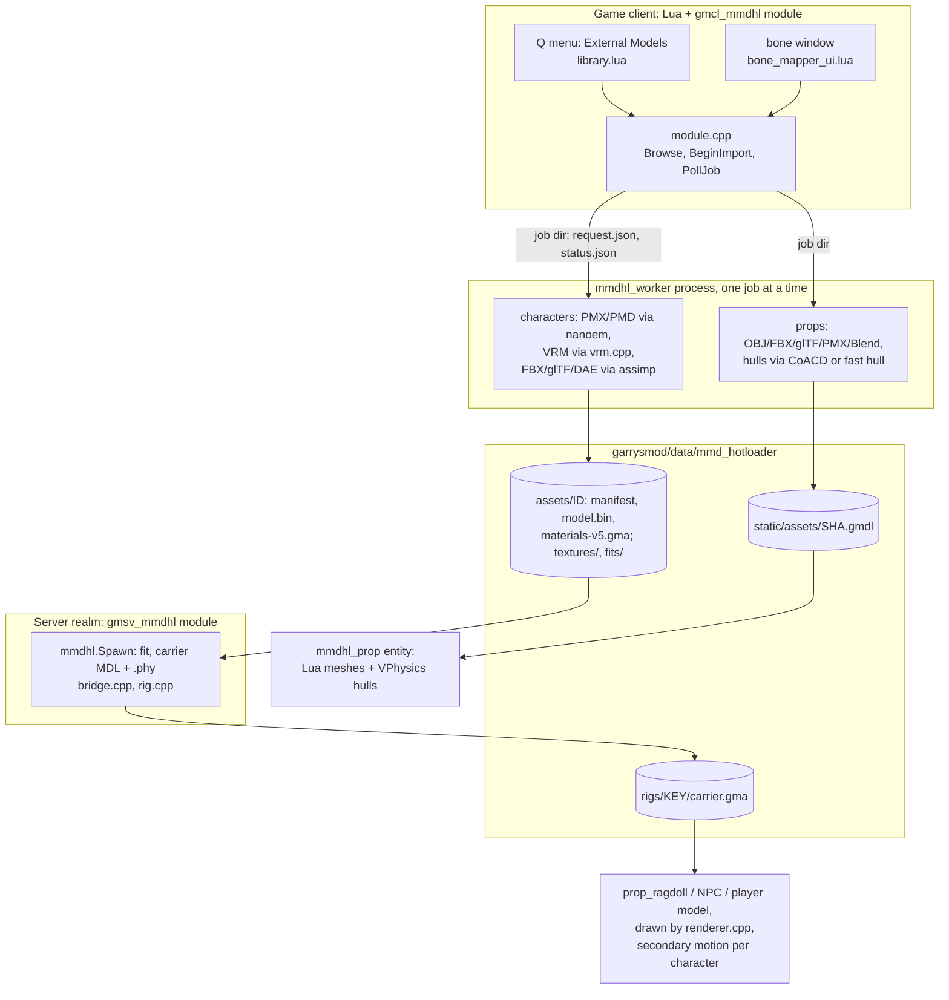

# Agent guide — Model Hotloader

Reference for AI agents that edit this repository; humans read `README.md` and `docs/`. Nothing
here is built, packaged or tested: no script, workflow or test reads `agent_guide/`, `AGENTS.md`
or `CLAUDE.md`. Written from the code, the full git history of this repository and its
predecessors, and verified against `main` @ `9e02a27` (release 2.3.0, 2026-10-16). When the code
and this guide disagree, the code wins: fix the guide in the same commit.

## Chapters

| Chapter | Covers | Read it when |
|---|---|---|
| [00 Repository map](00_repository_map.md) | every top-level path, CMake target, native source (role and target), Lua file, script and test kind; a "where do I change X?" table | you need to find something |
| [01 Architecture](01_architecture.md) | what ships and how it updates; diagrams of the binaries, processes/realms and the file → character flow; identities and versions; safety model; platforms | always, first |
| [02 Character import](02_character_import_pipeline.md) | the character importer: structure and sequence diagrams, worker job protocol (`request.json`/`status.json`), parsing, asset identity, bone mapping, fitting, carriers, on-disk layout, error codes, invariants | import, bone map, fit or carrier work |
| [03 Engine integration](03_engine_integration.md) | runtime structure, the 160+ native Lua functions, carrier → engine model, native rendering, VPhysics bridge, compatibility/installation checks, networking, multiplayer sequence | anything that calls the engine or crosses the network |
| [04 Physics](04_physics.md) | the two physics systems: secondary motion (60 Hz tick, backends, collision, sleep/LOD) and the ragdoll `.phy` generation + physics editor; determinism and golden files | hair/cloth, solver, ragdoll or performance work |
| [05 Static props](05_static_props.md) | the prop importer: pipeline diagram, `.gmdl` bundle format, CoACD hulls, Lua meshes, VPhysics, limits | anything under `native/props/` or `addon/lua/mmdhl/props/` |
| [06 Lua addon](06_lua_addon.md) | load order and installation gate, the `mmdhl` table, entities/hooks, per-file reference, net message and ConVar catalogues, DATA files, i18n, debug bridge, offline lupa tests | any Lua change |
| [07 Build, test, release](07_build_test_release.md) | CMake, build scripts and commands, files builds rewrite, all CTests, offline tests, CI, release records, publishing | building, testing, CI, releases |
| [08 Renderer packages](08_renderers_dxvk_togl.md) | DXVK on Windows; the Linux ToGL-ABI shim over DXVK (enum translation, depth bias, adapter identity); shared compute queues | `renderer/`, `patches/dxvk*`, `-vulkan` packages |
| [09 History and lineage](09_history_and_lineage.md) | predecessor repositories, the re-rooted history, version timeline, catalogue of `docs/*.md` with staleness, decisions and rejected approaches | before redesigning anything, or to judge a `docs/` file |
| [10 Debugging and gotchas](10_debugging_and_gotchas.md) | where evidence lives, symptom → cause → fix, traps, known loose ends | something fails |
| [11 Conventions](11_conventions_and_rules.md) | code style per language, compatibility rules, localization workflow, documentation placement, tests, git | before your first edit |

## Read by task

| Task | Chapters |
|---|---|
| Import fails or a format is mis-read | 02 (§4 job protocol, §10 errors) → 10 → 00 |
| Bone mapping, fitting, carrier, ragdoll proportions | 02 (§7, §8, §12) → 04 §10 → 09 §4 |
| Character renders wrongly, crashes in the engine | 03 (§4, §6) → 08 → 10 |
| Hair/cloth motion, solver backends, performance | 04 → 03 §1 → 10 |
| Static props | 05 → 03 §7 (networking) |
| Lua UI, settings, net messages, translations | 06 → 11 (Localization) |
| Multiplayer sharing, approvals, Workshop packages | 03 §7–§8 → 06 §6 |
| Build, CI, packaging, release | 07 → 08 → 11 (Git) |
| Linux port or Vulkan renderer | 08 → 07 §1 → 10 |

## The importer at a glance

Two importers share one worker process; details and full diagrams in [02](02_character_import_pipeline.md)
(characters) and [05](05_static_props.md) (props).



## Glossary

| Term | Meaning |
|---|---|
| asset (id) | an imported character in `assets/<id>/`; id = SHA-256 of its manifest, which covers the parsed model's info, every warning string, texture hashes and the version |
| fit | the mapping of a character onto Source's ValveBiped ragdoll: bone frames, hulls, masses (`fitter.cpp`, `rig.cpp`); default fits cached in `fits/` |
| carrier | the engine-facing model built from a fit on the server: empty-mesh ValveBiped MDL/VVD/VTX + 18-body `.phy`, packed as `rigs/<key>/carrier.gma`; the engine animates and simulates it, the native renderer draws the real mesh posed by its bones |
| rig key / carrier fit key | hash naming a carrier; unedited rigs keep their key across releases |
| generator | `RigGenerator` (31): the fitter generation; carriers from `RigGeneratorMinLoadable` (30) on still load |
| secondary motion | client-side hair/cloth/soft-body simulation from the model's own MMD rigid bodies (nanoem + Bullet); backends `cpu_mt_v2` (default), `cpu_mt`, `reference`, `gpu_vulkan`, `gpu_opencl` |
| presentation | the client's per-frame drawing of a character (native renderer, GPU skinning), fed by the carrier's bones and the secondary world |
| bridge | `native/bridge.cpp`, server module only: VPhysics and engine access, `.phy` generation |
| worker | `mmdhl_worker` process: file pickers, all parsing of untrusted source files, GPU probes, installation self-test |
| native policy | `addon/lua/mmdhl/native_policy.lua`: the addon's record of known native releases (sizes, SHA-256, approvals, recommended release) |
| prop bundle | a static prop's `.gmdl` file (magic `GMLHOT1`), named by its SHA-256 |
| realm | GMod's client/server split; one process in single player and listen servers |

## Working loop

1. Read 01, the chapter for your area and 11. Check `git log --oneline -20` and `git status`.
2. Find the code with the chapter's "where to change X" table; read it, and read its tests.
3. Make the change in the style of the surrounding code; keep defaults byte-identical and gate
   new behaviour ([11](11_conventions_and_rules.md)).
4. Run the offline checks; build and run CTest for native changes; check in game when the engine
   is involved. Revert files the build rewrote (`git status`).
5. Update `agent_guide/` (and `AGENTS.md`) where your change makes them wrong; commit with a body
   that says what was and was not tested.

## Quick commands

Offline (any platform; Python 3 with `pip install lupa==2.8`):

```bash
python scripts/check-i18n.py
python scripts/check-lua-tests.py
```

Windows (Visual Studio 2022 Build Tools): `./scripts/build.ps1`, then
`ctest --test-dir build -C Release --output-on-failure`.

Linux, release-equivalent build in the CI container (writes as root):

```bash
docker run --rm -v "$PWD:/src" -w /src quay.io/pypa/manylinux_2_28_x86_64:2026.10.09-1 scripts/build-linux.sh linux64
```

After any build: `git status`, then `git checkout -- addon/lua/mmdhl/native_policy.lua` (and any
other rewritten tracked file) unless the change is intended. More commands, including the Linux
development build and DXVK, are in [07](07_build_test_release.md) §1.3.
